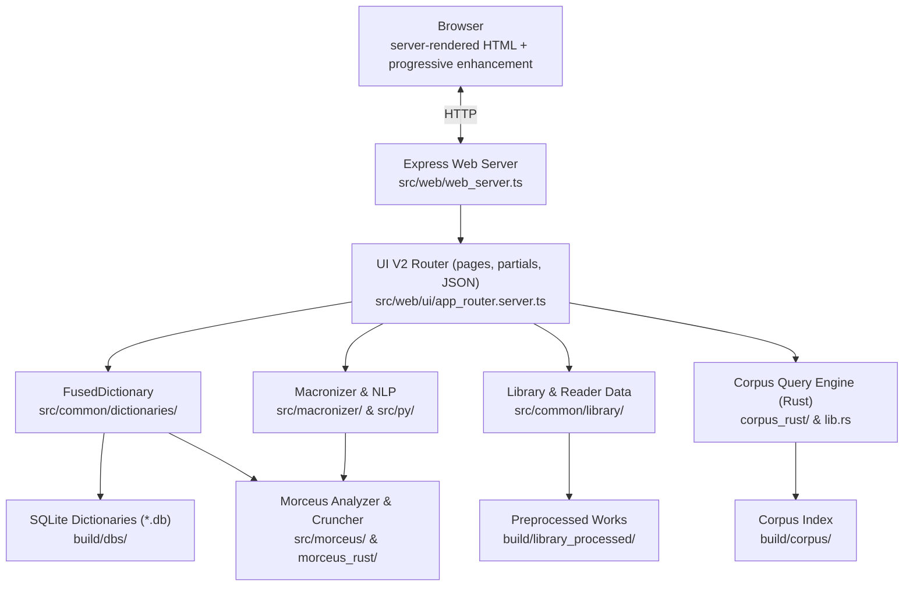

# Morcus.net Architecture Guide

This document provides a comprehensive architectural overview of Morcus.net to help developers and AI coding agents understand system boundaries, module interactions, data flows, and design conventions across the repository.

---

## 1. High-Level Overview

Morcus.net is an integrated digital platform and toolkit for Latin language study and research, providing:

- **Dictionary Search & Aggregation**: Fused multi-dictionary engine combining Latin-English, English-Latin, Latin-French, Latin-German, Latin-Spanish, Latin-Latin, and numeral references.
- **Morphological Analysis (Morceus)**: Algorithmic cruncher that resolves inflected Latin tokens into constituent stems, endings, grammatical annotations, and lemmata.
- **Library Reader**: Structured reader for classical texts (sourced from Perseus, Hypotactic, and PHI) with hierarchical navigation, chunked sectioning, and interlinear lookup capabilities.
- **Corpus Query Engine**: High-performance indexed search engine in Rust for searching syntax, lemmata, grammatical features, and word patterns across millions of Latin tokens.
- **Macronizer**: Tool reconstructing classical vowel lengths (macrons) combining rule-based candidate generation (Morceus) with machine-learning disambiguation (LatinCy / spaCy, Stanza, Alatius).
- **Installable PWA**: Web app manifest and an Android TWA. There is no offline mode today; `/serviceworker.js` only removes the retired V1 offline worker from returning browsers.



---

## 2. Multi-Language Tech Stack

| Layer                 | Technology                                              | Key Locations                                                                 | Responsibility                                                                                     |
| --------------------- | ------------------------------------------------------- | ----------------------------------------------------------------------------- | -------------------------------------------------------------------------------------------------- |
| **Web UI (UI V2)**    | TypeScript, Light DOM custom elements, Rsbuild / Rspack | `src/web/ui/` (`*.client.ts`), `src/bundler/client.rsbuild.ts`                | Progressive enhancement of server-rendered pages: dictionary, reader, corpus, macronizer.          |
| **Web Server**        | TypeScript, Node.js 22, Express, esbuild                | `src/start_server.ts`, `src/web/web_server.ts`, `src/web/ui/` (`*.server.ts`) | Server-side rendering, partials and JSON endpoints, precompressed static assets, telemetry.        |
| **Native Extensions** | Rust, `node-bindgen`, `better-sqlite3`                  | `lib.rs`, `corpus_rust/`, `morceus_rust/`, `Cargo.toml`                       | High-throughput corpus querying, bitmask operations, native morphological crunching.               |
| **NLP & ML**          | Python 3.12, spaCy (LatinCy), Stanza, Alatius           | `src/py/`, `src/macronizer/`, `requirements.txt`                              | Latin syntax analysis, part-of-speech tagging, vowel length disambiguation.                        |
| **Storage & Data**    | SQLite, JSON, localStorage / IndexedDB                  | `src/common/sqlite/`, `build/dbs/`, `build/library_processed/`                | Pre-built dictionary indices, preprocessed texts; browser preferences and External Reader imports. |
| **CLI & Automation**  | Bash, TypeScript (`ts-node`/`swc`/`bun`)                | `morcus.sh`, `src/scripts/run_morcus.ts`                                      | Build pipelines, data processing orchestration, benchmark runners, test harnesses.                 |

---

## 3. Subsystem Breakdown

### 3.1. Web Server & UI V2 Routes (`src/web/`)

- **Server Entry Points**:
  - `src/start_server.ts`: Assembles the services (dictionaries, corpus handler, macronizer engine, telemetry), builds the UI V2 router with them, and starts the HTTP server.
  - `src/web/web_server.ts`: Express pipeline: build-time precompressed `/assets` (Brotli/Gzip), `compression()`, PWA files (`/public`, `/.well-known`, `/favicon.ico`, `/robots.txt`, `/serviceworker.js`), then the UI V2 router at `/`.
- **UI V2 Router (`src/web/ui/app_router.server.ts`)**: Mounts each slice's routes. Pages are full server-rendered documents; with JS, the same URLs return partials (`?format=partial` / `X-Requested-With: fetch`) for in-place swaps.
  - Pages: `/dicts`, `/dicts/id/:id`, `/library`, `/work/:author/:name/:page?` (plus legacy `/work/:workId` and `/work?id=` redirects), `/corpus`, `/macronizer`, `/externalReader`, `/about`.
  - Fragments and JSON: `/work/:author/:name/:page/translation`, `/api/completions` (autocomplete chunks), `/api/corpus/lemmata/:letter`, `POST /api/report` (GitHub issues), `POST /macronizer` and `/macronizer/apply`.
  - See [`src/web/ui/README.md`](src/web/ui/README.md) for the architecture and conventions.
- **Shared plumbing (`src/web/utils/rpc/`)**: `parsing.ts` holds validator combinators (`isString`, `matchesObject`, `isArray`, `maybeUndefined`, ...) and `encodeMessage`/`decodeMessage`. `rpc.ts`/`server_rpc.ts` keep the `ServerMessage` envelope, in which build steps still write library works and corpus suggestion lists. (The V1 JSON-RPC layer is gone.)

### 3.2. Dictionary Subsystem (`src/common/dictionaries/` & `src/common/*`)

- **Unified Interface (`src/common/dictionaries/dictionaries.ts`)**:
  - `Dictionary` interface with `getEntry()`, `getEntryById()`, and `getCompletions()`.
  - `FusedDictionary` (`fused_dictionary.ts`): Aggregates individual dictionary drivers into a unified query pipeline with configurable modes (exact headword, lemma lookup, inflection-expanded lookup).
- **Supported Lexica**:
  - **Lewis & Short** (`src/common/lewis_and_short/`): Extensive Latin-to-English dictionary parsed from TEI XML.
  - **Smith & Hall** (`src/common/smith_and_hall/`): English-to-Latin dictionary.
  - **Riddle & Arnold** (`src/common/dictionaries/riddle_arnold/`): English-to-Latin copius guide.
  - **Gaffiot** (`src/common/gaffiot/`): Latin-to-French dictionary.
  - **Georges** (`src/common/dictionaries/georges/`): Latin-to-German Ausführliches Handwörterbuch.
  - **Pozo** (`src/common/dictionaries/pozo/`): Latin-to-Spanish dictionary.
  - **Gesner** (`src/common/dictionaries/gesner/`): Latin-to-Latin thesaurus.
  - **Forcellini** (`src/common/dictionaries/forcellini/`): Latin-to-Latin lexicon.
  - **Numeral Dictionary** (`src/common/dictionaries/numeral/`): Algorithmic Roman numeral parsing and English glossing.
- **Database Backing**:
  - All dictionaries are preprocessed into SQLite databases under `build/dbs/*.db` via `better-sqlite3`.
  - Server uses `delayedInit` in `start_server.ts` to stagger SQLite connection setups on startup, preventing I/O thundering herd problems.

### 3.3. Morceus: Morphological Analysis (`src/morceus/` & `morceus_rust/`)

Morceus analyzes Latin wordforms to determine root lemmata and inflectional features (case, number, gender, tense, mood, voice, person, degree).

- **Data Tables (`morceus-data/latin/`, `src/morceus/tables/`)**:
  - Endtables: Suffix conjugation/declension matrices.
  - Stems: Nominal and verbal stem lists with compatibility codes.
  - Irregulars & Compounds: Specific irregular handling (`sum`, `volo`, enclitic attachment `-que`, `-ne`, `-ve`, preverb prefixes).
- **The Cruncher (`src/morceus/crunch.ts`)**:
  - Splits a target token into prospective stems and endings.
  - Queries `CruncherTables` (ending map and stem index).
  - Validates compatibility codes between stem and ending.
  - Returns `CrunchResult[]` with lemmatization and grammatical breakdown.
- **Rust Implementation (`morceus_rust/`)**:
  - Provides native performance for stem-merging, completions, and crunching.

### 3.4. Corpus Query Engine (`corpus_rust/` & `lib.rs`)

A specialized engine designed to query massive Latin textual corpora with complex grammatical filters:

- **Indexing**:
  - Tokens, lemmata, inflections, and punctuation are assigned sequential integer IDs.
  - Bitmasks and run-length encoding index morphological properties across the corpus.
- **Query Syntax**:
  - Exact token match: `amavit`
  - Lemma filter: `@lemma:amare`
  - Morphological constraint: `@case:acc @number:pl`
  - Multi-token proximity, window context, and pagination.
- **Node Integration**:
  - `lib.rs` exports `QueryEngineWrapper` and `Cruncher` via `node-bindgen` compiled into `build/corpus-rust-bindings`.
  - Loaded in TypeScript by `src/common/library/corpus/corpus_rust.ts`.

### 3.5. Library & Text Processing (`src/common/library/`, `texts/`)

- **Text Pipeline**:
  - Raw sources: Perseus TEI XML, Hypotactic JSON, PHI (Packard Humanities Institute).
  - `process_library.ts`, `process_phi_json.ts`, `process_hypotactic.ts` normalize raw formats into `ProcessedWork2` structures (`library_types.ts`).
  - Hierarchical tree structure: works contain books, chapters, sections, and chunked paragraphs (`NavTreeNode`, `WorkPage`).
  - Output lands in `build/library_processed/`; `src/common/library/preprocess/` preprocesses it further into the pages the reader serves.
- **Reader UI (`src/web/ui/reader/`, `src/web/ui/library/`, `src/web/ui/external/`)**:
  - Server-rendered, citation-addressed pages with in-place page turns when JS is available.
  - Word click-through to the embedded dictionary panel.
  - Parallel English translations, notes, and the External Reader for pasted or scraped texts.

### 3.6. Macronizer & NLP (`src/macronizer/`, `src/latincy/`, `src/py/`)

- **Pipeline**:
  1. Input text is tokenized into words and whitespace (`src/nlp/text_tokenization.ts`).
  2. For each word, Morceus retrieves all valid morphological analyses and possible vowel length variants (e.g. `venit` -> `vĕnit` [pres] vs `vēnit` [perf]).
  3. Machine learning models (spaCy with LatinCy pipeline, Stanza, or Alatius) predict the contextual Part-of-Speech and grammatical properties.
  4. Best candidate is selected and rendered with options for manual user disambiguation in `src/web/ui/macronizer/`.

### 3.7. UI V2 Architecture (`src/web/ui/`)

- **Zero-JS baseline**: every page works as plain server-rendered HTML; client code only enhances it. See [`src/web/ui/README.md`](src/web/ui/README.md).
- **Target suffixes**: `*.server.ts` runs in Node, `*.client.ts` in the browser, `*.common.ts` in both; ESLint enforces the boundaries.
- **Vertical slices**: `dict/`, `reader/`, `library/`, `corpus/`, `macronizer/`, `external/`, `about/`, plus `shell/`, `dialog/` and `core/`.
- **Client code**: Light DOM custom elements, bundled by Rsbuild into route-aligned chunks in `build/client/` (hashed, immutable, precompressed).
- **Testing**: [`src/web/ui/docs/TESTING.md`](src/web/ui/docs/TESTING.md) (Jest under jsdom, Playwright functional and visual suites).

---

## 4. Key Workflows & Pipelines

### 4.1. Development & Execution (`morcus.sh`)

`morcus.sh` acts as the command dispatcher running `src/scripts/run_morcus.ts` (with Node or Bun):

```bash
# Start dev web server (builds the minified UI V2 assets and serves on $PORT)
./morcus.sh web

# Build only the UI V2 assets into build/client/ (-m: minified and precompressed)
./morcus.sh bundle -m

# Build dictionary databases (run once or after editing dictionary sources)
./morcus.sh web --build_ls --build_sh --build_gaffiot

# Build all artifacts (all dictionaries + library + corpus)
./morcus.sh build --build_all

# Execute corpus CLI query
./morcus.sh corpus --query "@lemma:do oscula @case:dat"
```

### 4.2. Production Build Pipeline (`src/scripts/prod_build_steps.ts`)

1. Compile Rust bindings (`setup-node-bindgen` via `cargo` and `nj-cli`).
2. Download sources at the commits pinned in `upstream_sources.lock.json`, and build the dictionary databases, library, V2 library and corpus. Pins change only through `./morcus.sh upstream pin`; see [`src/scripts/upstream/README.md`](src/scripts/upstream/README.md).
3. Bundle the UI V2 assets with Rsbuild (`src/bundler/client.rsbuild.ts`) into `build/client/`, writing Brotli and Gzip siblings.
4. Bundle the server with esbuild (`src/bundler/server.esbuild.ts`) into `build/server.js`, type-checking the repo.

---

## 5. Architectural Conventions for AI Agents

When editing or extending the codebase, adhere to the following principles:

1. **Absolute Module Imports**:

   - Always use the `@/...` path alias mapping to `src/`.
   - Example: `import { LewisAndShort } from "@/common/lewis_and_short/ls_dict";`
   - _Never_ use relative imports like `../../common/` across top-level modules.

2. **Routes**:

   - Add routes in the owning UI V2 slice (`createXRoutes` in a `*.server.ts`) and mount them in `app_router.server.ts`.
   - Register async handlers through `asyncHandler` / `createAsyncRegistrars` (`core/server/async_handler.server.ts`) so rejections reach Express; read query parameters with the helpers in `core/server/request_params.server.ts`.

3. **Performance & Caching**:

   - Static assets are content-hashed and served `immutable`. Fetches whose response is static per build carry `?v=<build version>` (`withBuildVersion`) and are cached with `setVersionedCacheControl`.
   - Large text assets must be chunked or streamed to avoid excessive Node heap usage.

4. **Testing Conventions**:

   - Unit tests are located alongside code with `.test.ts` extensions.
   - If a test requires browser DOM APIs, include `/** @jest-environment jsdom */` at the top of the test file.
   - Run tests with `npm run ts-tests`, `npm run py-tests`, or `cargo test --package corpus`; UI V2 browser suites are described in `src/web/ui/docs/TESTING.md`.

5. **Linting & Formatting**:
   - Run `npm run format` (ESLint + Prettier + Black) before concluding edits.
   - Verify TypeScript compilation with `npx tsc --noEmit`.
