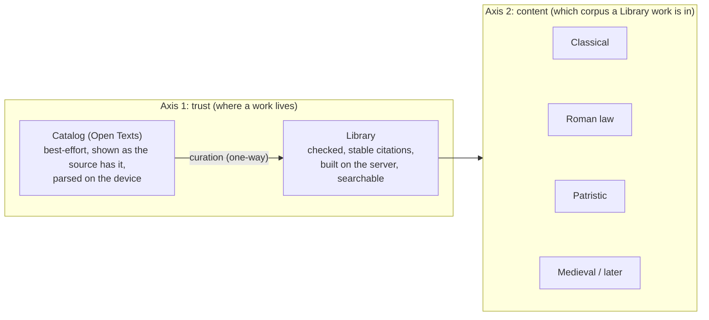

# Two-Axis Tiered Text Architecture

Condensed from [`next_steps_two_tracks.md`](file:///usr/local/google/home/nkprasad/.gemini/jetski/brain/e2d36e7b-95cf-49b8-9c82-401b0aa12008/next_steps_two_tracks.md). Tiers are about **trust**; corpora are about **content**.

---

## 1. The Two Axes: Trust vs. Content

1. **Axis 1 — Trust (Catalog $\rightarrow$ Library, One-Way)**:

   - Trust has **exactly two states**, and movement is strictly one-way (**Strategy Position 1**):
     - **Catalog (Open Texts, `/opentexts`)**: Best-effort, uncurated intake. Makes no editorial promise; each entry is metadata-only on the server, fetched from a pinned upstream fork and parsed on the reader's device (`parseTeiDocument` for TEI; lenient page layer + adapter for The Latin Library) into an `OpenTextDocument`. Never indexed in corpus search.
     - **Library (`/library`, `/work/...`)**: Curated, verified against strict validators, normalized into a stable citation hierarchy, preprocessed on the server into `library.db`, and searchable in the corpus.
   - **Nothing sits in between**, and **nothing is listed in both** (with the single explicit exception of **Decision #19**: Latin Library works covered only partially by the Library are listed in Open Texts with a note pointing to the Library for the covered part).
   - **Your texts (`/externalReader`)** sits beside Library and Open Texts under the top-bar **Texts** section (Decisions #13, #14, #15) for user-pasted text and arbitrary URL imports.

2. **Axis 2 — Content (Library Corpora Behind a Search Toggle)**:
   - Content partitions **the Library only** into named corpora: **Classical**, **Roman law**, **Patristic**, and **Medieval / later** (**Strategy Position 3 & 4**).
   - Catalog (Open Texts) works are **never** searchable in the corpus.
   - When multiple corpora ship (Horizon 2; deferred in this release per `milestones.md`, with the Digest staying in the single corpus for now per **Decision #22**), corpus search gets a toggle defaulting to Classical so classical search quality is protected while the Library grows in any direction without a scope limit.

---

## 2. Universal Intake & One-Way Graduation

- **Catalog as Universal Intake (**Strategy Position 2**)**:
  - Every pinned open collection is listed and readable best-effort in Open Texts as soon as it is pinned: **Patrologia Latina** (`nkprasad12/patrologia_latina-dev`) and **all of The Latin Library** (`nkprasad12/TheLatinLibrary`) not already in the Library and not excluded (medieval and Neo-Latin included, **Decision #18**).
  - Structure-aware best-effort parsing preserves whatever structure the source visibly has: Migne columns and section letters (`529A`–`D`) for Patrologia Latina via `parseTeiDocument` (`src/common/open_texts/tei_parser.ts`), and `LIBER` headings, bracketed numbers, and anchors for The Latin Library via `extractLenientPage` (`src/common/thelatinlibrary/`).
- **Automatic Drop-Out on Graduation**:
  - The Latin Library snapshot's identity map (`work_index.json`) tracks each work as `"in_library" | "partial" | "excluded" | "candidate"`. When a work is curated into `$THELATINLIBRARY_ROOT/works/*.json` (like the 6 pilot works), its status becomes `"in_library"` and it automatically drops out of the Open Texts catalog.

---

## 3. Strict Layered on Top of Lenient (M2a / M2b)

- **Shared Lenient Core (`src/common/thelatinlibrary/`, M2a)**:
  - A single browser-safe page reader (`extractLenientPage`) runs on both `parse5` (Node build) and `DOMParser` (browser) via `MinimalElementNode`. It strips site chrome, extracts ordered `PageBlock`s and `DetectedMarker`s, and never throws (recording quirks in `warnings`).
- **Strict Library Layer (`src/scripts/thelatinlibrary/`, M2b)**:
  - Curation takes the lenient parse, applies `splitAtSequentialMarkers` and strict validators (in-order markers, no lost text, CLTK cross-check, page coverage), and refuses on unexpected structure. Improvements to the lenient page reader benefit both tiers.

---

## 4. Rights, Provenance & Single Takedown Surface

- **Open-Licensed TEI (Patrologia Latina)**:
  - CC BY-SA 4.0 (`OpenGreekAndLatin/patrologia_latina-dev` forked at `nkprasad12/patrologia_latina-dev`, **Decision #5**); attributed with upstream source link and license in the reader.
- **The Latin Library Good-Faith Public-Domain Policy (**Decision #20**)**:
  - Every page is scanned for edition and copyright statements (`manifest.json`). Works naming a post-1930 edition/translation or copyright/permission restriction are marked `status: "excluded"` in `work_index.json` and excluded from **both** the Library and Open Texts.
- **Single Takedown Surface Outside `morcus-net`**:
  - **All** Latin Library text—both raw HTML (`raw/`) and converted Library JSON (`works/*.json`)—lives in a single separate data repository (`nkprasad12/TheLatinLibrary`, **Decision #5**) that both tiers read from (`upstream_sources.lock.json`). `morcus-net` itself stores no Latin Library text, giving a single takedown surface outside the application repository.
