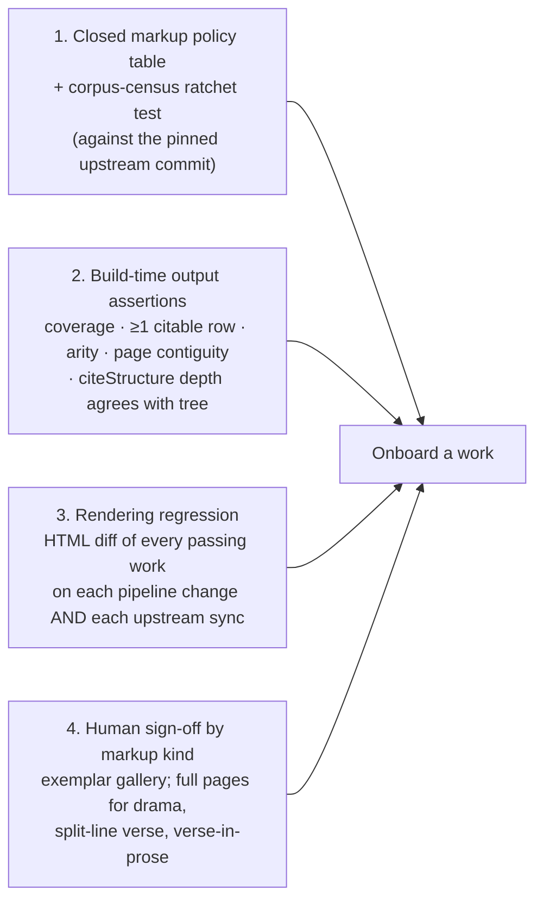

# Library Expansion Plan

**Status:** in progress — Phase 0
**Goal:** onboard every distinct Perseus Latin work into the V2 library with an enumerated, tested guarantee that we are not misrendering the editor's intended formatting.
**Sources:** the Sep-2026 study ([README.md](README.md), [V1_PREPROCESSING.md](V1_PREPROCESSING.md), [DIRECTION.md](DIRECTION.md), [OUTPUT_MODEL.md](OUTPUT_MODEL.md)); the Oct-2026 corpus survey over all 398 `perseus-lat*` files ([CORPUS_SURVEY.md](CORPUS_SURVEY.md)); and the diff of our fork against `PerseusDL/canonical-latinLit@master` ([UPSTREAM.md](UPSTREAM.md)).

| Phase | Scope                                                        | Status          | Target onboarded |
| ----- | ------------------------------------------------------------ | --------------- | ---------------: |
| **0** | Instrumentation, baseline, and upstream sync                 | **In progress** |               98 |
| **1** | Free wins (Cluster A) and markup / silent-drop bug fixes     | Not started     |             ≈115 |
| **2** | `citeStructure`-driven structural builder and unified markup | Not started     |             ≈250 |
| **3** | Speakers, stage directions, and verse-in-prose               | Not started     |             ≈290 |
| **4** | Secondary milestone axes and explicit pagination depth       | Not started     |             ≈290 |
| **5** | Long tail, multi-edition selection, and upstream PRs         | Not started     |             ≈300 |

---

## 1. Summary

1. **The Sep-2026 diagnosis still holds:** structure, not markup, is the dominant blocker, and the header-vs-tree check ([INV-3](V1_PREPROCESSING.md#inv-3)) is the biggest single lever.
2. **The target is ~300 distinct works, not 398.** Duplicate editions and Livy per-book slices inflate the file count — and **upstream has since deleted the Livy slices itself** ([§5](#5-upstream-perseus-what-changed-and-what-it-means)).
3. **The markup vocabulary is closed and small** (69 content elements, 34 note elements, ~39 `rend` values, 31 attributes across the whole corpus). "Good faith on formatting" can be an _enumerated, tested_ property: one policy table, a ratchet test that the corpus ⊆ table, and human sign-off per markup _kind_ (~60 of them), not per work.
4. **Fidelity gaps ship today** with nothing catching them ([§4.2](#42-fidelity-gaps-shipping-today-none-caught-by-any-check)). The plan closes those alongside adding works.
5. **Upstream is converging on the model these docs proposed.** 326 of 334 upstream Latin files now carry a TEI `<citeStructure>` declaration that names the canonical citation levels _including_ milestone-, `<lb>`- and `div1`-based ones, using a vocabulary of 19 `match` patterns. That gives Phase 2 an authoritative input instead of a heuristic, and makes the spine/axis split a declared fact rather than an inference.
6. **Syncing is not free.** 15 onboarded files are deleted upstream (re-editioned as `-lat2`), ~5,000 paragraph indents were renamed `rend="indent"` → `rend="align(indent)"` (which we _know_ but do not _render_), and the licence moved to CC BY-SA 4.0. The sync happens first, behind regression tooling, so we do not ship silent regressions.
7. **Target architecture:** a clean structural stage driven by `citeStructure` with a tree-derived fallback; a table-driven markup stage; a structured output type that Hypotactic and PHI can also target; `CorpusInputWork` emitted from it unchanged. Everything gated by HTML-diff regression plus the review gallery.

---

## 2. The corpus, re-counted

Full details in [CORPUS_SURVEY.md](CORPUS_SURVEY.md) and [UPSTREAM.md](UPSTREAM.md).

| Measure                                        |            Our clone |            Upstream HEAD |
| ---------------------------------------------- | -------------------: | -----------------------: |
| `perseus-lat*` files                           |                  398 |                  **334** |
| Distinct `textgroup.work` with a Latin edition |                  370 |                     ~318 |
| Works with >1 Perseus Latin edition            |                   29 |                      ~16 |
| Livy per-book / periochae / fragment slices    |                   47 | **0** (deleted upstream) |
| **Effective target (distinct, non-redundant)** |                 ≈320 |                 **≈300** |
| Onboarded today (`LatinWorks`)                 |                   98 |    98 (15 files renamed) |
| V1 passes today, as shipped                    |                  133 |                        — |
| …of which not in the allowlist                 |                   36 |                        — |
| Body text in V1-passing works                  | 48.7% of 44.2M chars |                        — |

Of the 36 works that pass V1 today but are not onboarded: ~20 are verse works currently shipped from **Hypotactic** instead (_Aeneid_, _Metamorphoses_, _Fasti_, Horace, …). Per [Decision 2](#6-decisions), those stay Hypotactic for now and will carry both editions long-term. The remaining ~16 are immediate free wins: **Gellius, ten Suetonius lives, Apuleius _Apologia_ / _Florida_, three pseudo-Caesar wars, Propertius, Martial, Silius Italicus, Valerius Flaccus, Ovid _Ex Ponto_.**

---

## 3. What blocks the rest, by cluster

First-error buckets on our clone (sums to 398): OK 133 · header/tree nesting mismatch 132 · `<forename>` 34 · `refsDecl` ambiguous 28 · `rend=""` 17 · no `<author>` 16 · note contents 13 · `<speaker>` 8 · long tail 17. Of the 132 mismatches, **74 are `Expected "card"`** — the TEI.2 header declares Perseus's old chunking unit, which has no body representation. The header is stale; the tree is clean.

| #   | Cluster                                                                                                                           | Works | Blocker today                                                                                             | What it needs                                                                               |
| --- | --------------------------------------------------------------------------------------------------------------------------------- | ----: | --------------------------------------------------------------------------------------------------------- | ------------------------------------------------------------------------------------------- |
| A   | Free wins                                                                                                                         |   ~16 | Not in the allowlist                                                                                      | Add + review                                                                                |
| B   | Clean `textpart` spine, bad header (Ausonius 26, Claudian 14, Prudentius 8, Seneca _Dialogi_ 9, Boethius 6, Statius, Nepos ×4, …) |   ~90 | [INV-3](V1_PREPROCESSING.md#inv-3) / [INV-1](V1_PREPROCESSING.md#inv-1)                                   | Citation scheme from `citeStructure` (or tree); arity + coverage assertions                 |
| C   | Historia Augusta                                                                                                                  |    30 | [INV-3](V1_PREPROCESSING.md#inv-3) (`work` level = the collection) + no `<author>` + `<note n=…>` pairing | Cluster B, plus author from `__cts__.xml` `<ti:groupname>`, plus `n`→`xml:id` note fallback |
| D   | Livy per-book slices                                                                                                              |    47 | —                                                                                                         | **Skip** (decided; and deleted upstream)                                                    |
| E   | Drama (Plautus 20, Terence 6, Seneca tragedies 10, _De Div._, _Eclogues_)                                                         |    39 | `<sp>`/`<speaker>`/`<stage>`; Seneca has no `textpart` divs (spine = `card` milestone + `<l n>`)          | Speaker-label rendering in V2; `act/scene/line` spine with a ragged `prologue`              |
| F   | Livy-style name markup                                                                                                            |    35 | `<forename>`, `<addName>`, `<genName>`                                                                    | Markup table entries                                                                        |
| G   | Note vocabulary                                                                                                                   |   ~30 | `<name>`, `<reg>`, `<choice>`, `<p>`, `rend=sub` inside notes                                             | One vocabulary with a context predicate                                                     |
| H   | TEI.2 `div1/div2/div3`, `<div type="book">`                                                                                       |   ~12 | Not recognised as containers                                                                              | Declared by `citeStructure` upstream (`div1[@type='book']` …)                               |
| I   | `<lb n>`/`<l>`-only verse (Appendix Vergiliana 11, _Ars Poetica_, Petronius fragments)                                            |   ~14 | No divs, no author                                                                                        | Declared by `citeStructure` upstream (`.//lb` as `line`); author from `__cts__.xml`         |
| J   | Ragged leaf depth (Terence prologues, letter collections, _Academica_ bks 2–3, Gellius praef.)                                    |    20 | Would process but ship uncitable rows                                                                     | Rule for shallower leaves: citable at their own depth, labelled                             |
| K   | Multiple editions of one work                                                                                                     |    29 | Policy                                                                                                    | Highest `-latN` unless review says otherwise (decided)                                      |

> [!NOTE]
> Prose is structurally mixed too: _De Divinatione_ and _Academica_ have speakers; _Topica_, _Apocolocyntosis_, _Satyricon_, and Boethius (`loebline` milestones) embed verse in prose; Cicero speeches quote verse as bare `<l>`. This is why `display: "verse"` must be a **per-row** property derived from the content (`<l>`/`<lg>` present), never a per-work flag from `textParts[last] === "line"` as today. Speaker labels are likewise a content-node kind, not a "drama mode".

---

## 4. What "good faith on formatting" requires

### 4.1 The vocabulary is closed — make the guarantee explicit

The gap list by works affected is short: `<sp>`/`<speaker>` 39 · `<forename>`/`<addName>` 35 · note `<name>`/`<reg>` 28 · `<genName>` 19 · note `<choice>` 11 · `<stage>` 10 · `<listPerson>`/`<person>`/`<roleName>` 6 · `label@opener` 6 · `l@bulletted`, `seg@dateline`, `seg@salute` 4–5 · ~35 singletons (several typos: `inddent`, `bockquote`, `secton`, `chaper`).

The principle from [DIRECTION.md §5](DIRECTION.md#5-markup) — _every attribute is rendered, explicitly ignored with a reason, or fatal_ — is right. What is missing:

1. **A single policy table** as the only home for markup decisions.
2. **A ratchet test that the corpus census ⊆ table**, run against the _pinned upstream commit_, so a sync that introduces or renames markup fails CI instead of rendering as a bare `<span>`. Same pattern as [`inventory_ratchet.test.ts`](../../../../web/ui/tools/inventory/inventory_ratchet.test.ts).

### 4.2 Fidelity gaps shipping today (none caught by any check)

| Issue                                                                                                                                                                                                                                                          | Scope                         |
| -------------------------------------------------------------------------------------------------------------------------------------------------------------------------------------------------------------------------------------------------------------- | ----------------------------- |
| `rend="bold"`/`"sup"` are _known_ but not _handled_ in [`perseus_rends.ts`](../../perseus_rends.ts#L18-L30), so dropped in body text; the `bold`/`superscript` branches in [`work_preprocessor.ts`](../work_preprocessor.ts#L251-L254) are only live for notes | `hi@bold` ×117, `hi@sup` ×135 |
| `rend="align(indent)"` is _known_ but not _handled_ — and upstream has just renamed ~5,000 `p rend="indent"` to it ([§5](#5-upstream-perseus-what-changed-and-what-it-means))                                                                                  | 6,555 occurrences upstream    |
| `note@place` accepted, never read (the _Academica_ speaker-label bug, [V1_PREPROCESSING.md §3.2](V1_PREPROCESSING.md#sec-academica))                                                                                                                           | 67 works                      |
| `l@part` (split verse lines `I`/`M`/`F`) accepted, never read; second half-lines should be indented                                                                                                                                                            | **68 works**                  |
| Milestone citation levels dropped in **50 onboarded works** (Cicero `chapter`, Pliny `section`, Catullus `meter`)                                                                                                                                              | 50 works                      |
| `<note n>` ↔ `<note target>` pairing unsupported → empty note bodies                                                                                                                                                                                           | HA (30)                       |
| Licence string hardcoded "CC BY-SA 3.0"; upstream files now say 4.0                                                                                                                                                                                            | all Perseus works             |
| No "≥1 citable row" check → _Topica_/_Academica_ failure mode still possible                                                                                                                                                                                   | latent                        |

### 4.3 Four pillars of confidence



Pillar 4's "full pages" rule applies to any _passage_ using speaker, split-line, or embedded-verse kinds — not to a genre.

### 4.4 Constraint: corpus processing must keep working

The corpus pipeline's dependency on the library is narrow and well-defined. [`saveAsCorpusInputWork`](../../corpus/corpus_library_utils.ts) writes one JSON per work with `{ id, workName, shortTitle, author, authorCode, rows: string[], rowIds: string[][], sectionDepth }`, read by both the TS and Rust builders ([`library_utils.rs`](../../../../../corpus_rust/src/build_corpus_v2/library_utils.rs)). Two invariants matter:

1. **`extractRowText`'s word-boundary rule must agree with the reader's** (`needsWordBreak` in [`work_preprocessor.ts`](../work_preprocessor.ts)) because corpus word offsets become reader highlight ranges. Today that agreement is maintained by two parallel implementations. The new design should compute row text and row HTML **from one tokenised intermediate**, so the agreement is structural rather than by convention — and add a test that asserts parity over the whole library.
2. `rowIds`/`sectionDepth` drive citation display in corpus results. Under the new model `rowIds` = the default-scheme citation and `sectionDepth` = its depth; non-citable rows (headings) need either an empty id or to be filtered — decide once, assert in the ratchet.

Nothing else in the corpus reads `ProcessedWork2`, so **the library output type is free to change** as long as `CorpusInputWork` is still emitted. The `SKIPS`/`AUTHOR_CODE_MAP` tables in [`corpus_library_utils.ts`](../../corpus/corpus_library_utils.ts) will need entries for new authors; worth deriving `authorCode` from `__cts__.xml` instead of hand-mapping.

### 4.5 Constraint: don't strand Hypotactic (or PHI)

Both alternate producers ([`process_hypotactic.ts`](../../process_hypotactic.ts), [`process_phi_json.ts`](../../process_phi_json.ts)) hand-build `textParts`, `rows`, `pages`, `navTree` and bypass all TEI logic. Whatever replaces `ProcessedWork2` must be constructible from "I already know the rows and their ids" with no TEI in sight: all rows citable, one spine scheme, default pagination computed. Hypotactic additionally needs per-row macra text and meter metadata to survive, and `hasMacra`. Keep the new type a strict superset of what they emit today; port the two converters as a mechanical change in the same commit that introduces the type.

---

## 5. Upstream Perseus: what changed and what it means

Our fork (`nkprasad12/canonical-latinLit`, branch `morcus-user-typos`) was **202 commits behind `PerseusDL/canonical-latinLit@master`** (merge base `b2a135df`, 2026-04-22; upstream HEAD `0700a6b7`, 2026-10-20), and 3 commits ahead (local typo fixes). 1,024 files changed. Authors: Lisa Cerrato 172, Charles Pletcher 17, Alison Babeu 8, Gregory Crane 4, Thibault Clérice 1. Commit subjects reference a `review_work` branch, `HookTest` (CapiTainS validation), and `MVP` — a corpus-wide cleanup pass towards CapiTainS/CTS compliance for a new Perseus platform. See [UPSTREAM.md](UPSTREAM.md) for the full analysis and tables.

### 5.1 The changes

| Change                                                                                                                                                                          | Scale                                                                             | Effect on us                                                                                                                                                                                                                                                 |
| ------------------------------------------------------------------------------------------------------------------------------------------------------------------------------- | --------------------------------------------------------------------------------- | ------------------------------------------------------------------------------------------------------------------------------------------------------------------------------------------------------------------------------------------------------------ |
| **`<refsDecl xml:id="CTS">` with nested `<citeStructure>`** added (Pletcher, Aug 2026)                                                                                          | **326 / 334** Latin files; 0 in our clone                                         | Authoritative, machine-readable citation scheme. See [§5.2](#52-citestructure-is-the-design-input-phase-2-was-missing).                                                                                                                                      |
| `xml:base` URN on `<body>` and on every `textpart` div                                                                                                                          | all touched files                                                                 | Noise for diffs; harmless. Explains the `div@xml:base`/`l@xml:base` attrs already in the census.                                                                                                                                                             |
| **Cicero philosophica/rhetorica `-lat1` deleted, `-lat2` added** (`phi036`–`059`, `phi072`); _De Div._ gets `-lat3`/`-lat4`; Tacitus _Agricola_ and Vitruvius `-lat1` → `-lat2` | 25 works; **15 onboarded files no longer exist**                                  | **Not lost — re-editioned.** Every one has a `-lat2` successor from the _same_ editor ("URN bumped"). Text deltas are small and mostly improvements (Beta Code Greek → Unicode, line-break hyphenation removed, typo fixes). See [UPSTREAM.md](UPSTREAM.md). |
| **Livy per-book slices deleted** (67 files incl. English); `phi001` gains `-lat3` (Conway–Walters OCT), `-lat4` (Foster Loeb), `-lat5` (Weissenborn–Müller) alongside `-lat2`   | 398 → 334 Latin files                                                             | Confirms Cluster D. Introduces a multi-edition choice for Livy.                                                                                                                                                                                              |
| Header regularisation: `<author>` without `xml:lang`, `<licence>` → CC BY-SA **4.0**, `<idno type="filename">`, `<biblScope n="contents">`, `<change>` entries                  | ~300 files; a versioned `<licence>` is present in 99/334 (all 4.0), absent in 234 | Stop hardcoding "3.0" in [`work_preprocessor.ts`](../work_preprocessor.ts); read `<licence>` per file, fall back to the repo's licence; indicate when local patches modify the text.                                                                         |
| **`rend` regularisation**: `p rend="indent"` → `rend="align(indent)"`; `head rend="align(center)"` added                                                                        | `align(indent)`: 1,367 → 6,555 occurrences; `indent`: 6,897 → 6,396               | **Silent regression on sync**: `align(indent)` is in `KNOWN_REND` but not `HANDLED_REND`, so ~5,000 paragraph indents would vanish without a fix.                                                                                                            |
| Whitespace/format normalisation of whole files                                                                                                                                  | every modified file                                                               | Content-keyed text patches ([`patches/`](../../../../../patches)) survive; offset-based ones would not.                                                                                                                                                      |
| `__cts__.xml` metadata updates; `stoa0261/stoa000N` → `stoa00N` renames                                                                                                         | small                                                                             | Work-ID stability is _not_ guaranteed across syncs. IDs in URLs/saved spots need an alias table.                                                                                                                                                             |
| Prolog: `<?xml-model …epidoc.rng?>` processing instruction; DOCTYPE now only in 20 files                                                                                        | all                                                                               | Replace the exact-string DOCTYPE strip in [`process_library.ts`](../../process_library.ts) with general prolog handling.                                                                                                                                     |

The only structural _body_ change found is the `xml:base` attribute; no work was re-nested from milestones to divs or vice versa. The 8 files without `citeStructure` are the six new Cicero rhetorica `-lat2` (`phi036`–`phi041`, mid-migration), Vitruvius `-lat2`, and `stoa0054.stoa006`.

### 5.2 `citeStructure` is the design input Phase 2 was missing

The complete `match` vocabulary upstream is **19 normalized patterns** (including root `/TEI/text/body`), all of which a small XPath-subset evaluator handles (child steps, `[@attr='v']`, `[@attr]`, `.//`, `|`):

```
327  /TEI/text/body                283  div/div[@subtype='X']        145  div[@subtype='X']
 96  l                              13  milestone[@unit='X']          12  div1[@type='X']
 11  .//lb                          10  .//l                           6  div2[@type='X']
  5  div/div/div[@subtype='X']       3  .//milestone[@unit='X']        2  div[@type='X']
…plus 5 singletons (`.//seg[@type='X']`, `.//div[@subtype='X']`, `pb`, `div[@type]`, typo `div/div[@subtype=book']`)
 and 2 unions (`l | div2[…]`, `div3[…] | milestone[…]`)
```

What it declares, by example:

| Work                            | Declared scheme                                                 | V1 result                |
| ------------------------------- | --------------------------------------------------------------- | ------------------------ |
| Cicero, _Pro Sestio_ / _Topica_ | `section` (div). Chapter milestones **not** declared            | section ✓ / fails        |
| Cicero, _De Officiis_           | `book` > `section` (divs)                                       | ✓                        |
| Seneca, _Medea_                 | `card` (**milestone**) > `line` (`.//l`)                        | fails (no textpart divs) |
| Tacitus, _Annales_              | `book` (`div1`) > `chapter` (**`.//milestone`**)                | fails                    |
| Symmachus (`stoa0261`)          | `book` (`div1`) > `letter` (`div2`) > `section` (**milestone**) | fails                    |
| Appendix Vergiliana, _Dirae_    | `line` (**`.//lb`**)                                            | fails                    |
| Plautus, _Amphitruo_            | `act` > `scene` (divs) > `line` (`l`)                           | fails                    |
| Historia Augusta                | `chapter` (div). Section milestones **not** declared            | fails                    |

Three consequences:

1. **The "what is the citation scheme" question has an authoritative answer for 97% of the corpus.** [INV-1](V1_PREPROCESSING.md#inv-1)'s two-headed header and [INV-3](V1_PREPROCESSING.md#inv-3)'s name matching are moot where `citeStructure` exists; for the 8 files without it (and as a cross-check everywhere), keep the tree-derived fallback and assert agreement.
2. **Containment and position levels are both first-class in the declaration.** A point-based level under a container means "rows are the spans between consecutive markers inside that container" — the standard CTS passage semantics that Perseus's own resolver uses. This is the spine/axis model from [DIRECTION.md](DIRECTION.md), with Perseus telling us which axes are canonical. The _undeclared_ milestones (Cicero `chapter`, HA `section`, Pliny `section`, all the `para`/`card`/`loebline` ones) are the secondary axes for Phase 4, and the declaration gives a principled policy table: **declared ⇒ scheme level; undeclared ⇒ recognised, exposed as a secondary axis or not per unit.**
3. **Ragged structures are declared too** — Terence's `prologue` act, Plautus `act/scene/line` — so Cluster J's rule is "cite at the declared depth that applies to this passage" rather than a heuristic.

> [!WARNING]
> Upstream is still mid-migration (8 files without `citeStructure`, two `match` typos, _De Divinatione_ with four editions, Livy with four). The pipeline must treat `citeStructure` as _strongly preferred input with validation_, not as unverified ground truth, and every sync must run the full survey + HTML diff.

### 5.2a How far along is upstream, and should we wait?

Two distinct efforts are running upstream at different stages:

| Effort                                                                                                                                                               | Status                                                                                                                                                                                 |
| -------------------------------------------------------------------------------------------------------------------------------------------------------------------- | -------------------------------------------------------------------------------------------------------------------------------------------------------------------------------------- |
| **`citeStructure` + `xml:base`** (Pletcher, scripted, Aug 2026)                                                                                                      | **Essentially done**: 326/334. The remaining 8 are files mid-rework.                                                                                                                   |
| **Per-textgroup deep review** (Cerrato: header/encoding fixes, Beta Code → Unicode, front/back matter removed, section breaks revised, milestones → divs, URN bumps) | **83/334 files** have a review `<change>` entry. Cicero, Suetonius, Tacitus done. Not yet: HA 30, Ausonius 26, Nepos 25, Plautus 20, Claudian 14, Seneca 14, App. Verg. 11, Ovid 10, … |

Deep-review throughput in 2026: Jan 5 · Mar 11 · Jun 35 · Jul 10 · Aug 7 · Sep 13 · Oct 1 — about **8 files/month on average, 35 at peak**. ~250 files remain, so at this pace the pass finishes in **1.5–3 years**. The review _does_ change bodies (9 Suetonius files had sections converted from milestones to divs; Cicero files had section breaks revised and front matter removed) and bumps URNs, so work IDs will keep changing as it proceeds.

**Conclusion: do not defer.** The part that matters for the design (`citeStructure`) is already present; the unfinished review pass is slow, open-ended, and will keep landing in the textgroups we want to onboard next. The right response is tooling that makes a sync cheap and visible (Phase 0), an ID-alias table, and the expectation that a work's gallery sign-off may need a re-look when its URN bumps.

### 5.3 Immediate consequences for the plan

- **Sync first, behind tooling.** Pin to upstream HEAD in Phase 0, after the HTML-diff baseline exists, and resolve: 15 gone files → their `-lat2` successors; `align(indent)` handling; licence; DOCTYPE/prolog; `FORCE_CTS_WORKS` (goes away in Phase 2 anyway).
- **Carry fixes as upstream PRs, not fork commits.** Upstream actively merges small patches; our 3 typo commits should go up as PRs so the fork can track `master` with zero diff. Same for the markup typos we find (`inddent`, `alternatechpater`, the `match` typos).
- **Work-ID aliasing.** `stoa0261.stoa0002` → `stoa0261.stoa002`, `phi0474.phi055.perseus-lat1` → `-lat2`: reader URLs and saved spots use a redirect table maintained alongside the pin.

---

## 6. Decisions

### Decisions taken

| #   | Decision                                                                                                                                                                                    |
| --- | ------------------------------------------------------------------------------------------------------------------------------------------------------------------------------------------- |
| 1   | **Clean rewrite** — no obligation to preserve existing V1 library internals. Only constraint: corpus processing keeps working ([§4.4](#44-constraint-corpus-processing-must-keep-working)). |
| 2   | **Perseus first**; Hypotactic later, without making decisions that break it ([§4.5](#45-constraint-dont-strand-hypotactic-or-phi)).                                                         |
| 3   | **Skip Livy per-book slices**; `phi0914.phi001` (_Ab Urbe Condita_) is the canonical edition.                                                                                               |
| 4   | **Review standard**: sign off per markup kind + spot-check per work; inspect full pages wherever a passage uses speaker, split-line, or verse-in-prose kinds.                               |
| 5   | **Fix source typos upstream** via PRs and keep the local policy table clean.                                                                                                                |

### Open questions

| #   | Question                                                                                                                                        | Current direction                                                                                                                                                                 |
| --- | ----------------------------------------------------------------------------------------------------------------------------------------------- | --------------------------------------------------------------------------------------------------------------------------------------------------------------------------------- |
| 6   | **D1 (pipeline shape)** — pre-rendered page HTML in the DB, or a structured artifact rendered per request with a cache?                         | Defer until Phase 4 needs multiple paginations. With a clean rewrite the natural cut is "structured work artifact" at build + SSR renderer; pre-rendering becomes a cache policy. |
| 7   | **Livy edition** now that there are four: stay on `-lat2` (Weissenborn–Müller, what we ship), or move to `-lat3` (Conway–Walters OCT)?          | Stay on `-lat2` for the Phase 0 sync (translation alignment `eng3` is tuned to `-lat2`, and `-lat2` covers all 142 books/periochae); evaluate `-lat3` in the gallery later.       |
| 8   | **Undeclared milestones policy**: expose Cicero `chapter` / HA `section` / Pliny `section` as secondary citation axes in Phase 4, or omit them? | Expose `section` (HA, Pliny — scholars cite them) and `chapter` for Cicero as a secondary scheme; `card`/`para`/`loebline`/`mspage` recognise-only. Revisit with gallery data.    |

---

## 7. Phased plan

### Phase 0 — Instrumentation, then sync (small)

1. Promote the survey into `./morcus.sh library survey`: per-work V1 status, census, assertions, fingerprint manifest; runs against `$LIB_XML_ROOT` or an override path.
2. HTML-render cache + diff tool (`./morcus.sh library render` / `./morcus.sh library diff`); **baseline today's 98 works at the pre-sync pin**.
3. Corpus-census ratchet test with an explicit "not yet onboarded" exclusion list.
4. Corpus-pipeline parity test: `extractRowText` word boundaries == reader tokenisation, over the whole library.
5. **Pin to upstream HEAD.** Fix what the tools report: 15 re-editioned IDs (+ alias table), `align(indent)`, licence from `<licence>`, prolog handling, `FORCE_CTS_WORKS` entries for renamed files. Prepare our 3 typo commits as upstream PRs.
6. Update the docs in `src/common/library/preprocess/docs/` with the fresh survey numbers and upstream findings.

**Exit:** on upstream HEAD, every shipped page is diff-identical to the baseline or its diff is reviewed; the ratchet is green; a new upstream element cannot enter silently.

### Phase 1 — Free wins and bug fixes (small, high value)

- Onboard Cluster A (~16 works) through the gallery — first test of Pillar 4.
- Fix the [§4.2](#42-fidelity-gaps-shipping-today-none-caught-by-any-check) bugs that need no model change: `bold`/`sup`, `note n=` pairing, `l@part` indentation, `place="inline"` → fatal until speaker labels exist.
- Markup table data: `forename`/`addName`/`genName`, `rend=""`, `abbr`/`expan` child-set match, merged note vocabulary, collect-all-errors per work.

**Exit:** ≈115 onboarded; zero known silent drops on them.

### Phase 2 — New structural stage, `citeStructure`-driven (medium; the big lever)

A fresh builder (~500 lines) that:

- evaluates the `citeStructure` declaration with a 19-pattern XPath-subset evaluator → ordered citation levels, each **container** (`div`, `div1..3`, `seg`, `l`) or **point** (`milestone`, `lb`, `pb`);
- walks the body producing `Row { id, citable, display?, content }` with **declared** citability, point levels producing rows between consecutive markers, ragged depth handled per the declaration;
- falls back to tree derivation (right-aligned header names) when no `citeStructure` is present, and **asserts** tree depth == declared depth otherwise (warning on mismatch, listed in the survey);
- enforces OUT-1…OUT-5 (coverage, ≥1 citable row, arity, page contiguity, unique page ids) at build;
- reads author/title from `__cts__.xml` when `titleStmt` lacks them; reads `<licence>`;
- emits a structured work type that `work_preprocessor`, `saveAsCorpusInputWork`, Hypotactic, and PHI all consume ([§4.4](#44-constraint-corpus-processing-must-keep-working), [§4.5](#45-constraint-dont-strand-hypotactic-or-phi)). `ProcessedWork2` is deleted.

Markup stage: one table, one transformer, context predicates for notes. Deletes `FORCE_CTS_WORKS`, `NO_SUBTYPES`, `IGNORE_SUBTYPES`, the Lucretius hardcode, `pruneSectionNumbering`, and the DOCTYPE string hack. Migration gate: Phase 0 HTML diff — identical or reviewed.

**Exit:** ≈250 onboarded (Clusters B, C, H, I); every row citable or deliberately not; coverage proven; corpus build unchanged byte-for-byte on previously shipped works.

### Phase 3 — Speakers, stage directions, verse-in-prose (medium; one UI feature)

- `<sp>`/`<speaker>`/`<stage>` and `note type="sp" place="inline"` → a `speaker` content kind → V2 rendering.
- Per-row `display: "verse"`; `l@part` half-lines; `card`/`line` spines for Seneca.

**Exit:** Cluster E + _Academica_; ≈290 onboarded.

### Phase 4 — Secondary axes (needs Open Questions 6 & 8)

Undeclared milestones as inline citable anchors and secondary schemes; explicit pagination depth (Pliny). The survey shows `crossing` is the common case (185 axes) and `aligned` is rare (13), so inline anchors are the general answer; re-run the classifier after Phase 2 since the prototype assumes a `textpart`-only spine.

**Exit:** no onboarded work drops a citation level a scholar would use.

### Phase 5 — Long tail and policy

Remaining multi-edition choices, front matter, the 5 coverage mismatches (Catullus, Lucan, Florus, two fragment files), upstream PRs for typos, and an explicit exclusion list with reasons for whatever remains.

**Exit:** every distinct work onboarded or documented on the exclusion list.

---

## Appendix — Reference numbers

- **Axis relations** (prototype, our clone): `crossing` 185 · `finer` 115 · `aligned` 13 · `coarser` 12. Works with ≥1 milestone axis: 221 (177 have none).
- **Milestone units by works**: `chapter` 111 · `section` 110 · `card` 41 · `para` 25 · `paragraph` 7 · `Book` 6 · `loebline` 6 · 22 more ≤5 each.
- **Spine shapes** (top): `(none)` 80 · `chapter` 63 · `section` 63 · `act/scene` 25 · `poem` 24 · `book/chapter/section` 23 · `book/poem` 18 · `chapter/section` 18.
- **Header facts** (our clone): no `<author>` 41 · 2 `refsDecl` 238 · ≥2 non-CTS `refsDecl` 24 · `__cts__.xml` present 310 · ragged leaf depth 20.
- **Upstream `citeStructure`**: 326/334 files; 19 distinct normalized `match` patterns; point-based levels declared in ~28 files (`milestone` 16, `lb` 11, `pb` 1).
- **Survey note**: _Tacitus Dialogus_ (`phi1351.phi003.perseus-lat1`) has no `textpart` divs (`NO_SUBTYPES` in V1) and is counted under `NO_SPINE` in the `textpart`-only prototype, though V1 ships it via `NO_SUBTYPES`. Similarly, Apuleius _Apologia_ (`phi1212.phi001.perseus-lat1`) passes V1 (one of the 36 V1-OK non-onboarded works) and only failed the prototype's standalone XML comment strip.
