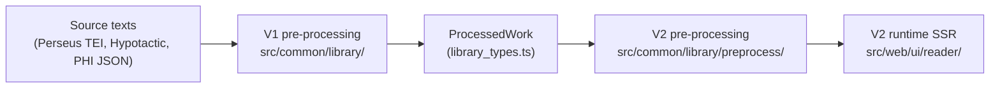

# Library Pre-Processing — V2 Investigation

Notes on the source-text pre-processing pipeline that feeds the V2 reader, and on where it should
go next.

> [!NOTE]
> These documents are scoped to **V2**. They assume the legacy React reader will not be adapted to
> any of the changes proposed here, which removes a large compatibility constraint: the only
> consumer that has to keep working is `src/web/ui/reader/`.

## The problem, briefly

Producing a reader page takes three stages:

Stage B — the V1 layer — is the bottleneck. It works hard to coerce arbitrary TEI into one clean,
uniformly-nested tree, and sources that don't fit that shape need bespoke code, hand-written
patches, or stay unavailable. **At the pre-sync clone (`379331f1`), 137 of the 398 Latin files
processed through `processTei2`** (133 in the initial scratch survey before fixing its DOCTYPE
regex, 129 with ≥1 citable row, and 130 works in `NOT_YET_ONBOARDED`). **After the Phase 0 upstream
sync (`452d0905`), 136 of the 334 Latin files (143 of 341 total surveyed) process through
`processTei2`, 266 of 334 have zero markup violations against the closed markup policy table, and
only 68 works remain in `NOT_YET_ONBOARDED`** (98 Perseus Latin works are onboarded today out of
≈300 distinct works post-sync / ≈320 pre-sync — see [CORPUS_SURVEY.md](CORPUS_SURVEY.md) and
[UPSTREAM.md](UPSTREAM.md)).

Two distinct kinds of strictness are tangled together in that layer, and they deserve opposite
treatment:

1. **Structural rigidity** — assumptions about how a document must be shaped (uniform nesting, a
   header that agrees with the body, divisions encoded only as nested `div`s). This is the dominant
   blocker: **66% of failures are structural or metadata, before any markup is examined.** Most of
   it turns out to be incidental to what the reader actually needs.

2. **Markup defensiveness** — an allowlist of which elements and `rend` values are acceptable in
   which contexts, throwing on anything unrecognised. This is the _only_ automated guarantee of
   faithful rendering that exists today, and it is usually cheap to extend when a new element shows
   up.

   > [!IMPORTANT]
   > The defensiveness is a feature and must be preserved. Anything that buys structural
   > flexibility by becoming permissive about markup is the wrong trade.

A third problem sits underneath both: the pipeline's strictness is aimed at the wrong things.
Several checks that _do_ matter — that every work has citable content, that citation depth is
uniform, that no text is silently dropped — are not enforced anywhere, so a work can process
"successfully" and render with no citations at all.

## Source corpus

The Perseus-derived Latin texts are **not** in this repository. They come from
[nkprasad12/canonical-latinLit](https://github.com/nkprasad12/canonical-latinLit), a fork of the
Perseus Digital Library's canonical corpus, kept as a local sync and pointed at by the
`LIB_XML_ROOT` environment variable in `.env` (also used by
[`src/scripts/process_lat_lib.ts`](../../../../scripts/process_lat_lib.ts)).

Individual works live at `$LIB_XML_ROOT/data/<textgroup>/<work>/<id>.xml`. The "398 works" figure
used in the initial Sep-2026 study is every `perseus-lat*` file found under that tree at the time
(≈320 distinct works in our clone; **334 files / ≈300 distinct works** upstream after Livy slice
removal). Which of them are actually built is a separate, hand-maintained question — see
[`library_constants.ts`](../../../../common/library/library_constants.ts).

## Where this is going

The concrete execution plan for expanding the library to the full Perseus Latin corpus — starting
with Phase 0 instrumentation (`./morcus.sh library survey|render|diff`), ratcheting the closed
markup vocabulary, syncing `canonical-latinLit` to upstream `HEAD`, and replacing the structural
stage with a `<citeStructure>`-driven builder — lives in **[PLAN.md](PLAN.md)**.

## Documents

| Document                                   | What it is                                                                                                                                                                                                                                                                                        |
| ------------------------------------------ | ------------------------------------------------------------------------------------------------------------------------------------------------------------------------------------------------------------------------------------------------------------------------------------------------- |
| [PLAN.md](PLAN.md)                         | **The execution plan.** Phased roadmap (Phases 0–5), architectural constraints (corpus parity, Hypotactic/PHI compatibility), the four pillars of formatting confidence, and decisions taken vs open.                                                                                             |
| [CORPUS_SURVEY.md](CORPUS_SURVEY.md)       | **Corpus-wide numbers.** V1 status buckets, blocker clusters, full `<body>` markup census (elements, note elements, `rend`s, attributes, gaps), header/structure facts, and axis relation distributions across all 398 files.                                                                     |
| [UPSTREAM.md](UPSTREAM.md)                 | **Upstream Perseus delta & policy.** What changed across 202 upstream commits: `<citeStructure>` adoption (19 `match` patterns), 15 re-editioned `-lat2` works, Livy slice removal, `align(indent)`, CC BY-SA 4.0, and sync policy.                                                               |
| [V1_PREPROCESSING.md](V1_PREPROCESSING.md) | The initial study. What V1 does stage by stage, an inventory of 19 structural/markup/output invariants with enforcement sites, and a catalogue of how real unintegrated works deviate.                                                                                                            |
| [DIRECTION.md](DIRECTION.md)               | Conceptual model for citation structure (a hierarchical spine plus linear marker axes) and how it handles milestones. _(§4's header heuristic is superseded by `<citeStructure>` in [PLAN.md §5.2](PLAN.md#52-citestructure-is-the-design-input-phase-2-was-missing).)_                           |
| [OUTPUT_MODEL.md](OUTPUT_MODEL.md)         | The data contract that model implies: the proposed successor to `ProcessedWork2`, its checked output invariants (OUT-1 … OUT-9), and prototype validation. _(§11–§12 updated by [PLAN.md §5.2](PLAN.md#52-citestructure-is-the-design-input-phase-2-was-missing) and [§6](PLAN.md#6-decisions).)_ |

## Scratch work

Investigation tooling — instrumentation scripts, probes, corpus surveys — **may** be present
locally under `.investigation/<topic>/`, e.g. `.investigation/library-preprocessing/` for the work
behind these documents (note: an early scratch `README.md` there referred to the checked-in docs
path as `src/common/library/v2/docs/`; the canonical path is `src/common/library/preprocess/docs/`).

At the time of writing that directory holds, beyond the V1 harness in
[Appendix A](V1_PREPROCESSING.md#appendix-a--the-harness):

| File               | Purpose                                                                                                                                                                                                                                                            |
| ------------------ | ------------------------------------------------------------------------------------------------------------------------------------------------------------------------------------------------------------------------------------------------------------------ |
| `proto_axes.ts`    | End-to-end prototype of the spine/axis model in [OUTPUT_MODEL.md](OUTPUT_MODEL.md). Builds `ProcessedWork3` straight from TEI, classifies axis relations, runs the OUT-n assertions, renders pages, resolves citations. Shares no code with `src/common/library/`. |
| `keys_diag.ts`     | Dumps colliding axis citation keys with row context. This is what produced the identity-vs-citation split.                                                                                                                                                         |
| `bench_render.ts`  | Per-page render cost, for the request-time-rendering question.                                                                                                                                                                                                     |
| `notes_rank.ts`    | Ranks the whole built library by footnotes per page.                                                                                                                                                                                                               |
| `corpus_survey.ts` | One-pass survey over all 398 `perseus-lat*` files collecting V1 status, `proto_axes` relations, full `<body>` markup census, and header facts ([CORPUS_SURVEY.md](CORPUS_SURVEY.md); promoted into `./morcus.sh library survey`).                                  |
| `xtab.ts`          | Cross-tabulations over `corpus_survey.json` (non-`textpart` structures, onboarded works with dropped milestone axes, ragged leaf depths, drama works, per-author pass rates).                                                                                      |
| `upstream_diff.sh` | Compares our `canonical-latinLit` fork against `upstream/master`: old vs new `-lat2` editions, Livy `-lat2`…`-lat5`, and structural vs header diffs across modified files ([UPSTREAM.md](UPSTREAM.md)).                                                            |

That directory is gitignored and is never checked in. It is a convention, not a guarantee: on a
fresh clone it will not exist, and nothing in these documents depends on it. It is written down so
that

- anyone picking this up knows **where to look** for tooling that may already exist, and
- anyone writing new throwaway tooling knows **where to put it** instead of scattering scripts
  through the source tree.

Scratch files go stale — they reference line numbers and internals of `src/` that move. If
something there no longer applies cleanly, delete it rather than repair it. What matters is
reproducibility of the _results_, and the commands for that are recorded in
[Appendix A](V1_PREPROCESSING.md#appendix-a--the-harness).

---

_Provenance: written Sep 2026. Investigation only — no pipeline code was changed._
