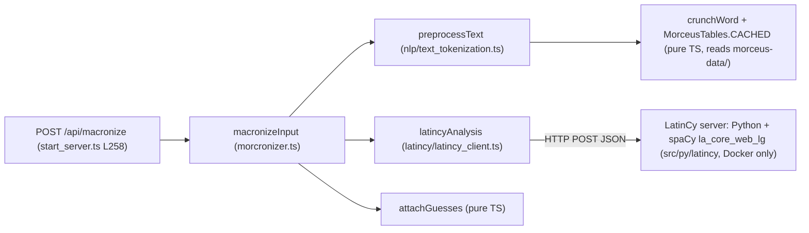

# Macronizer UI V2: research

> **Archived.** Kept for context only; do not treat it as current guidance or a to-do list.
> Living doc: [macronizer/README.md](../../macronizer/README.md). Open work: [macronizer/TODOS.md](../../macronizer/TODOS.md).
> Commit SHAs, phase numbers, and relative links in this file refer to `lit-prototype` history and may not resolve.

**Scope:** research and decision record for the macronizer slice. The actionable plan is [MACRONIZER_IMPLEMENTATION_PLAN.md](MACRONIZER_IMPLEMENTATION_PLAN.md), which wins wherever the two disagree. Code was read on branch `lit-prototype` @ `e3218552`; line references are as of that commit.
**Inputs:** [AGENTS.md](../../../../AGENTS.md), [v2/README.md](../../../../src/web/ui/README.md), PE RFC review §7 Phase 3, [CORPUS_DESIGN.md](../../../../src/web/ui/docs/archive/CORPUS_DESIGN.md), V1 `macron.tsx`, the backend in `src/macronizer/`, and the V2 `reader/`, `external/`, `core/`, `testing/` code.

Every claim below is cited to file and line and was read in the code unless marked **(unverified)**. Two things were also run: `morcronizer.test.ts` (passes, 14 tests) and a scratch probe of the pure-TS pipeline against a stub tagger (§2.4).

> [!IMPORTANT]
>
> **Revised after the prototype review.** The design is now a **standalone two-pane page** (§5) with a single-word inspector, not the reader frame. §3.1, §4.1, §4.2, §5, §6, §8 and §9 are updated; §4.2 keeps the reader-frame analysis as the record of why it was rejected. The interactive prototype (canned data, mock dictionary pane) was reviewed during the research and is not checked in.

---

## 1. V1 feature inventory and parity

Source: [macron.tsx](https://github.com/nkprasad12/morcus-net/blob/archive/ui-v1/src/web/client/pages/macron.tsx), [macron.test.tsx](https://github.com/nkprasad12/morcus-net/blob/archive/ui-v1/src/web/client/pages/macron.test.tsx), [styles.tsx L866–894](https://github.com/nkprasad12/morcus-net/blob/archive/ui-v1/src/web/client/styling/styles.tsx#L866-L894), [active_pages.tsx L55–58](https://github.com/nkprasad12/morcus-net/blob/archive/ui-v1/src/web/client/routing/active_pages.tsx#L55-L58).

| #   | V1 feature                                                                                                                                                                                                              | Where                                                                                                                                                                                                                                             | V2 parity                                  | Notes                                                                                                                                                                                                                                              |
| --- | ----------------------------------------------------------------------------------------------------------------------------------------------------------------------------------------------------------------------- | ------------------------------------------------------------------------------------------------------------------------------------------------------------------------------------------------------------------------------------------------- | ------------------------------------------ | -------------------------------------------------------------------------------------------------------------------------------------------------------------------------------------------------------------------------------------------------- |
| 1   | Route `/macronizer`, lazy-loaded, **no app-bar link** (no `appBarConfig`). Nothing in `src/` links to it.                                                                                                               | [active_pages.tsx L55–58](https://github.com/nkprasad12/morcus-net/blob/archive/ui-v1/src/web/client/routing/active_pages.tsx#L55-L58)                                                                                                            | Must match (`/v2/macronizer`, unlinked)    | Same as corpus D5: the link is a separate, later decision.                                                                                                                                                                                         |
| 2   | Multiline textarea, label "Enter text to macronize", `minRows=8`.                                                                                                                                                       | [L177–189](https://github.com/nkprasad12/morcus-net/blob/archive/ui-v1/src/web/client/pages/macron.tsx#L177-L189)                                                                                                                                 | Must match                                 | Native `<textarea name="text" rows="8" lang="la" spellcheck="false">`, as the External Reader's paste field ([external.server.ts L141–150](../../../../src/web/ui/external/external.server.ts#L141-L150)).                                         |
| 3   | Limit **10,000 chars**: live counter `(n / 10000)`, button disabled when empty or ≥ 10,000, `aria-labelledby` points at the limit text. Server limit is **20,000** (`INPUT_MAX_LENGTH`).                                | [L173–202](https://github.com/nkprasad12/morcus-net/blob/archive/ui-v1/src/web/client/pages/macron.tsx#L173-L202); [morcronizer.ts L26](../../../../src/macronizer/morcronizer.ts#L26)                                                            | Must match the limit; counter nice-to-have | Two different limits is a mistake: pick one, enforce it on the server with a 200 error view, and put `maxlength` on the textarea so No-JS can't overshoot. See D8.                                                                                 |
| 4   | Submit calls `POST /api/macronize` with the raw text; button ignores clicks while loading; no other loading UI.                                                                                                         | [L154–171](https://github.com/nkprasad12/morcus-net/blob/archive/ui-v1/src/web/client/pages/macron.tsx#L154-L171)                                                                                                                                 | Must match (as a POST form)                | README convention 1. `aria-busy` on the result region while a JS swap is in flight.                                                                                                                                                                |
| 5   | Error: `"An error occurred."` for any failure (TODO in code).                                                                                                                                                           | [L164–167](https://github.com/nkprasad12/morcus-net/blob/archive/ui-v1/src/web/client/pages/macron.tsx#L164-L167)                                                                                                                                 | Improve                                    | Corpus pattern: user errors (empty, too long) → 200 with the message in the result slot; NLP server down → 503 "unavailable" page ([corpus_routes.server.ts L66–69](../../../../src/web/ui/corpus/corpus_routes.server.ts#L66-L69)).               |
| 6   | Result rendering, `white-space: pre-wrap` (string tokens carry `\n`): plain words as text; **unknown** (0 forms) red dotted (`.macUnknown`); **ambiguous** (≥ 2 forms) blue, dashed underline (`.macAmbig.unresolved`). | [L117–145](https://github.com/nkprasad12/morcus-net/blob/archive/ui-v1/src/web/client/pages/macron.tsx#L117-L145); [styles.tsx L867–879](https://github.com/nkprasad12/morcus-net/blob/archive/ui-v1/src/web/client/styling/styles.tsx#L867-L879) | Must match                                 | Three visual states: plain / ambiguous / unknown. Use tokens, not the V1 hex colours.                                                                                                                                                              |
| 7   | Initial form for an ambiguous word = `options[suggested ?? 0]`.                                                                                                                                                         | [L24–28](https://github.com/nkprasad12/morcus-net/blob/archive/ui-v1/src/web/client/pages/macron.tsx#L24-L28)                                                                                                                                     | Must match                                 | `getIdx` is a no-op round trip; it equals `suggested ?? 0`.                                                                                                                                                                                        |
| 8   | **Click** an ambiguous word → "Analysis" panel shows `Original`, then each form with its lemmas (book icon, clickable) and morph lines.                                                                                 | [L100–111](https://github.com/nkprasad12/morcus-net/blob/archive/ui-v1/src/web/client/pages/macron.tsx#L100-L111), [L362–417](https://github.com/nkprasad12/morcus-net/blob/archive/ui-v1/src/web/client/pages/macron.tsx#L362-L417)              | Must match (content), change the trigger   | Content becomes the inspector card (§5.3). Empty morph strings (`"in"` has `morph: [""]`) are filtered ([L400](https://github.com/nkprasad12/morcus-net/blob/archive/ui-v1/src/web/client/pages/macron.tsx#L400)).                                 |
| 9   | **Ctrl+Click** cycles through the forms; **Alt+Click** toggles "resolved" (drops the blue background). Caret position is saved/restored across the re-render.                                                           | [L47–110](https://github.com/nkprasad12/morcus-net/blob/archive/ui-v1/src/web/client/pages/macron.tsx#L47-L110)                                                                                                                                   | Keep the capability, drop the gesture      | Modifier clicks are undiscoverable, keyboard- and touch-hostile. The RFC calls cycling "an enhancement". Radios/buttons in the note do the same job accessibly (D6). "Resolved" is nice-to-have.                                                   |
| 10  | Lemma click → embedded `DictionaryViewV2` (`hideSearch`, `skipJumpToResult`, 80% scale) in the right panel, replacing the analysis.                                                                                     | [L319–357](https://github.com/nkprasad12/morcus-net/blob/archive/ui-v1/src/web/client/pages/macron.tsx#L319-L357)                                                                                                                                 | Must match                                 | V2 reuses the reader's dictionary iframe URL contract (`/v2/dicts?q=…&lang=La&o=1&embedded=1`, [reader.server.ts L81–85](../../../../src/web/ui/reader/reader.server.ts#L81-L85)).                                                                 |
| 11  | V1 passes the raw lemma to the dictionary, including Morceus disambiguators such as `eo#1`.                                                                                                                             | [L387](https://github.com/nkprasad12/morcus-net/blob/archive/ui-v1/src/web/client/pages/macron.tsx#L387); real output has `edo#1`, `qui#2` (§2.4)                                                                                                 | Fix                                        | The server strips `#…` when it builds dict entries ([latin_dict_fetching.ts L101–103](../../../../src/common/dictionaries/latin_dict_fetching.ts#L101-L103)); whether `q=eo%231` finds anything is **unverified**. V2 should strip before linking. |
| 12  | **Copy Text** button: `textContent.normalize("NFC")` of the result, `navigator.clipboard`, "Copied!" for 2 s, "Error" otherwise.                                                                                        | [L243–271](https://github.com/nkprasad12/morcus-net/blob/archive/ui-v1/src/web/client/pages/macron.tsx#L243-L271)                                                                                                                                 | Must match (JS-only)                       | `core/widgets/clipboard.client.ts` `copyText` has the `execCommand` fallback for `http://` dev ([clipboard.client.ts L8–18](../../../../src/web/ui/core/widgets/clipboard.client.ts#L8-L18)); `core/widgets/toast.client.ts` for the confirmation. |
| 13  | The result `<div>` and each ambiguous span are **`contentEditable`** (the user can hand-edit the output before copying).                                                                                                | [L95–99](https://github.com/nkprasad12/morcus-net/blob/archive/ui-v1/src/web/client/pages/macron.tsx#L95-L99), [L122–127](https://github.com/nkprasad12/morcus-net/blob/archive/ui-v1/src/web/client/pages/macron.tsx#L122-L127)                  | Drop                                       | Undocumented in the UI, fights the caret-restore code, and conflicts with word-click lookup. Track as a TODO if anyone asks.                                                                                                                       |
| 14  | Instructions `<details open>` with the colour legend and the click gestures.                                                                                                                                            | [L292–312](https://github.com/nkprasad12/morcus-net/blob/archive/ui-v1/src/web/client/pages/macron.tsx#L292-L312)                                                                                                                                 | Must match (legend)                        | Native `<details>`; text changes with D6.                                                                                                                                                                                                          |
| 15  | Layout: `ResizeablePanels` with input+results on the left, "Analysis" on the right; "Enter text in the box to get started." placeholder; results `scrollIntoView` on arrival.                                           | [L208–241](https://github.com/nkprasad12/morcus-net/blob/archive/ui-v1/src/web/client/pages/macron.tsx#L208-L241)                                                                                                                                 | Match the shape, own layout                | Two-pane page: text pane and an inspector/dictionary column; bottom drawer on narrow screens (§5.2). Resizing is deferred (D16).                                                                                                                   |
| 16  | No settings, no persistence, no URL state; results are ephemeral.                                                                                                                                                       | whole file                                                                                                                                                                                                                                        | Must match for v1 of V2                    | See D2 on addressability.                                                                                                                                                                                                                          |
| 17  | `./morcus.sh worker -wt mac` points at `src/web/workers/macronizer_processor.ts`, which **does not exist**.                                                                                                             | [run_morcus.ts L466–468](../../../../src/scripts/run_morcus.ts#L466-L468)                                                                                                                                                                         | Not a UI concern                           | Dead code; the macronizer no longer uses a worker (§2.2).                                                                                                                                                                                          |

**V1 tests worth porting** ([macron.test.tsx](https://github.com/nkprasad12/morcus-net/blob/archive/ui-v1/src/web/client/pages/macron.test.tsx)): no server call on empty submit; error path; happy path renders `dīvīsa in partēs trēs`, click → options, lemma → `DictsFusedApi` with `query: "divido"`; copy writes the NFC text. Its `SAMPLE_OUTPUT` ([L39–88](https://github.com/nkprasad12/morcus-net/blob/archive/ui-v1/src/web/client/pages/macron.test.tsx#L39-L88)) is a ready-made small fixture.

---

## 2. Backend

### 2.1 Result shape

[api_routes.ts L31–61](../../../../src/web/api_routes.ts#L31-L61):

```ts
MacronizedResult = (MacronizedWord | string)[]   // strings = untouched separators ("\n", ", ")
MacronizedWord = { word: string;                   // original surface form
                   options: { form: string;        // one entry per distinct macronized spelling
                              options: { lemma: string; morph: string[] }[] }[];
                   suggested?: number }             // index into `options`, only when ≥ 2 forms and the NLP agreed
```

- Forms are grouped by display text, then by lemma ([morcronizer.ts L82–98](../../../../src/macronizer/morcronizer.ts#L82-L98)); `morph` strings are Morceus `wordInflectionDataToArray` joins such as `"perf part pass fem abl sg"` ([L37–47](../../../../src/macronizer/morcronizer.ts#L37-L47)). Indeclinables give `morph: [""]`.
- **Ambiguity** = `options.length ≥ 2`. **Unknown** = `options.length === 0` (the `Math.max()` of an empty list is `-Infinity`, so everything is filtered; [L203–218](../../../../src/macronizer/morcronizer.ts#L203-L218)).
- **Lemma and morphology are present for every form**, so links into the dictionary are free. Lemmas carry Morceus disambiguators (`edo#1`, `qui#2`, `incolo#1` in §2.4); `findBestMatch` strips them with `split("#")[0]` ([L119](../../../../src/macronizer/morcronizer.ts#L119)).
- Macra the user typed are respected: forms contradicting them are dropped ([L148–169](../../../../src/macronizer/morcronizer.ts#L148-L169), [L203–213](../../../../src/macronizer/morcronizer.ts#L203-L213)), and the original casing is kept ([L64–80](../../../../src/macronizer/morcronizer.ts#L64-L80)).
- The output validator is loose (`options: isArray(isAny)`, [api_routes.ts L56](../../../../src/web/api_routes.ts#L56)). A V2 server renderer consumes the TS type directly, so this doesn't matter.

### 2.2 What depends on what



| Part                                         | Runs where                                                                                                                                                                                                                                                                                                                       | Available here?                                                                                                                                                                                                                                                                                                                                |
| -------------------------------------------- | -------------------------------------------------------------------------------------------------------------------------------------------------------------------------------------------------------------------------------------------------------------------------------------------------------------------------------- | ---------------------------------------------------------------------------------------------------------------------------------------------------------------------------------------------------------------------------------------------------------------------------------------------------------------------------------------------- |
| Tokenizing + Morceus cruncher                | In-process TS: [text_tokenization.ts L12–15](../../../../src/nlp/text_tokenization.ts#L12-L15); tables from `MORCEUS_DATA_ROOT` (default `morceus-data/`, [env_vars.ts L23](../../../../src/common/env_vars.ts#L23), [cruncher_tables.ts L38](../../../../src/morceus/cruncher_tables.ts#L38))                                   | **Yes.** `morceus-data/` is present, the Docker image copies it ([Dockerfile L21](../../../../Dockerfile#L21)), and the server already loads these tables for the numeral dictionary ([numeral_dict.ts L93](../../../../src/common/dictionaries/numeral/numeral_dict.ts#L93)). Probe: tables ready in ~490 ms, first macronize ~120 ms (§2.4). |
| NLP tagging (lemma + UPOS per token)         | `fetch(envVar("LATINCY_SERVER_ADDRESS"))` ([latincy_client.ts L31–45](../../../../src/latincy/latincy_client.ts#L31-L45)); the server is a separate container with profile `nlp` ([docker-compose.yaml L34–43](../../../../src/devops/docker-compose.yaml#L34-L43), [latincy/Dockerfile](../../../../src/py/latincy/Dockerfile)) | **No.** `LATINCY_SERVER_ADDRESS` is not in `.env` and has no default, so `envVar` throws → V1's route 500s. CI's E2E image gets no such env either ([ci-workflow.yaml L129](../../../../.github/workflows/ci-workflow.yaml#L129), [morcus_integration_setup.ts L26](../../../../src/integration/utils/morcus_integration_setup.ts#L26)).       |
| `stanzaAnalysis` (hard-coded `:5759`)        | [latincy_client.ts L54–66](../../../../src/latincy/latincy_client.ts#L54-L66), only when `useStanza` is passed; the route never passes it ([start_server.ts L258](../../../../src/start_server.ts#L258))                                                                                                                         | Irrelevant to the UI.                                                                                                                                                                                                                                                                                                                          |
| `macronizer_processor.ts` (TCP to `main.py`) | [macronizer_processor.ts](../../../../src/macronizer/macronizer_processor.ts): `nlpProcessor` is exported but **nothing imports it**; `src/py/` (`processes.py`, Alatius) is the research/benchmark pipeline, not the serving path.                                                                                              | Dead for serving. Ignore.                                                                                                                                                                                                                                                                                                                      |

So "the NLP server" = the LatinCy container only. Everything else is TypeScript and runs for real in dev, jsdom (with `setupMorceusWithFakeData`, [dict_test_utils.ts L3–13](../../../../src/common/dictionaries/dict_test_utils.ts#L3-L13)) and the Docker image.

### 2.3 Latency and limits

- **Latency:** one LatinCy round trip per request, with the whole text ([latincy_client.ts L36–41](../../../../src/latincy/latincy_client.ts#L36-L41)); the TS side is ~100 ms for two sentences (§2.4). Real spaCy time per 10k chars on the prod box is **unverified** (no numbers in the repo; the benchmark tracks accuracy, [benchmarking.ts](../../../../src/macronizer/benchmarking/benchmarking.ts)). Plan for seconds, not milliseconds: the result region needs a visible busy state.
- **Size:** server asserts `≤ 20,000` chars ([morcronizer.ts L255–258](../../../../src/macronizer/morcronizer.ts#L255-L258)); V1 UI stops at 10,000. V1 posts `text/plain` (global `bodyParser.text()`, [web_server.ts L92](../../../../src/web/web_server.ts#L92)). The V2 router only has `express.json()` ([app_router.server.ts L27](../../../../src/web/ui/app_router.server.ts#L27)); **there is no `express.urlencoded` anywhere in V2**, and the only V2 POST is the JSON `/api/report` ([api_routes.server.ts L90](../../../../src/web/ui/api_routes.server.ts#L90)). A native `<form method="POST">` sends `application/x-www-form-urlencoded`; 10k chars of macronized Latin percent-encode to well over the parser's 100 kB default, so the route needs its own `express.urlencoded({ extended: false, limit })` and a friendly 413.
- **Concurrency:** `macronizeInput` is async and awaits the network, so unlike the corpus's synchronous `runQuery` it does not block the event loop; no caching story is needed.

### 2.4 Probe: the pipeline with a stub tagger (verified)

A scratch script (`probe_macronizer.ts` (not checked in), not in the repo) started a one-line HTTP server that answers `[[word, "", ""], …]` and pointed `LATINCY_SERVER_ADDRESS` at it, then called the real `macronizeInput` with the real `morceus-data`:

```
tables ready in 490 ms
macronize (stub NLP) in 119 ms
Gallia  → Gallia | Galliā      (Gallius / Gallia; nom/voc sg vs abl sg)
est     → ēst | est            (edo#1 vs sum)      ← wrong one listed first without the NLP
omnis   → omnis | omnīs
divisa  → dīvīsa | dīvīsā      (same shape as V1's SAMPLE_OUTPUT)
quarum  → quārum               (qui#2, qui#1, quis#1, quis#2)
Arma    → Arma | Armā          (arma vs armo imperative)
virumque → virumque | vīrumque (vir vs virus; enclitic handled)
cano    → cānō | canō
```

A second probe (`probe_apply_cost.ts` (not checked in)) ran the same pipeline on the first 10,000 characters of `macronized_goldens/dcc_dbg.txt` with macra stripped: 1,413 words, 193 ambiguous; `preprocessText` 56–97 ms, full macronize with the stub tagger 87–95 ms warm (217 ms first call); result JSON 211 kB.

Takeaways: (1) the pure-TS path is usable as a **realistic dev/E2E fake**; (2) with no tagger there is never a `suggested`, so the first form is sometimes wrong (`ēst`), which is exactly the "unresolved" state the UI must handle; (3) `#n` lemma suffixes are common.

### 2.5 Proposed seam and fakes

Mirror the corpus: a small interface the routes take, injected from `start_server.ts`, with fakes in `testing/`.

```ts
// src/web/ui/macronizer/macronizer_engine.server.ts  (name TBD)
export interface MacronizerEngine {
  /** Rejects on NLP failure; throws MacronizerUnavailableError when not configured. */
  macronize(text: string): Promise<MacronizedResult>;
  /** Morceus only, no suggestions; used by No-JS "Apply choices" (D5). */
  analyzeOnly(text: string): MacronizedResult;
}
```

| Implementation                     | What it is                                                                                                                                                                                                                                                                                                                                                                                                                                                                       | Used by                                                                                                                                                               |
| ---------------------------------- | -------------------------------------------------------------------------------------------------------------------------------------------------------------------------------------------------------------------------------------------------------------------------------------------------------------------------------------------------------------------------------------------------------------------------------------------------------------------------------- | --------------------------------------------------------------------------------------------------------------------------------------------------------------------- |
| `realMacronizerEngine()`           | `{ macronize: (t) => macronizeInput(t) }`. Only built when `LATINCY_SERVER_ADDRESS` is set.                                                                                                                                                                                                                                                                                                                                                                                      | `start_server.ts`: `createV2Router(fusedDict, { corpus, macronizer })`, as [L274](../../../../src/start_server.ts#L274) does for corpus.                              |
| `fakeMacronizerEngine(respond?)`   | Canned `MacronizedResult`s, like [`fakeCorpusEngine`](../../../../src/web/ui/testing/fake_corpus_engine.ts#L58-L71): records requests, `respond(text)` defaults to a fixture with plain, ambiguous (with and without `suggested`), unknown and enclitic words plus `\n` separators.                                                                                                                                                                                              | Unit tests, SSR fixtures (`buildMacronizerFixtures` in `ssr_fixtures.ts`), form and interaction conformance, `fake_network.ts` (a POST route that reads `init.body`). |
| `cruncherOnlyEngine()` (dev / E2E) | The real `macronizeInput` with a **stub tagger** (§2.4). Needs `macronizeInput` to accept an injected `tag: (words, spaces) => Promise<LatinToken[]>` instead of importing `latincyAnalysis` directly, a ~5-line change in [morcronizer.ts L251–266](../../../../src/macronizer/morcronizer.ts#L251-L266) (the test already mocks that import, [morcronizer.test.ts L7–11](../../../../src/macronizer/morcronizer.test.ts#L7-L11)). Any text typed in dev gets realistic output. | `./morcus.sh web` and the Playwright E2E/visual runs, switched on by an env var (D4).                                                                                 |
| `throwingMacronizerEngine(err)`    | As [`throwingCorpusEngine`](../../../../src/web/ui/testing/fake_corpus_engine.ts#L74-L80).                                                                                                                                                                                                                                                                                                                                                                                       | Error-view tests.                                                                                                                                                     |

**Fixture data sources** (best to worst):

1. A **captured real LatinCy response** for one or two demo sentences, checked in as JSON. Feed it to a `tableTagger` (word → `[lemma, morph]`, `""` for misses) and run the real `attachGuesses`: the fixture then has real `suggested` values and stays in sync with Morceus. The format is tiny ([latincy_client.test.ts](../../../../src/latincy/latincy_client.test.ts) shows it; e.g. `["Gallia","Gallia","Case=Nom|Gender=Fem|Number=Sing"]`). Capturing needs the container once (`docker run … morcus-latincy`, [latincy/README.md](../../../../src/py/latincy/README.md)); **not possible in this environment**, so item 2 is the fallback.
2. The §2.4 probe output, hand-annotated with `suggested` where obvious (`est → 1`, `divisa → 0`…), as a static `MacronizedResult` constant.
3. V1's `SAMPLE_OUTPUT` ([macron.test.tsx L39–88](https://github.com/nkprasad12/morcus-net/blob/archive/ui-v1/src/web/client/pages/macron.test.tsx#L39-L88)) and `morcronizer.test.ts`'s `PANTHIA_OPTIONS` for small unit cases.
4. `benchmarking/macronized_goldens/*.txt` (DCC De Bello Gallico, Vita Hannibalis) as realistic _input_ text for E2E and visual scenarios (the fake must still produce the result).

Visual-test determinism: the cruncher-only engine is deterministic given fixed `morceus-data`, so screenshots of a POST result are stable; any timing text gets `data-volatile` (masked, [browser_screenshot.test.ts L86](../../../../src/integration/screenshot/browser_screenshot.test.ts#L86)). Visual scenarios already support an `action` step, so "fill textarea, submit" is expressible ([L47–54](../../../../src/integration/screenshot/browser_screenshot.test.ts#L47-L54)).

---

## 3. The No-JS baseline

### 3.1 Form and result

- `GET /v2/macronizer` → the form page. `POST /v2/macronizer` (urlencoded `text`) → the **same page with the result rendered below/around the form**, status 200 on user errors (empty, too long), 503 when no engine. The textarea is re-rendered prefilled, so "edit and resubmit" works without JS and nothing is lost (V1 keeps the input visible, item 15).
- Result text: separators as text (inside `white-space: pre-wrap` or split into paragraphs on blank lines, as [external_text.common.ts](../../../../src/web/ui/external/external_text.common.ts) does for the reader); each word in a `<span class="mac-word" data-i="12">` with a state class (`mac-ambig` / `mac-unknown`), showing `options[suggested ?? 0].form`.
- **Ambiguous words without JS:** each ambiguous word is `<a class="mac-word mac-ambig" id="t12" href="#w12">` and its alternatives are a server-rendered card `<details class="mac-card" open id="w12">` in the inspector column. CSS shows only the card the URL fragment points at (`.mac-card:not(:target) { display: none }`) and highlights it; the card has a `data-nojs-only` "↑ in text" link to `#t12`, which highlights the word via `.mac-word:target`. Fragment navigation scrolls the right scroll container, adds a history entry (Back returns), and needs no JS. Verified in the prototype (headless Chromium).
- **Dictionary without JS:** plain words and lemma links are `<a href="/v2/dicts?q=…&lang=La&o=1&embedded=1" target="mac-dict">`, and the macronizer's own aside holds `<iframe name="mac-dict">`, so a plain link loads the entry beside the text. Lemmas have their `#n` suffix stripped (item 11). (Verify `embedded=1` renders acceptably as a top-level navigation fallback; `isEmbeddedRequest`, [request_params.server.ts L42–48](../../../../src/web/ui/core/server/request_params.server.ts#L42-L48).)
- **Choosing an alternative without JS (D5): "Apply choices", without a second tagger call.** The tagger contributes **only** the `suggested` indices; the list of forms per word comes entirely from Morceus ([`attachGuesses`, morcronizer.ts L203–229](../../../../src/macronizer/morcronizer.ts#L203-L229)). So the Apply form carries everything the server can't cheaply recompute: hidden `text` (the original input), a hidden compact `sug` field with the first run's suggestions (e.g. `12:1,40:0,…`, ~1–2 kB for 10k characters), and the radios (`name="w12" value="k"`, tied in with `form="mac-apply"`). A `data-nojs-only` "Apply choices" button submits it. The server re-runs **only the Morceus step** (no LatinCy), overlays `sug`, applies the `wN` choices, and re-renders the page: chosen forms in the text, radios checked, plain-text box updated. Hidden (non-targeted) cards still submit their radios.
  - **Cost (measured, §2.4):** the Morceus-only pipeline on a 10,000-character golden (1,413 words, 193 ambiguous) takes **~60–100 ms warm** on this machine (217 ms on the first call). Prod-box timing is unverified, but there is no NLP round trip.
  - **Why not carry the whole analysis:** the full result for that input is **211 kB** of JSON, too big for a hidden field.
  - **Trust:** `sug` and `wN` come from the client; validate indices against the recomputed options and ignore bad ones. Tampering only affects the submitter's own output.
  - **Needs:** `macronizeInput` split into a Morceus step and a guess step (the same refactor D3's tagger injection needs), and a test that identical input gives identical word indices.
- **Copy without JS:** a `data-nojs-only` **editable** `<textarea>` under the text holds the plain macronized text (editable so No-JS users can fix plain words by hand, D22) (with applied choices), so Ctrl+A inside it selects only that text. Selecting the passage itself doesn't work: nearly every word is a link, and dragging on a link starts a link drag.

### 3.2 PRG and addressability

| Option                                                                                                                                                                                  | Bookmark / reload / share                                                                                           | Cost                                                                                                                                       | Verdict                                                                                        |
| --------------------------------------------------------------------------------------------------------------------------------------------------------------------------------------- | ------------------------------------------------------------------------------------------------------------------- | ------------------------------------------------------------------------------------------------------------------------------------------ | ---------------------------------------------------------------------------------------------- |
| **Ephemeral POST result** (render on the POST response)                                                                                                                                 | Not bookmarkable; reload asks to resubmit (Firefox "Document Expired"); back/forward fine via bfcache               | None. Matches V1 (item 16). JS path swaps a result slot in place; URL never changes.                                                       | **Recommended for v1.** The RFC and README both say "POST form with a server-rendered result". |
| PRG with **server storage** (POST → store under id → 303 → `GET /v2/macronizer/<id>`)                                                                                                   | Yes                                                                                                                 | New server state (memory/LRU or SQLite), eviction, privacy of pasted text, multi-instance/restarts. No precedent in V2.                    | Not now. Record as a TODO.                                                                     |
| PRG via **client storage**, like the External Reader's `?local=` (IndexedDB, [external_loader.client.ts L250–293](../../../../src/web/ui/external/external_loader.client.ts#L250-L293)) | Bookmarkable on this device; JS-only to re-render (the page would re-POST the stored text, or store the result too) | Reuses `ExternalContentStore`; a "Saved texts" list. But the text **must** go to the server here, unlike the External Reader's paste path. | A good **later** enhancement (phase 4), not a baseline property.                               |
| Text in the URL (`?text=`)                                                                                                                                                              | Yes for short texts                                                                                                 | URL limits (~2 kB safe) vs 10k-char inputs; leaks text into logs/history.                                                                  | No.                                                                                            |

Tradeoff summary: ephemeral keeps the server stateless and the design small; the price is reload/bookmark, which V1 doesn't offer either.

---

## 4. JS enhancements and what `core/` covers

### 4.1 Enhancements

| Enhancement                                | Behaviour                                                                                                                                                                                                                                                                                                                                                                     | Covered by                                                                                                                                                                                  | Gap                                                                                                                                                                                                                                                                                                                                                                                   |
| ------------------------------------------ | ----------------------------------------------------------------------------------------------------------------------------------------------------------------------------------------------------------------------------------------------------------------------------------------------------------------------------------------------------------------------------- | ------------------------------------------------------------------------------------------------------------------------------------------------------------------------------------------- | ------------------------------------------------------------------------------------------------------------------------------------------------------------------------------------------------------------------------------------------------------------------------------------------------------------------------------------------------------------------------------------- |
| Submit without reload                      | `hijackForm` → `fetch(POST, X-Requested-With: fetch, body = URLSearchParams(formData))` → replace the result slot(s) (text, notes, status). Busy state on the slots. On failure, **submit natively** (not `location.assign`).                                                                                                                                                 | [`hijackForm`](../../../../src/web/ui/core/dom/base_element.client.ts#L719-L748) (note it `trim()`s values; use the `formData` argument for the textarea). `swapSlots` for several regions. | **`swapSlots` / `fetchAndSwapPartial` are GET-only**: no `method`/`body` option ([partial.client.ts L76–79](../../../../src/web/ui/core/nav/partial.client.ts#L76-L79), [L232–235](../../../../src/web/ui/core/nav/partial.client.ts#L232-L235)) and the fallback is `location.assign(url)` ([L246](../../../../src/web/ui/core/nav/partial.client.ts#L246)), wrong for a POST. → E1. |
| Choose / cycle an ambiguous form           | Inspector radios (none pre-checked, D18); `change` → set the word's text, add `mac-chosen`, move `data-shown`, update the status, reload the dictionary. Attribute/text writes only.                                                                                                                                                                                          | `scope.delegate`, `scope.listen`.                                                                                                                                                           | None: no popover, no created DOM.                                                                                                                                                                                                                                                                                                                                                     |
| Word → dictionary / selection              | Ambiguous word focus/click: `preventDefault`, mark `.mac-selected`, give its card `.current`, load the dictionary for the shown form; focus stays in the text. Enter keeps the shown form and advances; ↓ enters the card (D6). Plain word: its `target="mac-dict"` link works natively; JS needn't intercept it. "Next to review" scrolls the **text pane**, never the page. | Server-rendered word links (no tokenizer); the dictionary iframe URL contract (`buildReaderDictIframeSrc`, to be shared, §5.1).                                                             | None for v1.                                                                                                                                                                                                                                                                                                                                                                          |
| Copy macronized text                       | Button in the text card header; build the string from text nodes + each `.mac-word`'s current text, NFC-normalize, `copyText`, `showToast("Copied")`.                                                                                                                                                                                                                         | [`copyText`](../../../../src/web/ui/core/widgets/clipboard.client.ts#L8-L18), [`showToast`](../../../../src/web/ui/core/widgets/toast.client.ts#L28-L41); `data-js-only` on the button.     | None.                                                                                                                                                                                                                                                                                                                                                                                 |
| Character counter / disable over the limit | `input` listener; `data-js-only` counter; server still validates.                                                                                                                                                                                                                                                                                                             | `scope.listen`; `maxlength` on the textarea for No-JS.                                                                                                                                      | None.                                                                                                                                                                                                                                                                                                                                                                                 |
| Legend / instructions                      | Native `<details>`; nothing to enhance.                                                                                                                                                                                                                                                                                                                                       | —                                                                                                                                                                                           | —                                                                                                                                                                                                                                                                                                                                                                                     |
| `ComboboxController`, dialogs              | Not needed: no suggestions, no modal (the legend is inline, as corpus D4 chose).                                                                                                                                                                                                                                                                                              | —                                                                                                                                                                                           | —                                                                                                                                                                                                                                                                                                                                                                                     |

### 4.2 Reusing the reader frame and dictionary panel

How the External Reader does it ([external.server.ts L1–11](../../../../src/web/ui/external/external.server.ts#L1-L11), [L333–351](../../../../src/web/ui/external/external.server.ts#L333-L351)): it calls `renderReaderFrameHtml` with its own sticky bar, text card and `renderReaderDictPanelHtml({ query, dictIframeSrc, closeHref })`, omits `data-work`/TOC/pager so saved spots and page turns stay off, renders the passage in the library's section markup, and ships one small element (`<morcus-external-loader>`, 9.7 kB raw / 3.9 kB gzip) whose chunk `dependOn: "reader"` ([client_build_contract.ts L67–70](../../../../src/bundler/client_build_contract.ts#L67-L70)). It gets word lookup, the drawer, the splitter, typography settings and the mobile sheet for free. It never calls into `MorcusReaderView` except `adoptPassage` (public) for the client-rendered `?local=` case ([external_loader.client.ts L251–287](../../../../src/web/ui/external/external_loader.client.ts#L251-L287)).

**Is the macronizer's "analysis view" the same idea?** Yes, and better than it first looks, because the companion panel already has the two views V1's right panel needs:

- **Dictionary tab** = V1's embedded `DictionaryViewV2`.
- **Notes tab** = V1's "Analysis". `ReaderDictPanelOptions.companion.notesHtml` takes arbitrary endnote markup ([reader.server.ts L389–410](../../../../src/web/ui/reader/reader.server.ts#L389-L410)); markers in the text open it with and without JS ([reader_panel.client.ts L1–16](../../../../src/web/ui/reader/reader_panel.client.ts#L1-L16)); backlinks scroll to the word. The **About tab** (`aboutHtml`) can hold the legend/instructions.
- Set `hasMacra: false` so the "Show Macra" toggle is omitted ([reader_dialogs.server.ts L123–128](../../../../src/web/ui/reader/reader_dialogs.server.ts#L123-L128)); it makes no sense here.

**Cost.**

| Dimension       | Reader frame (B)                                                                                                                                                                                                                              | Own layout (A)                                                                                                                                                                                      |
| --------------- | --------------------------------------------------------------------------------------------------------------------------------------------------------------------------------------------------------------------------------------------- | --------------------------------------------------------------------------------------------------------------------------------------------------------------------------------------------------- |
| JS per visit    | `common` 50.9 + `reader` 45.0 + new chunk (~3–6 kB) ≈ **100 kB raw / 32 kB gzip** (external route today: 105.6 / 33.7, [client_bundle_budget.ts L44–57](../../../../src/bundler/client_bundle_budget.ts#L44-L57))                             | `common` + new chunk ≈ **55 kB / 19 kB**, but only if it has no dictionary panel. Adding one means a second copy of iframe plumbing, splitter, sheet and theme sync (`reader_view` is 1,600 lines). |
| Coupling        | Server-side imports of `reader.server.ts` renderers (same as external); the note markup contract from `work_preprocessor.ts`; CSS classes `reader-*`. Client: none required for the baseline; a later public `lookup`/`setTab` API if wanted. | None, but duplicates `reader-dict.css`/panel behaviour or drops the embedded dictionary (regression vs V1 item 10).                                                                                 |
| New client code | Form hijack + POST swap, choice radios, copy, counter: one element, small.                                                                                                                                                                    | The same, plus a panel/iframe if parity is kept.                                                                                                                                                    |
| Risk            | The frame is tuned for library pages (sticky bar, TOC, pager). External already proved the "no work" configuration. Two components acting on the same word spans (reader lookup vs macronizer choices) is an ownership seam (E4).             | Visual drift from the reader; a third split-pane implementation.                                                                                                                                    |

**Verdict (revised): don't reuse the reader frame.** The first pass recommended B to avoid duplicating the panel. On review the deciding factor is divergence: the macronizer's job is submit → fix → copy, the reader's is reading, and embedding the macronizer would pull macronizer-only branches into `reader/*` (Notes semantics for choices, word ownership, tokenization, the E4 public APIs) and ship 45 kB of unused `reader.js`. The External Reader cost the reader only three `dataset.work` checks ([reader_view.client.ts L249, L437, L656](../../../../src/web/ui/reader/reader_view.client.ts#L249)); the macronizer would cost far more. What's actually shared is small and belongs in `core/` (§5.1). The prototype also showed the reader's Notes-list model doesn't scale: a list of every ambiguous word pushes the dictionary off screen on a few sentences, so the macronizer wants a single-word inspector the reader doesn't have.

---

## 5. UI shape (decided: standalone two-pane page)

The (unchecked-in) prototype encoded everything below except the server round trips and the narrow-screen drawer.

### 5.1 Standalone, sharing only `core/`-level pieces (D1)

- Own feature folder, own element `<morcus-macronizer-view>`, chunk `dependOn: "common"` (~55 kB raw / 19 kB gzip per visit vs ~100 / 32 with the reader).
- **Shared, not copied:** `hijackForm`, slots, `copyText`, `showToast`, `DrawerController` (already in `core/`); the dictionary iframe URL contract (`buildReaderDictIframeSrc` in `reader.server.ts` → move to a shared module when the macronizer needs it); design tokens and `components.css`.
- **Not shared yet:** `ReaderLayoutController` (307 lines, the splitter). v1 uses a fixed column; promote it to `core/` if and when a resizable divider is wanted (README convention 4; D16).
- **Rule:** no macronizer-specific branches or public APIs in `reader/*`.

### 5.2 Layout

- **Landing** `GET /v2/macronizer`: one card with the form (label, `<textarea name="text" maxlength="10000">`, JS counter / No-JS limit text, Macronize).
- **Result** `POST /v2/macronizer`: a collapsed "Edit text and macronize again" `<details>` holding the prefilled form (D10), then the two-pane area:
  - **Wide screens (>~860 px), JS and No-JS alike, pure CSS:** the page doesn't scroll. A grid `minmax(0, 1fr) | 380px` with row `minmax(0, 1fr)` fills the viewport. Left: the text pane scrolls internally with a sticky toolbar (status, "Next to review", Copy). Right: the **inspector** (selected word's card, capped at ~45 % of the column, scrolls) over the **dictionary iframe** (the rest). Verified at 1280/1000 px: page `scrollY` stays 0, the text pane scrolls, the column stays put.
  - **Narrow, JS:** the right column is a bottom drawer (`DrawerController`) with a collapsed peek (selected word → chosen form) that expands to inspector + dictionary. The prototype's fixed 50 vh sheet covers too much text; the peek state fixes that (D15).
  - **Narrow, No-JS:** stacked. A word link scrolls down to its card; "↑ in text" or Back returns.
- Below the text: legend `<details>`; the No-JS plain-text box (§3.1).

### 5.3 Word states and markup

| State                    | Markup                                                                                    | Look                  | Notes                                                                                                             |
| ------------------------ | ----------------------------------------------------------------------------------------- | --------------------- | ----------------------------------------------------------------------------------------------------------------- |
| Plain (1 form)           | `<a class="mac-word mac-plain" href="/v2/dicts?q=<form>&…&embedded=1" target="mac-dict">` | Normal text           | Click = dictionary.                                                                                               |
| Ambiguous, suggested     | `<a class="mac-word mac-ambig" id="t12" href="#w12">` showing `options[suggested]`        | Dashed underline      | Counted as "suggestions unchecked" until kept or changed.                                                         |
| Ambiguous, chosen        | same + `mac-chosen`                                                                       | Faint solid underline | Any radio checked by the user (JS) or applied (No-JS).                                                            |
| Ambiguous, no suggestion | same + `mac-unresolved`, showing `options[0]`                                             | Shaded + underline    | Counted by "N need a choice" (D12).                                                                               |
| Unknown (0 forms)        | `<a class="mac-word mac-unknown" id="t12" href="#w12" data-tier="5">`                     | Red dotted            | Has a card with the macron editor open and a dictionary link for the original spelling (D11, D22); review tier 5. |

Ambiguous words also carry `data-tier` (D20): 1 shaded, 2–3 dashed, 4 faint dotted. The full markup contract is in [IMPLEMENTATION_PLAN.md §3.4](IMPLEMENTATION_PLAN.md).

**Card** (one per ambiguous word, all server-rendered): `<details class="mac-card" open id="w12">` → summary "divisa → **dīvīsa**" plus a tag (tier tag, "possible Roman numeral", "your choice" or "edited"); `<fieldset>` with one `<label><input type="radio" name="w12" value="k" form="mac-apply"> form</label>` per form, **none pre-checked** (D18), a "suggested" badge on the suggested option and an "in text" marker on the form currently shown (a `data-shown` attribute + CSS, so changing it creates no DOM), each followed by its lemma links (📖, `#n` stripped, `target="mac-dict"`) and morph lines (empty strings filtered); a `data-nojs-only` "↑ in text" link. CSS shows only the selected card (`.current` with JS, `:target` without).

### 5.4 JS behaviour (`<morcus-macronizer-view>`)

- **Select:** focusing or clicking an ambiguous word selects it: `.mac-selected` on the word, `.current` on its card, dictionary loads the shown form. No DOM created or moved. Adopt a `#w12` hash on upgrade.
- **Keep (Enter):** on the selected word, Enter (or the card's "Keep _form_ and go to next" button) marks the shown form chosen and moves focus to the next word to review. ↓ moves into the card's radios; Enter on a radio keeps that form and moves on; Esc returns to the word. Enter is only handled while focus is on a word or a card radio, so it never fires from elsewhere.
- **Focus explicitly on click.** Safari (and Firefox on macOS) don't focus links, radios or buttons on mouse click, so a click-then-Enter flow silently breaks there while working in Chrome. Clicking a word or radio calls `focus({ preventScroll: true })` on it, and keep/next always moves focus programmatically. Cover it in the interaction tests by dispatching clicks without focus (`el.click()`), and run the E2E keyboard journey on the Firefox projects too, not just Chromium (WebKit isn't available in this Linux environment, per AGENTS.md). (Found in the prototype review.)
- **Choose:** radio `change` → word text, `data-choice`, `mac-unresolved` off, `mac-chosen` on, move `data-shown`, status, dictionary. (Re-clicking a checked radio no longer needs special handling: nothing starts checked.)
- **Next to review:** the next ambiguous word without `mac-chosen` after the current one, in reading order (wraps); focuses and selects it and scrolls the text pane.
- **Copy:** NFC text of the passage with current choices; `copyText` + toast. The No-JS box is hidden.
- **Submit:** POST swap of the result slots with a busy state and a native-submit fallback (E1). "Apply choices" is hidden; choices apply live.
- **Removed vs V1:** Ctrl/Alt-click, `contentEditable`, and "Accept all suggestions" (suggestions are already in the text, so it only cleared highlighting).

## 6. Constraints that will shape the design

| Constraint                                                                                                                                                                              | Effect on the macronizer                                                                                                                                                                                                                                                                                                                                                                                                            |
| --------------------------------------------------------------------------------------------------------------------------------------------------------------------------------------- | ----------------------------------------------------------------------------------------------------------------------------------------------------------------------------------------------------------------------------------------------------------------------------------------------------------------------------------------------------------------------------------------------------------------------------------- |
| **Activation gate** ([README L132–148](../../../../src/web/ui/README.md#L132-L148))                                                                                                     | Form hijack must go through `scope.listen` (it does via `hijackForm`), so when the chunk fails the POST submits natively. `label[for]` on choice radios must share an owner with the input; keep each radio's label wrapping it. Words, cards and the dictionary iframe all live under `<morcus-macronizer-view>`, so there is no cross-owner reference. Radios use `form="mac-apply"` to join the Apply form across the two panes. |
| **JS gate** (`data-js-only` / `data-nojs-only`)                                                                                                                                         | Copy button, counter, choice radios (if choosing stays JS-only) are `data-js-only`; "Apply choices", the plain-text box and the cards' "↑ in text" links are `data-nojs-only`. Radios are **not** JS-only (D5).                                                                                                                                                                                                                     |
| **Conformance harnesses** ([TESTING.md L127–147](../../../../src/web/ui/docs/TESTING.md#L127-L147))                                                                                     | New feature folder → `buildMacronizerFixtures()` (landing, result, error) in `ssr_fixtures.ts`, `macronizer_ssr_conformance.test.ts` and `macronizer_interaction_conformance.test.ts`; a Tier 2 scenario "type, submit, choose a form" ending in a swap; a POST route in `fake_network.ts`; an entry in `route_bundle_conformance` for the route and the partial; `reattach_conformance` fixture for the new element.               |
| **Form round-trip harness**                                                                                                                                                             | `serializeGetForm` only builds GET URLs ([form_roundtrip.ts L13–24](../../../../src/web/ui/testing/form_roundtrip.ts#L13-L24)); a `serializePostForm` → `{ action, body }` for `supertest.post().type("form")` is needed (E2).                                                                                                                                                                                                      |
| **Bundle budget and chunks** ([client_bundle_budget.ts](../../../../src/bundler/client_bundle_budget.ts), [client_build_contract.ts](../../../../src/bundler/client_build_contract.ts)) | Add `macronizer` to `V2_JS_ENTRY_NAMES`, `V2_JS_CHUNKS`, `V2_CHUNK_ENTRIES` (`dependOn: "common"`), `V2_ROUTES`, `V2_ROUTE_LEAF`, both budget tables, and `pageRoute()` ([page_shell.server.ts L38–42](../../../../src/web/ui/shell/page_shell.server.ts#L38-L42)), which today derives the route from `activePage`/`isExternal` (E5). Phase 1 ships **no** macronizer JS.                                                          |
| **`CREATED_DOM_ALLOWLIST`** ([created_dom_allowlist.ts](../../../../src/web/ui/testing/created_dom_allowlist.ts))                                                                       | Design so nothing is created: choices toggle text/attributes; cards and radios are server-rendered and only shown/hidden; the swap brings server markup. No tokenizer runs. A per-word popover would need an entry; avoid it.                                                                                                                                                                                                       |
| **Inventory ratchet** (Metric C ignored)                                                                                                                                                | New `*.client.ts` adds a `domMutationOutsideCore` entry only if it mutates DOM; `textContent`/`dataset` writes for choices may count, so expect one reviewed entry. No duplicate CSS blocks: reuse `components.css` and tokens; don't copy `reader-*` CSS.                                                                                                                                                                          |
| **Don't move SSR nodes; read before write**                                                                                                                                             | Adopt what the user typed before upgrade (textarea `value` vs `defaultValue`); adopt a `#w12` hash on upgrade (select that word); the form in `<details>` keeps its `open` state.                                                                                                                                                                                                                                                   |
| **`html` templates; `he` banned in new code**                                                                                                                                           | New `.server.ts` uses `html`/`joinHtml`/`raw`. The reader renderers it composes still return strings (`he`), so wrap with `raw()` at the boundary.                                                                                                                                                                                                                                                                                  |
| **Body parsing**                                                                                                                                                                        | Route-level `express.urlencoded({ extended: false, limit })` (none in V2 today, §2.3) and a 413 → friendly 200 error view.                                                                                                                                                                                                                                                                                                          |

---

## 7. Candidate evidence-log entries

1. **E1 — `swapSlots` / `fetchAndSwapPartial` are GET-only.** No `method`/`body`/`headers` options; the failure fallback is `location.assign(url)`, which turns a failed POST into a GET of the form page. A `{ method, body }` option and a `fallback` that calls `form.requestSubmit()` would make the first POST form a one-line caller. _Class: missing primitive._
2. **E2 — Form harness is GET-only.** `serializeGetForm` has no POST counterpart; `*_form_conformance.test.ts` for a POST needs a `serializePostForm(form) → { action, body }` and `request(app).post(action).type("form").send(body)`. _Class: test-harness gap._
3. **E3 — No urlencoded body parsing in V2.** `app_router.server.ts` mounts only `express.json()`; the first native POST form needs `express.urlencoded` with an explicit limit and 413 handling. Candidate: a `core/` helper `formBody({ limit })` that also renders the error view. _Class: missing seam._
4. **E4 — `MorcusReaderView` has no public lookup/tab API.** _(Moot for the macronizer under Shape A; kept for future reader embedders.)_ `lookupWord` and `panelController.setTab` are private; the External Reader got away with `adoptPassage` only. A third user that wants "select a form → look it up" or "open the note for this word" programmatically needs a method or a DOM event (`morcus-lookup`?) — or keeps using links, which is what the baseline does. Also: the reader's word elements and a sibling slice's choice controls share one DOM subtree; which component owns `.mac-word` is inferred. _Class: ownership seam (same family as corpus DESIGN §9 item 9)._
5. **E5 — Route ⇄ nav coupling.** `pageRoute()` maps `activePage | isExternal` to a chunk route, so a page with no app-bar entry must invent an `activePage` value or a flag (external chose a flag). A `route` field on `PageShellOptions`, independent of nav highlighting, would be cleaner. _Class: sharp edge._
6. **E6 — _(Moot under Shape A.)_ Note markup contract lives in `common/library/preprocess/work_preprocessor.ts`.** `reader-note-ref`/`reader-note`/`reader-notes-list` are string templates with `he` in the preprocessor; nothing in `reader/` exports "render a note marker" or "render an endnote list". The macronizer must copy the shape by hand (and the harness checks ids/`href`s against it). Extracting `renderNoteRef` / `renderNotesList` into `reader/` (an `html`-based `.server.ts`) removes the duplication. _Class: duplication / server `html` migration._
7. **E7 — `hijackForm` trims every value.** Fine for search boxes, wrong for a textarea whose leading indentation matters (the external loader already dodges this by reading `.value` directly, [external_loader.client.ts L192–193](../../../../src/web/ui/external/external_loader.client.ts#L192-L193)). Document it, or add `{ trim: false }`. _Class: sharp edge._
8. **E8 — Morceus lemma disambiguators (`eo#1`) in a UI contract.** `MacronizedWord.options[].options[].lemma` leaks `#n` to every consumer; V1 passes it to the dictionary unchanged. Either strip at the API boundary or document it as part of the type. _Class: correctness gap in a shared seam._
9. **E9 — No dev convention for "fake engine".** Corpus runs the real Rust engine in dev and E2E; there is no flag for a fake, and CI's E2E image has no NLP. The macronizer needs one (D4). A general `MORCUS_FAKES=macronizer,…` would also help future external dependencies. _Class: missing convention._
10. **E10 — Reader renderers are `he` string templates** (`renderReaderFrameHtml`, `renderReaderDictPanelHtml`, …), so a new `html`-based slice has to `raw()` at every boundary. Already in the Phase 4 "server `html` migration" bucket; the macronizer adds a third caller. _Class: server `html` migration._ _(Moot under Shape A.)_
11. **E11 — Splitter lives in `reader/`.** `ReaderLayoutController` is the only resizable split pane; a second split-pane page either goes without resizing or promotes it to `core/`. _Class: abstraction timing (README convention 4)._
12. **E12 — Dictionary iframe URL contract is owned by the reader.** `buildReaderDictIframeSrc` lives in `reader.server.ts`; a non-reader page embedding the dictionary should import it from a shared module. _Class: misplaced shared seam._
13. **E13 — Fragment links break in sandboxed previews.** `href="#w12"` resolves outside an `about:srcdoc`-style document, so No-JS fragment navigation can't be judged in the in-app artifact viewer; test in a real tab or Playwright. _Class: tooling sharp edge._
14. **E14 — Letterless and format characters count as word characters.** _(Fix agreed.)_ `processTokens` treats anything not in `TEXT_BREAK_CHAR_SET` as part of a word, so a run of soft hyphens (U+00AD) became an "unknown word" in the Caesar sample, and a soft hyphen _inside_ a word (`tem\u00ADpus`) would make a known word unknown. Fix in the macronizer's `preprocessText` (not the shared tokenizer): strip `\p{Cf}` from words before crunching and emit letterless tokens as separators. _Class: correctness gap._

---

## 8. Decisions

**Status:** _Decided_ = agreed in review; _Rec._ = my recommendation, not yet confirmed; _Open_ = needs a call.

| #   | Decision                  | Status                | Choice                                                                                                                                                                                                                                                                                                                                                                                                                                                                                                                                                                                                                                                                                                                                                                                                                                                                                                                                                                                                                                                   | Alternatives                                                                                                                            |
| --- | ------------------------- | --------------------- | -------------------------------------------------------------------------------------------------------------------------------------------------------------------------------------------------------------------------------------------------------------------------------------------------------------------------------------------------------------------------------------------------------------------------------------------------------------------------------------------------------------------------------------------------------------------------------------------------------------------------------------------------------------------------------------------------------------------------------------------------------------------------------------------------------------------------------------------------------------------------------------------------------------------------------------------------------------------------------------------------------------------------------------------------------- | --------------------------------------------------------------------------------------------------------------------------------------- | ------------ | --- | ------------ | --- | ------------------------------------------------------------------------------------------------------------------------------------------------------------------------------------------------------------------------------------------------------------------------------------------------------------------------------------------------------------------------------------------------------------------------------------------------------------------------------------------------------------------------------------------------------------------------------------------------------------------------------------------------------------------------------------------------------------------------------------------------------------------------------------------------------------------------------------------------------------------------------------------------------------------------------------- | -------------------------------------------------------- |
| D1  | UI shape                  | Decided               | Standalone two-pane page, single-word inspector over the dictionary; `core/`-level reuse only (§5.1).                                                                                                                                                                                                                                                                                                                                                                                                                                                                                                                                                                                                                                                                                                                                                                                                                                                                                                                                                    | Reader frame (rejected: divergence, bloat).                                                                                             |
| D2  | Addressability            | Decided               | Ephemeral POST result; form re-rendered prefilled. Client-side saving later.                                                                                                                                                                                                                                                                                                                                                                                                                                                                                                                                                                                                                                                                                                                                                                                                                                                                                                                                                                             | Server PRG with an id; `?local=` from day one.                                                                                          |
| D3  | Engine seam               | Decided               | `MacronizerEngine { macronize(text) }` via `createV2Router(…, { macronizer })`; canned and cruncher-only fakes; tagger injection in `macronizeInput`.                                                                                                                                                                                                                                                                                                                                                                                                                                                                                                                                                                                                                                                                                                                                                                                                                                                                                                    | Canned fakes only.                                                                                                                      |
| D4  | Dev / CI switch           | Decided               | `MACRONIZER_ENGINE` = `latincy` (needs `LATINCY_SERVER_ADDRESS`) / `fake-latincy` (simulated tagger, labelled in the UI) / `off` (default, 503 page). Unknown values fail startup. Dev and CI E2E use `fake-latincy`.                                                                                                                                                                                                                                                                                                                                                                                                                                                                                                                                                                                                                                                                                                                                                                                                                                    | Fake by default when unconfigured.                                                                                                      |
| D5  | Choosing without JS       | Decided               | "Apply choices" POST that re-runs only the Morceus step (~60–100 ms for 10k chars), takes the first run's suggestions from a hidden `sug` field, and applies the `wN` choices. No second tagger call.                                                                                                                                                                                                                                                                                                                                                                                                                                                                                                                                                                                                                                                                                                                                                                                                                                                    | Re-run the full pipeline (rejected: a LatinCy call per Apply is too expensive); read-only cards (rejected: no complete No-JS workflow). |
| D6  | Interaction model         | Decided               | The focused ambiguous word is the selected one (inspector + dictionary). **Enter on it keeps the form shown and moves to the next word to review**; ↓ moves into the card's radios (arrow keys pick), Enter there keeps that form and moves on, Esc returns. A visible "Keep _form_ and go to next ⏎" button in the card does the same for mouse/touch and documents the shortcut. "Next to review" visits every ambiguous word not yet chosen, in reading order. No modifier clicks, no "Accept all".                                                                                                                                                                                                                                                                                                                                                                                                                                                                                                                                                   | V1 modifier clicks; per-word popover.                                                                                                   |
| D7  | Editable output           | Decided               | Drop `contentEditable`; hand-editing is covered by D22.                                                                                                                                                                                                                                                                                                                                                                                                                                                                                                                                                                                                                                                                                                                                                                                                                                                                                                                                                                                                  | JS-only toggle later.                                                                                                                   |
| D8  | Input limit               | Decided               | One limit, 10,000, server-enforced + `maxlength`.                                                                                                                                                                                                                                                                                                                                                                                                                                                                                                                                                                                                                                                                                                                                                                                                                                                                                                                                                                                                        | 20,000.                                                                                                                                 |
| D9  | App bar link              | Decided               | None (V1 parity).                                                                                                                                                                                                                                                                                                                                                                                                                                                                                                                                                                                                                                                                                                                                                                                                                                                                                                                                                                                                                                        | Link now.                                                                                                                               |
| D10 | Form on the result page   | Decided               | Collapsed prefilled `<details>` above the panes.                                                                                                                                                                                                                                                                                                                                                                                                                                                                                                                                                                                                                                                                                                                                                                                                                                                                                                                                                                                                         | "← New text" only.                                                                                                                      |
| D11 | Unknown words             | Decided               | Marked and counted, no card; click looks up the original spelling in the dictionary (worth trying, though it will usually find nothing).                                                                                                                                                                                                                                                                                                                                                                                                                                                                                                                                                                                                                                                                                                                                                                                                                                                                                                                 | Plain unlinked span.                                                                                                                    |
| D12 | Highlighting              | Superseded by D18/D20 | Shaded = no suggestion (needs a choice); underlined = suggested.                                                                                                                                                                                                                                                                                                                                                                                                                                                                                                                                                                                                                                                                                                                                                                                                                                                                                                                                                                                         | V1: every ambiguous word blue until "resolved".                                                                                         |
| D13 | Copy                      | Decided               | JS: Copy button (NFC, current choices). No-JS: editable plain-text box (D22).                                                                                                                                                                                                                                                                                                                                                                                                                                                                                                                                                                                                                                                                                                                                                                                                                                                                                                                                                                            | —                                                                                                                                       |
| D14 | Tokenization              | Decided (by D1)       | Server renders word links; no client tokenizer.                                                                                                                                                                                                                                                                                                                                                                                                                                                                                                                                                                                                                                                                                                                                                                                                                                                                                                                                                                                                          | —                                                                                                                                       |
| D15 | Narrow screens            | Decided               | JS: `DrawerController` bottom drawer with a collapsed peek. No-JS: stacked.                                                                                                                                                                                                                                                                                                                                                                                                                                                                                                                                                                                                                                                                                                                                                                                                                                                                                                                                                                              | Fixed half-height sheet (covers the text).                                                                                              |
| D16 | Resizable divider         | Decided               | Fixed 380 px column in v1; promote `ReaderLayoutController` to `core/` later if wanted.                                                                                                                                                                                                                                                                                                                                                                                                                                                                                                                                                                                                                                                                                                                                                                                                                                                                                                                                                                  | Promote now.                                                                                                                            |
| D17 | Keyboard cycling shortcut | Decided               | None; cycling is via ↓ into the radios. (Keeping a form _does_ have a shortcut, Enter: D6.)                                                                                                                                                                                                                                                                                                                                                                                                                                                                                                                                                                                                                                                                                                                                                                                                                                                                                                                                                              | `[`/`]` on the focused word.                                                                                                            |
| D18 | Radio state / "reviewed"  | Decided               | **No radio is pre-checked.** The suggestion is a "suggested" badge on its option and the form in the text gets an "in text" marker; a pre-checked radio read as a decision already made. A word counts as chosen once any radio is checked (including the suggested one); chosen words drop their highlight. Status: "N need a choice · M suggestions unchecked". No-JS Apply: a group with nothing checked submits nothing, so the server keeps the suggestion.                                                                                                                                                                                                                                                                                                                                                                                                                                                                                                                                                                                         | Pre-check the suggestion (rejected in review).                                                                                          |
| D19 | Dictionary on selection   | Decided               | Selecting an ambiguous word (or choosing a form) loads that form in the dictionary.                                                                                                                                                                                                                                                                                                                                                                                                                                                                                                                                                                                                                                                                                                                                                                                                                                                                                                                                                                      | Only lemma clicks load it.                                                                                                              |
| D20 | Review tiers              | Decided (staged)      | Add an optional `confidence` to `MacronizedWord`, computed in [`findBestMatch`](../../../../src/macronizer/morcronizer.ts#L108-L146): **1** no suggestion; **2** weak (only the grammar-only second pass matched, so the tagger's lemma disagrees); **3** tied (the tagger's analysis fits more than one form and the first won; needs the loop to keep counting instead of returning early); **4** confident (lemma + grammar, exactly one form). Rendered as `data-tier` (works without JS): 1 shaded, 2–3 dashed, 4 faint dotted. Status counts by tier. "Next to review" takes the most urgent remaining tier, continuing in reading order within a tier and starting from the top of the text when it moves to the next tier, with a toast at each tier change. **Staging:** ship 1 vs rest first; split 2–4 only after the benchmark ([benchmarking.ts](../../../../src/macronizer/benchmarking/benchmarking.ts)) measures each tier's error rate against the goldens (needs a running LatinCy). The No-JS Apply `sug` field carries the tier too. | Flat reading order (no tiers); score-ordered jumping (loses context).                                                                   |
| D21 | Non-words among unknowns  | Decided               | Reclassify a token as **plain, uncounted** only if Morceus already doesn't know it, so real words (_vi_, _a_, _i_) are never touched. Then: (1) strict Roman-numeral grammar, any case (`^M{0,4}(CM                                                                                                                                                                                                                                                                                                                                                                                                                                                                                                                                                                                                                                                                                                                                                                                                                                                      | CD                                                                                                                                      | D?C{0,3})(XC | XL  | L?X{0,3})(IX | IV  | V?I{0,3})$`, case-insensitive); (2) single letters and praenomen abbreviations followed by `.` (*C.*, *Cn.*, *M'.*, *Sex.*…); (3) tokens with no letter (`\p{L}`) at all are separators, not words. Mixing up numerals and abbreviations is harmless, since both render plain. **Flag the overlap:** when a *known* word is all caps and valid numeral grammar (*VI*, *DI*, *MI*, *CI*, single *I*/*V*), the server appends a numeral option (`{ form: "VI", kind: "numeral" }`, rendered as "Roman numeral (6), no macrons" with no lemma link) and leaves it unsuggested, so it lands in tier 1 tagged "possible Roman numeral". It stays unsuggested even if the tagger marks the token `NUM`: LatinCy's `NUM`tag is unreliable (it tags the imperative _I_ as`NUM`, and all caps causes `NUM` everywhere), so the user decides. All-caps prose (inscriptions) only triggers it for valid numerals: _DIVI_ and _CIVI_ don't match. | Classify before crunching (would break _vi_, _mi_, _a_). |
| D22 | Manual macron editing     | Decided               | Every word's card has "Edit macrons": its vowels as toggle buttons (`aria-pressed`); toggling writes a custom form into the text and marks the word chosen ("edited"), unchecking the radios. Open by default for unknown words, collapsed (`<details>`) for the rest. Unknown words get a card ("Morceus doesn't know this word…", editor, dictionary link) and are review tier 5, after confident suggestions; Enter keeps them as is. **Plain words (option a):** with JS, clicking a plain word selects it and shows one shared card (lemmas, collapsed editor) that the script fills in, which needs one reviewed `CREATED_DOM_ALLOWLIST` entry for the vowel buttons; plain words aren't in the review queue. No-JS: plain words stay dictionary links; ambiguous and unknown cards carry one checkbox per vowel (`name="m17" value="<pos>"`) in the Apply form; and the plain-text box is **editable** (not read-only) as the catch-all.                                                                                                          | Server-render a card for every word (~1,400 for 10k chars; rejected for page weight); unknown words only.                               |

---

## 9. Suggested phases

> [!NOTE]
>
> Superseded by the PR-sized phases in [IMPLEMENTATION_PLAN.md §9](IMPLEMENTATION_PLAN.md), which add the backend work (pipeline split, confidence, D21, E14). Kept as first drafted.

| Phase | Scope                                                                                                                                                                                                                                                                                                                                                                        | Exit                                                                                                                                            |
| ----- | ---------------------------------------------------------------------------------------------------------------------------------------------------------------------------------------------------------------------------------------------------------------------------------------------------------------------------------------------------------------------------- | ----------------------------------------------------------------------------------------------------------------------------------------------- |
| 0     | **Seam and fakes.** `MacronizerEngine`; tagger injection in `morcronizer.ts`; `testing/fake_macronizer_engine.ts` (canned + cruncher-only + throwing); fixture `MacronizedResult` from §2.5; `start_server.ts` wiring and the D4 env switch; `createV2Router` option. Capture a real LatinCy response when a container is available.                                         | `morcronizer.test.ts` still green; `./morcus.sh web` with `MACRONIZER_ENGINE=fake-latincy` serves a 503-free `/v2/macronizer` stub route.       |
| 1     | **Zero-JS SSR.** Routes (GET landing, POST result + Apply choices + partial, urlencoded parsing, error views); result renderer (word links, cards, status, legend, plain-text box, dictionary iframe); two-pane CSS with `:target` inspector; `macronizer.css` on tokens. Fixtures, SSR conformance, form conformance (E2), route-bundle entries. Word-index stability test. | Full No-JS workflow: submit → open a card → Apply choices → copy from the box; dictionary links load beside the text. No macronizer JS shipped. |
| 2     | **`<morcus-macronizer-view>`.** Chunk (`dependOn: "common"`) + budget + `pageRoute`; POST swap (E1), native-submit fallback, busy state; select/inspector, live choices, Next to review, Enter-to-keep / ↓ / Esc, Copy, counter, hash adoption; narrow-screen drawer with peek. Interaction conformance, client unit tests, ratchet entry.                                   | JS and No-JS produce identical markup for the same input; conformance green; bundle within a new `macronizer.js` ceiling.                       |
| 3     | **Ship.** E2E journeys (No-JS submit → Apply → copy; JS submit → select → choose → copy); visual scenarios (landing; result wide and narrow, light/dark; card selected; No-JS) × 4 projects on the cruncher-only engine; baselines after approval; `TODO.md` with deferred items.                                                                                            | Visual suite green; evidence-log entries filed in the design doc.                                                                               |
| 4     | **Later.** Benchmark the D20 tiers and split 2–4; saved texts via `ExternalContentStore`; resizable divider (promote `ReaderLayoutController`); reviewed-state tracking if users ask; server PRG.                                                                                                                                                                            | —                                                                                                                                               |

---

## Appendix: files a design doc would list

_Superseded by [IMPLEMENTATION_PLAN.md §11](IMPLEMENTATION_PLAN.md)._

```
src/web/ui/macronizer/
├── DESIGN.md, TODO.md
├── macronizer_engine.server.ts     # MacronizerEngine, real/cruncher-only factories, UnavailableError
├── macronizer_params.server.ts     # read `text` from the body, limits, error kinds
├── macronizer_view.server.ts       # landing, two-pane result, slots, cards, status, legend, plain-text box
├── macronizer_routes.server.ts     # createMacronizerRoutes({ engine })
├── macronizer_slots.common.ts      # MACRONIZER_SLOTS, page title
├── macronizer_view.client.ts       # <morcus-macronizer-view> (phase 2)
├── macronizer_entry.client.ts      # macronizer.js, dependOn: "common"
├── macronizer.css
└── *.test.ts, *_ssr_conformance.test.ts, *_interaction_conformance.test.ts, *_form_conformance.test.ts
src/web/ui/testing/fake_macronizer_engine.ts
```

Outside the slice: `app_router.server.ts`, `start_server.ts`, `testing/all_entries.client.ts`, `app.css`, `client_build_contract.ts`, `client_bundle_budget.ts`, `shell/page_shell.server.ts` (`V2ActivePage`, `pageRoute`), `testing/ssr_fixtures.ts`, `testing/fake_network.ts`, `testing/form_roundtrip.ts`, `core/conformance/route_bundle_conformance.test.ts`, `core/conformance/reattach_conformance.test.ts`, `macronizer/morcronizer.ts` (tagger injection), `integration/utils/morcus_integration_setup.ts` (env for CI).
