# RFC: A Progressive-Enhancement Framework for UI V2

> **Archived.** Kept for context only; do not treat it as current guidance or a to-do list.
> Living docs: [README](../../README.md), [FRAMEWORK_GAPS.md](../FRAMEWORK_GAPS.md), [CODE_HEALTH.md](../CODE_HEALTH.md).
> Commit SHAs, phase numbers, and relative links in this file refer to `lit-prototype` history and may not resolve.

- **Status:** Draft for review
- **Author:** nkprasad
- **Scope:** `src/web/ui/` (UI V2). V1 is unaffected.
- **Prototype:** [`prototypes/nojs_tabbed_drawer.html`](prototypes/nojs_tabbed_drawer.html), a standalone page with zero JavaScript. Open it directly in a browser.

---

## 1. Summary

UI V2 renders HTML on the server and works without JavaScript, then upgrades itself with light-DOM custom elements. The baseline mostly works. The layer on top is where the bugs are: the [pre-hydration backlog](PRE_HYDRATION.md) (PH0–PH12) and much of [CODE_HEALTH.md](CODE_HEALTH.md) come from **server markup and client code drifting apart**, with nothing checking that they agree.

This RFC proposes to:

1. **Keep the architecture.** No framework migration: none of the candidates solves the actual problem (§4).
2. **Adopt five written principles** that define what "enhancement" is allowed to do (§6).
3. **Build a small set of mechanisms** (§8) that make those principles cheap to follow:
   - a typed markup contract between server and client;
   - declared relocation, with a reveal protocol;
   - sessions for temporary UI;
   - morph-based swaps;
   - a rule for which state lives in the URL and which belongs to the component.
4. **Enforce the principles** with a conformance harness, lint rules and late-hydration end-to-end tests (§9).
5. **Pilot on the reader companion panel** (§10.1). Pure CSS can replace a 760-line JS-built tab UI, keeping real tab behavior even without JS.

V1 is stable in production, so the goal is to ship V2 once and correctly, not quickly.

---

## 2. Background: where the bugs come from

### 2.1 Four definitions of "is JS on?"

V2 decides what to show without JS in four different ways, and during the pre-hydration window they disagree (see [PRE_HYDRATION.md §2](PRE_HYDRATION.md)):

| Mechanism                  | Pre-hydration (JS enabled, `v2.js` not yet run) |
| -------------------------- | ----------------------------------------------- |
| `<noscript>`               | JS = on                                         |
| `@media (scripting: none)` | JS = on                                         |
| `:not(:defined)`           | JS = off                                        |
| `:root:not(.has-js)`       | JS = off                                        |

This mismatch causes PH1, PH5, PH7 and PH12.

### 2.2 The DOM is an untyped API

Client code finds its elements through string selectors: `scope.require(".foo")`, `closest(".bar")`, `querySelectorAll`. Nothing checks that:

- the server rendered `.foo`;
- `.foo` exists in the mode where the client code runs;
- `.foo` is still in the same place after another component rearranged the tree.

### 2.3 JS builds structure and moves content

Several components create structure in JS and move server-rendered content into it:

- `reader_panel.client.ts` builds the whole companion tab bar and its panels with `createElement`. It then moves `.reader-notes`, `#reader-work-about` and the dictionary iframe into them.
- `section_edit.client.ts` moves a section's content nodes into a hidden `<span>` while the correction editor is open.

As a result, the page a JS user sees exists only as the output of imperative code. Hash links break: PH6 is a footnote link that points where the note used to be. Moved custom elements disconnect and reconnect, losing their state.

### 2.4 Hydration overwrites user input

`onConnect()` often writes state (checkbox values, `<details>` open state, focus, scroll position) without first reading what the user already did before JS arrived (PH1–PH4, PH9, PH10).

---

## 3. Goals and non-goals

**Goals**

- A zero-JS baseline where every primary flow works.
- An enhancement layer that is **as checkable as the baseline**: declared, deterministic, and verified by tooling rather than by review.
- Pre-hydration correctness by construction.
- Incremental adoption, one component at a time, with no big-bang rewrite.

**Non-goals**

- Adopting a framework (§4).
- TSX or a custom compiler. Contracts give name and type checking without one. TSX may be revisited later, purely for ergonomics.
- Shadow DOM.
- Replaying events that fire before hydration (jsaction-style). §6 explains why P2 makes this unnecessary.

---

## 4. Alternatives considered

### 4.1 What the client code actually does

We measured the ~10,000 lines of V2 client code:

- **Fetch-and-swap server HTML plus history:** `partial.client.ts` (102 lines) and `router.client.ts` (115), with **three** call sites of `fetchAndSwapPartial`. About 5% of the code.
- **The other ~95%:**
  - reader interactions (`reader_view` alone is 1,675 lines: word tokenization, lookup, match highlighting, scroll state);
  - drawers and gestures, popovers, tabs, dialogs;
  - local preferences;
  - client-side data (autocomplete JSON, the dictionary chunk cache, external texts in local storage);
  - browser APIs (wake lock, clipboard);
  - component lifecycle (`BaseElement` / `LifetimeScope`).

### 4.2 The two camps

| Camp                  | Examples                                                      | Source of truth | Zero-JS baseline          | Enhancement-layer safety                             |
| --------------------- | ------------------------------------------------------------- | --------------- | ------------------------- | ---------------------------------------------------- |
| Enhancement libraries | htmx, Turbo + Stimulus, Enhance, WebC, GitHub Catalyst        | The HTML        | ✅ By design              | ❌ String selectors checked only at runtime          |
| Hydrating frameworks  | SvelteKit, Remix / React Router 7, Marko, Astro islands, Qwik | The component   | ⚠️ Possible, not enforced | ✅ Largely by design (one source renders both sides) |

No framework offers both a guaranteed baseline and a safe enhancement layer. V2 chose "the HTML is the source of truth", and every framework making that choice leaves the safety problem open.

### 4.3 Specific options

- **htmx / Turbo:** would replace the ~5% of swap plumbing, not the remaining 95%. The cost is a second programming model (attribute-driven swaps next to imperative components) and a seam between the two.
  - Turbo Drive's whole-body replacement fights the reader's client-side state; we would opt out on the pages that matter most.
- **Stimulus:** overlaps with `BaseElement` (connect/disconnect, targets, actions). `BaseElement` already does more: typed supersession lanes, timers and debounce tied to the component's lifetime, child controllers. Stimulus targets are untyped strings.
- **Lit:** used in the original prototype and removed in `89713305`. The components never called `render()`, so Lit added a base class and a dependency and nothing else. That still holds.
  - Lit's strength is templates built on the client, which §6 minimizes.
  - Lit SSR relies on shadow DOM: forms inside it need JS to submit, and global typography doesn't reach inside.
- **SvelteKit / Remix:** strong progressive-enhancement stories for forms. But they hydrate the whole page and embed the page data alongside the markup. For large dictionary entries and reader passages, that means sending the content roughly twice.
- **Marko:** the closest hydrating option, since its compiler works out which parts are interactive and serializes state only for those. It would still mean giving up "the HTML is the source of truth".
- **Qwik:** not really zero-JS-first. Typical interactive code depends on JS.

**Worth borrowing without migrating:**

- idiomorph, for DOM morphing;
- htmx's `hx-sync` semantics, as a naming reference for supersession lanes;
- Stimulus/Catalyst's declarative `data-action` idea;
- jsaction's analysis of the pre-hydration window.

---

## 5. Philosophy

### 5.1 What "the HTML is the source of truth" gets us

1. **The baseline works by construction.** Features start as real forms, links, `<details>` and anchor targets.
2. **Content ships once.** No serialized state is embedded next to the markup.
3. **Failures degrade instead of breaking.** If `v2.js` fails, the user gets a working page, not a dead one.
4. **Features are opt-in and removable.** Deleting a `.client.ts` file removes polish, never functionality.
5. **No hydration cost.** Nothing walks and re-renders a large dictionary DOM on a low-end phone.
6. **Browser-native state for free.** URLs, Back, bookmarks and "open in new tab" work by default.

### 5.2 What it costs

- The DOM becomes an untyped API between the server and the client.
- Some state lives in the DOM and some in JS fields, and the two can get out of sync.
- Re-rendering on the client needs either shared templates (`.common.ts`) or a server round-trip.

### 5.3 The underlying principle

The No-JS HTML is the only thing every user receives. It is also the only artifact we can inspect and test without running code, which is why it works as a **spec**. The enhancement layer is applied on top of that spec, and **it must stay as checkable as the spec itself**. In practice, the enhanced page must be:

1. **Declared:** it can be read off the markup or a contract, not only discovered by running code.
2. **Deterministic:** it gives the same result for every server output, not just the pages we tested.
3. **Address-preserving:** anything linkable, focusable or referenceable in one mode points to the same logical thing in the other (ids, hash links, refs, scroll anchors).
4. **State-preserving:** it doesn't discard what the user or browser already had (focus, input values, scroll, iframe contents, element lifecycle).
5. **Reversible when conditional:** if it depends on the viewport, it undoes cleanly when the viewport changes.

Everything below follows from these five properties.

---

## 6. Principles

| #      | Principle                                                                                                                                                                                                                      | What it rules out                                           |
| ------ | ------------------------------------------------------------------------------------------------------------------------------------------------------------------------------------------------------------------------------ | ----------------------------------------------------------- |
| **P1** | **The JS tree is the server tree plus declared transformations that keep addresses and state intact.** Most components need no transformation at all. Relocation is allowed only through the declared mechanism (§8.2).        | Building structure imperatively; moving content ad hoc      |
| **P2** | **One JS gate: `:root.has-js`.** Pre-hydration looks exactly like No-JS. JS-only controls stay invisible until the element has upgraded.                                                                                       | `<noscript>`, `@media (scripting)`, ad-hoc `:not(:defined)` |
| **P3** | **Server markup is an API with a schema.** Client code reaches the DOM only through declared refs and actions.                                                                                                                 | Arbitrary selector queries in component code                |
| **P4** | **Hydration adopts, never clobbers.** `onConnect` reads live DOM state (inputs, `<details>`, hash, scroll) before writing anything.                                                                                            | PH1–PH4, PH9, PH10                                          |
| **P5** | **Every feature starts as a form, link, `<details>` or anchor target.** JS makes it smoother. Features that are JS-only by nature must be declared as such, and must be launched from something that already works without JS. | Dead controls when JS is off                                |

> **Why no event replay:** under P2, the only controls a user can touch before hydration are native ones, and those work on their own. Nothing is lost, so nothing needs replaying.

---

## 7. Kinds of enhancement

| Level                    | What JS does                                                                                        | Status under this RFC       |
| ------------------------ | --------------------------------------------------------------------------------------------------- | --------------------------- |
| 1. Behavior              | Listeners, intercepting forms, fetching into an existing slot                                       | ✅ Freely allowed           |
| 2. Presentation state    | Classes, `hidden`, open/closed, ARIA attributes                                                     | ✅ Freely allowed           |
| 3a. Declared relocation  | Moving a subtree from a declared source to a declared destination                                   | ⚠️ Only through §8.2        |
| 3b. Temporary UI         | Menus, in-place editors, toasts: created on demand, not part of the page, fully removed when closed | ⚠️ Only through §8.4        |
| 3c. Imperative structure | Building persistent chrome or containers with `createElement`                                       | ❌ Banned (small allowlist) |

**Allowlist for 3c:** the autocomplete suggestion list, toasts, measurement probes, and fetched partials swapped into an **existing** slot.

**Before relocating, check whether CSS can do it without moving anything:**

- visual placement: grid areas, `order`, `display: contents`, subgrid;
- overlays: the top layer via `popover` / `<dialog>`;
- anchored UI: anchor positioning.

Relocate only when the **DOM position itself** has to change: when reading or tab order must follow, or when content must live inside a different scroll or behavioral container.

---

## 8. Mechanisms

### 8.1 Contract layer

Each component declares a contract once. Both the server renderer and the client element import it.

```ts
// dict_settings.contract.common.ts
export const DictSettingsContract = defineContract({
  tag: "morcus-dict-settings",
  refs: {
    form: one("form"),
    inflected: one("input"),
    dictBoxes: many("input"),
    slider: one("div", { mode: "js-only" }),
  },
  actions: ["toggleDict", "toggleInflected"],
});
```

- **Server:** `C.ref("form")` and `C.on("change", "toggleDict")` emit the `data-ref` / `data-on` attributes. Unknown names are TypeScript errors.
- **Client:** `class X extends ContractElement(DictSettingsContract)` provides typed refs (`this.refs.inflected: HTMLInputElement`). The actions map must implement exactly the declared names, so a missing or extra handler is a compile error.
- **Actions are delegated from the component root.** They survive swaps with nothing to re-attach, and most per-element `scope.listen` calls go away.
- The contract builds on `BaseElement` / `LifetimeScope` rather than replacing them.

**What the compiler checks:** that the server and client agree on names and element types.
**What the harness checks (§9):** mode consistency and presence at runtime, because TypeScript does not see into rendered markup.

### 8.2 Declared relocation

- **Both ends are declared.**
  - The server renders the source (`data-relocate="notes"`) and an empty destination slot.
  - The contract lists each relocation as `{ from, to, when: "js" | "<media query>" }`.
- **One core relocator.**
  - It uses `Element.moveBefore()` where supported. That keeps iframes, focus and element state, and fires `connectedMoveCallback` instead of a disconnect/reconnect.
  - Otherwise it falls back to `insertBefore` and tells `BaseElement` that this is a move, so the element can keep its state.
  - Moves are safe to repeat, and undo when a media query stops matching.
- **Pre-hydration adoption:** the relocator honors the current hash, focus and scroll position, keeping the scroll anchored so the page doesn't jump.

### 8.3 Reveal protocol

Containers that hide content (tabs, drawers, `<details>`) implement `reveal(el)`. Anything that targets an element inside one goes through it:

- the initial hash, and later `hashchange`;
- focus;
- find-in-page, via `hidden="until-found"` / `beforematch` where supported.

This fixes the whole PH6 class generically: the target's container is asked to show it.

### 8.4 Temporary-UI sessions

These replace ad-hoc module globals such as `activeEditor` / `menuEl` in `section_edit.client.ts`.

- **One session at a time,** tied to a `LifetimeScope`. The framework provides the dirty-state guard, focus restoration, and Escape / outside-click dismissal.
- **Temporary UI never moves page content.** It hides content where it is (`hidden` + `inert`) and mounts in a declared insertion point or in the top layer.
- **It is launched from a real control.** For the correction flow that's the section anchor, which is a permalink.

### 8.5 Morph-based swaps

`fetchAndSwapPartial` morphs the existing DOM (idiomorph, or a minimal in-house version) instead of replacing it wholesale, so focus and input state survive. `notifyContentSwap` stays as it is.

### 8.6 State ownership: URL or component

- **Navigational state** (should be linkable and work with Back) lives in the URL.
- **Temporary interface state** lives in the component.

Without JS, the URL hash has to carry both, because nothing else can. With JS, they separate. The CSS pattern for handing over from one to the other needs no global gate:

```css
/* Pre-hydration and No-JS: the hash decides */
.panel:not([data-active]) .view:is(:target, :has(:target)) {
  display: block;
}
/* Once JS sets data-active, it decides */
.panel[data-active="notes"] #p-notes {
  display: block;
}
```

On connect, the component reads the current `:target` to choose its starting state (P4). From then on, hash links still work as **ways in**: `hashchange` calls `reveal()`, which sets `data-active`. The hash just stops being the storage for the component's state.

---

## 9. Enforcement

### 9.1 Conformance harness

Jest + jsdom, generated per contract. For each fixture:

1. **No-JS:** every interactive control is native (`a[href]`, a form control inside a `<form>`, `summary`, a `label`) or hidden under `:root:not(.has-js)`.
2. **Hydrated:** all non-optional refs resolve and nothing throws. `js-only` refs are the only ones hidden without JS.
3. **Pre-hydration adoption:** mutate inputs, checkboxes, `<details>`, the hash and scroll before upgrading. After upgrading, assert they are unchanged.
4. **Lifecycle:** disconnect, reconnect and move the element. This extends `reattach_conformance.test.ts`.
5. **Tree fingerprint:** the structure after upgrade equals the server structure with the declared relocations applied, ignoring allowlisted nodes.
6. **Addresses:** ids stay unique, and every internal `href` resolves to an element that can be revealed.
7. **Temporary UI:** open then close leaves the tree identical, focus returns to the trigger, and the scope is disposed.

### 9.2 Lint rules

These start as warnings and become errors once migration is done.

- Ban `<noscript>` and `@media (scripting)` in V2 (P2).
- Ban string-selector queries in component `*.client.ts` files outside `core/` (P3).
- Ban `createElement` in `*.client.ts` except for the allowlist (P1, §7).

### 9.3 Late-hydration E2E

A Playwright project that **holds back `v2.js`** via route interception:

1. It interacts with the page: typing, toggling, hash links, scrolling.
2. It then releases the script.
3. It asserts that nothing was reverted or broken.

No existing test covers this window.

---

## 10. Case studies

### 10.1 Reader companion panel (proposed pilot)

**Today:** the server renders `aside#reader-dict` containing only the dictionary iframe, with notes and About at the bottom of the text card. JS builds the tab bar and tab panels and moves the content into them.

**How it got this way** (from git history): the panel started as a single-purpose dictionary drawer. Notes were added as _"progressively enhance … footnotes by moving them into a companion side panel"_ (`59d72770`). About (`b4c1e92d`) and Translation (`e6521a25`) then extended the JS-built structure. Each step was the smallest change available. Nothing, such as a one-tree rule, pushed back, and the No-JS baseline was treated as "a conventional document" rather than "the same interface, less polished".

**Proposal:** the server renders the tab bar and all four panels. Tabs work without JS through `:target` + `:has()`:

```css
.reader-panel-view {
  display: none;
}
.reader-panel-view:is(:target, :has(:target)) {
  display: block;
}
.reader-dict-panel:not(
    :has(.reader-panel-view:target, .reader-panel-view :target)
  )
  #panel-view-dict {
  display: block;
}
/* Mobile: the drawer opens when anything inside it is targeted */
.reader-dict-panel:is(:target, :has(:target)) {
  /* expanded */
}
```

See the working [prototype](prototypes/nojs_tabbed_drawer.html).

|                    | No-JS / pre-hydration                                              | JS                                                                                                                                     |
| ------------------ | ------------------------------------------------------------------ | -------------------------------------------------------------------------------------------------------------------------------------- |
| Switching tabs     | Anchor links; `:target` shows one panel; Dictionary is the default | Same links with `preventDefault`. JS adds `role="tab"`, `aria-selected`, roving tabindex and arrow keys, and sets `data-active` (§8.6) |
| Footnote `#note-3` | Notes panel shows via `:has(:target)`; on mobile the drawer opens  | `reveal(note-3)` activates Notes and scrolls to the note                                                                               |
| About `ⓘ`          | Same as footnotes, via `#panel-view-about`                         | Same, via `reveal`                                                                                                                     |
| Translation        | Tab hidden, or a link to a server-rendered translation page        | Loaded when first opened and cached, as today                                                                                          |
| History            | Each tab click is a history entry                                  | Tab state lives in the component; no history entries                                                                                   |
| Find in page       | Only the visible panel is searchable                               | Inactive panels use `hidden="until-found"` where supported                                                                             |
| Print              | `@media print` stacks all panels                                   | Same                                                                                                                                   |

**What this gets us:**

- The biggest relocation in V2 is deleted.
- PH6 is closed and PH7 partially.
- `reader_panel.client.ts` shrinks to behavior only.
- Arguably a better No-JS experience: notes sit beside the text like sidenotes.

**Why JS still takes over the tab state (§8.6).** Option A, keeping the hash in charge in JS mode, was considered and rejected:

- The hash is a single slot for the whole page. Section permalinks, anchors from page navigation and highlights inside the translation tab would all reset the panel.
- Every hash change scrolls, so the per-tab scroll position would be lost.
- Every word lookup would have to rewrite the URL to force the Dictionary tab.
- On mobile, drawer open state, drawer height, active tab and highlighted note can't share one slot.

**To verify during the pilot:**

- The real desktop sidebar is sticky and resizable, where the prototype's is fixed. Check whether jumping to a target scrolls the main window; if it does, switch to fixed.
- The `?q=` server-driven open state has to coexist with the `:target` rules.
- In-place page turns (`swapPage`) must work with the new structure.
- Tab roles must be added by JS only. Plain links are the honest markup without JS.
- Reader visual baselines will change and need explicit approval (see AGENTS.md).

### 10.2 "Suggest correction" (temporary UI)

**Today:**

- Clicking a section anchor builds a menu and appends it to `<body>`.
- Choosing "Edit" moves the section's content into a hidden `<span>` and inserts a textarea in its place.
- State lives in module globals, and submission posts JSON.

**Proposal:**

- The menu and editor become a temporary-UI session (§8.4). Content is hidden where it is, never moved.
- Launching from the section anchor, which is a real permalink, keeps P5 satisfied.
- **Optional No-JS baseline:** a small `/v2/report/section?…` page with the section text pre-filled in a `<form method="POST">`.
  - The in-place editor renders the **same form template** (`.common.ts`) and submits `FormData` to the same endpoint.
  - The form itself becomes the contract between the two modes.
  - Whether to build this baseline is a product decision. Declaring the feature JS-only is also acceptable under P5.

---

## 11. Rollout

```mermaid
flowchart LR
  A["1. Principles in README"] --> B["2. Pilot: reader panel (no contract yet)"]
  B --> C["3. Contract + ContractElement"]
  C --> D["4. Harness + lint (warn)"]
  D --> E["5. Migrate components one by one"]
  E --> F["6. Relocator, reveal, sessions, morph"]
  F --> G["7. Late-hydration E2E"]
  G --> H["8. Lint to error"]
  H --> I["9. GRADUATION.md"]
```



- **Step 2** tests the one-tree idea on the hardest real case before investing in infrastructure.
- **Steps 3–4** pilot the contract on `dict_settings`. It's small, has a real bug (PH1), and uses forms, checkboxes and a JS-only slider. The API gets adjusted there before wider migration.
- Items from `PRE_HYDRATION.md` and `CODE_HEALTH.md` get closed as they are touched, not patched separately.

---

## 12. Risks and open questions

**Risks**

- **Framework creep.** The mechanisms should stay small, and each one must remove more code than it adds. Measure this during the pilots.
- **`:target` edge cases.** Scroll behavior inside sticky containers differs between browsers. The late-hydration and visual suites need to cover it.
- **Browser support.** `:has()` is within the browser targets. `moveBefore()` and `hidden="until-found"` are progressive (used where available).

**Open questions for reviewers**

1. Is small hidden chrome acceptable, such as a server-rendered tab bar in markup that No-JS users never see? (Proposed: yes for chrome, never for content.)
2. Should contracts live in a separate `*.contract.common.ts` file, or inside the existing `*.common.ts`?
3. Should we take idiomorph as a dependency, or write a minimal morph in-house?
4. Should the correction flow get a No-JS baseline page, or be declared JS-only?
5. Should the new lint rules start as warnings (then become errors after migration) or as errors for new code only?
6. Tab state: do we agree with Option B (the component owns tab state in JS mode), or would reviewers rather keep the hash in charge (Option A), for example so Back goes from a note to the text?
