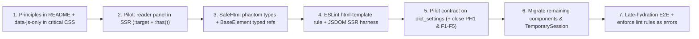

# RFC (Revision 1): A Progressive-Enhancement Framework for UI V2

> **Archived.** Kept for context only; do not treat it as current guidance or a to-do list.
> Living docs: [README](../../README.md), [FRAMEWORK_GAPS.md](../FRAMEWORK_GAPS.md) (including the deferred compile-time contracts decision).
> Commit SHAs, phase numbers, and relative links in this file refer to `lit-prototype` history and may not resolve.

- **Status:** Revision 1 (incorporating architectural review & compile-time contract design)
- **Author:** nkprasad
- **Supersedes / Revises:** [`PE_FRAMEWORK_RFC.md`](PE_FRAMEWORK_RFC.md)
- **Scope:** `src/web/ui/` (UI V2). V1 is unaffected.
- **Prototype:** [`prototypes/nojs_tabbed_drawer.html`](prototypes/nojs_tabbed_drawer.html), a standalone page with zero JavaScript.

> [!IMPORTANT] > **Status (2026-09-30): not the current plan as written.** A review on 2026-09-27 kept part of
> this RFC, changed part and deferred the rest. Read this table before building anything from it.
>
> | Decision   | Proposals                                                                                                                                                                                                                                                                                                                                 |
> | ---------- | ----------------------------------------------------------------------------------------------------------------------------------------------------------------------------------------------------------------------------------------------------------------------------------------------------------------------------------------- |
> | **Keep**   | `data-js-only` / `data-nojs-only` emitters with one global rule; the reveal protocol; hide-in-place temporary UI; the form round-trip harness; the preferences model (the server resolves, the client adopts); the late-hydration E2E test; the relocation ban (now that `swapSlots` exists); the server `html` migration, on XSS grounds |
> | **Change** | Two gates → one, keyed on the owner's upgrade. Root delegation → scoped to the host and optional, keeping `scope.listen` for non-bubbling events. Proxy lint rules (the `createElement` ban, the `<button type>` AST rule) → runtime checks of the real invariants, run against SSR output (`core/*_conformance.test.ts`)                 |
> | **Defer**  | The whole §8.1 contract layer: the Guaranteed/Possible phantom types on `SafeHtml`, type-erased `BaseElement` refs, the ESLint tag-matching rule (§9.1), and `data-on` actions until host scoping is designed                                                                                                                             |
>
> The deferred items wait for a **Phase 4** that comes after the macronizer and the corpus. Those
> features define its requirements, and the evidence log in
> [`corpus/DESIGN.md`](corpus/DESIGN.md) §9 records them. Phase 4 starts with typed ref names
> scoped to the host. It adds the Guaranteed/Possible algebra only if the SSR harness shows gaps
> in branch coverage.
>
> Why the phantom types were deferred: a prototype showed they compile a dead ref, give false
> positives with `joinHtml` / `raw` and `: SafeHtml`, and miss the re-escape trap. They also have
> no escape hatch, since `as` is banned. Separately, server-markup ↔ client-selector drift caused
> 0 of 40 fix commits between June and September; the bugs that did ship came from the
> progressive-enhancement layer. The cross-slice inventory ratchet
> ([`inventory_ratchet.json`](inventory_ratchet.json)) is a growth guard against
> drift, not a target to push down or a substitute for §8.1.
>
> Since then, cross-owner native actions have been handled by the runtime activation gate
> ("The activation gate" in [README.md](README.md)), not by a declared contract.

---

## 0. Summary of Revisions from Draft 1

1. **Moved the server/client contract from runtime to compile & lint time (`0 bytes` per component in `v2.js`):**
   - **Type-erased client refs (§8.1):** Instead of passing a runtime contract object into `ContractElement(DictSettingsContract)`, contracts are passed as a TypeScript type parameter to `BaseElement<Lane, Contract>`. SWC erases the schema completely when bundling `v2.js`.
   - **Compile-time server exhaustiveness & branch checking (§8.1):** By migrating `.server.ts` renderers to `html` (`SafeHtml`) and adding contravariant `GuaranteedRefs` and covariant `PossibleRefs` phantom type parameters to `SafeHtml`, `npx tsc --noEmit` verifies that every required (`one`) ref is emitted in **every** server code path, and forces any ref rendered inside an `if` / `? :` branch to be declared `optional` in the contract (`| null` on the client).
   - **`js-only` / `nojs-only` visibility by construction (§8.1):** `C.jsOnlyRef()` and `C.noJsRef()` emit `data-js-only` and `data-nojs-only` attributes backed by a single global rule in `critical.css`, making it impossible to forget per-component CSS hide rules (PH1, PH12).
   - **AST lint checks on `html` templates (§9.1):** A custom ESLint rule over `html` tagged templates verifies that enclosing `<tag>` names match the contract's element type and flags any `<button type="button">` (or form control outside a `<form>`) not marked `js-only`.
2. **Dropped the runtime DOM Relocator (former §8.2):**
   - The Reader Companion Panel pilot (§10.1) and in-place Temporary-UI Sessions (§8.3, §10.2) eliminate the only two subtree relocations in UI V2. Rather than building a runtime relocator engine for an anti-pattern we are removing, **P1 now bans subtree relocation outright**.
3. **Dropped DOM Morphing / idiomorph (former §8.5); addressed multi-region partials instead (§8.4):**
   - `fetchAndSwapPartial` has only 3 call sites, none suffer from lost input focus, and node-reusing morphers would preserve `dataset.enhanced` / `dataset.wordsEnhanced` markers across swaps and silently break word tokenization.
   - Replaced §8.5 with **shared `.common.ts` chrome renderers / multi-slot partials** to eliminate manual DOM scraping after page swaps (such as `patchStickyBar()` and `renderSheetTeaser()` in `reader_view.client.ts`).
4. **Updated Principle P2 for bundle-splitting compatibility (§6):**
   - Gating JS-only controls on `:not(:defined)` (or `data-js-only` scoped to component upgrade) alongside `:root.has-js` ensures that when heavy verticals (`reader/`, `external/`) are split into lazy-loaded chunks ([`CODE_HEALTH.md`](CODE_HEALTH.md)), controls inside lazy components stay hidden until their specific chunk finishes loading.
5. **Unified State Ownership (§8.5) to cover durable preferences (`dict/PREFERENCES.md`) and pre-paint layout (PH11):**
   - Extended the state model beyond URL-hash vs. component state to enforce **"the server resolves content-affecting state; the client adopts from SSR DOM"** and pre-paint critical CSS variables for layout-affecting preferences.

---

## 1. Summary

UI V2 renders HTML on the server and works without JavaScript, then upgrades itself with light-DOM custom elements. The baseline mostly works. The layer on top is where the bugs are: the [pre-hydration backlog](PRE_HYDRATION.md) (PH0–PH12), [dictionary preference defects](dict/PREFERENCES.md) (F1–F9), and much of [CODE_HEALTH.md](CODE_HEALTH.md) come from **server markup, server state, and client code drifting apart**, with nothing checking at compile time that they agree.

This RFC proposes to:

1. **Keep the architecture.** No framework migration: none of the candidates solves the actual problem (§4).
2. **Adopt five written principles** that define what "enhancement" is allowed to do (§6).
3. **Build a small, zero-bloat set of mechanisms** (§8) that make those principles cheap to follow:
   - a **compile-time** markup contract between server and client (`SafeHtml<Guaranteed, Possible>` + type-erased `BaseElement` refs + `data-js-only` by construction);
   - a reveal protocol for hidden containers (tabs, drawers, `<details>`);
   - temporary-UI sessions that hide content in place rather than moving it;
   - shared `.common.ts` renderers to replace ad-hoc DOM scraping on partial swaps;
   - a unified state ownership rule covering URL, cookies, `localStorage`, and component state.
4. **Enforce the principles** at compile/lint time (`tsc` + `eslint`), backed by a JSDOM behavioral harness and a late-hydration E2E test (§9).
5. **Pilot on the reader companion panel** (§10.1). Pure CSS (`:target` + `:has()`) replaces a 761-line JS-built tab UI and eliminates the largest DOM relocation in V2.

---

## 2. Background: where the bugs come from

### 2.1 Four definitions of "is JS on?"

V2 currently decides what to show without JS in four different ways, and during the pre-hydration window they disagree (see [PRE_HYDRATION.md §2](PRE_HYDRATION.md)):

| Mechanism                  | Pre-hydration (JS enabled, `v2.js` not yet run) | If component chunk is lazy-loaded |
| -------------------------- | ----------------------------------------------- | --------------------------------- |
| `<noscript>`               | JS = on                                         | JS = on                           |
| `@media (scripting: none)` | JS = on                                         | JS = on                           |
| `:root:not(.has-js)`       | JS = off                                        | **JS = on** (once shell runs)     |
| `:not(:defined)`           | JS = off                                        | **JS = off** (until chunk runs)   |

This mismatch causes PH1, PH5, PH7, and PH12—and will worsen when `v2.js` is split into per-route or lazy chunks ([`CODE_HEALTH.md`](CODE_HEALTH.md)).

### 2.2 The DOM is an untyped API, and server templates are unbranded strings

- Client code finds elements through raw string selectors (`scope.require(".foo")`, `querySelectorAll`). Nothing at compile time checks that the server rendered `.foo`, whether `.foo` is conditional (`| null`), or what `HTMLElement` subtype it has.
- Meanwhile, `*.server.ts` files build HTML with raw template strings and manual `${he.escape(...)}` calls, whereas `*.common.ts` and `*.client.ts` use the auto-escaping `html` tagged template (`SafeHtml`). Moving a template to `.common.ts` requires rewriting it, and forgetting a single `he.escape()` on the server compiles cleanly.

### 2.3 JS builds structure, moves content, and scrapes partial responses

Several components create structure imperatively or move server-rendered content:

- [`reader_panel.client.ts`](reader/reader_panel.client.ts) (761 lines, ~13.7 kB minified) builds the companion tab bar and its panels with `createElement`, then detaches `.reader-notes`, `#reader-work-about`, and `#dict-frame` and moves them into the tabs. Hash links break (PH6), and `onDisconnect()` takes 60 lines just to put nodes back.
- [`section_edit.client.ts`](core/widgets/section_edit.client.ts) moves a section's content nodes into a hidden `<span>` while the correction editor is open.
- [`reader_view.client.ts`](reader/reader_view.client.ts) (`patchStickyBar`, `renderSheetTeaser`) scrapes `.reader-continuation-card` links out of the swapped text card footer to manually patch `#pager-prev`, `#pager-next`, and the mobile drawer bar—duplicating server rendering logic in imperative DOM mutations.

### 2.4 Hydration and preference resolution clobber SSR state

- `onConnect()` often writes state (checkbox values, `<details>` open state, focus, scroll position) without first reading what the user already did before JS arrived (PH1–PH4, PH9, PH10).
- Dictionary and inflection preferences are resolved twice in different orders (Server: `URL → Cookie → Default`; Client: `URL → localStorage → Default`, see [`dict/PREFERENCES.md`](dict/PREFERENCES.md) F1–F9), so the client can overwrite the server's authoritative render on connect.

---

## 3. Goals and non-goals

**Goals**

- A zero-JS baseline where every primary flow works.
- An enhancement layer where **structural agreement between server and client is verified at compile/lint time (`tsc` + `eslint`)** with **zero client bundle overhead**.
- Pre-hydration correctness by construction, compatible with future bundle splitting.
- Incremental adoption, one component at a time, with no big-bang rewrite.

**Non-goals**

- Adopting an external framework (§4).
- TSX or a custom compiler plugin. Standard TypeScript 5.8 phantom types on `SafeHtml` + a lightweight ESLint AST rule give compile-time checking without changing the build pipeline.
- Shadow DOM.
- A runtime DOM relocator or DOM morphing library (eliminated by P1 and §8.4).

---

## 4. Alternatives considered

_(Unchanged from Draft 1; see [`PE_FRAMEWORK_RFC.md §4`](PE_FRAMEWORK_RFC.md#4-alternatives-considered) for the evaluation of htmx, Turbo, Stimulus, Lit, SvelteKit/Remix, Marko, and Qwik.)_

**Update on borrowings:** We borrow Stimulus/Catalyst's declarative `data-on` action delegation idea and jsaction's analysis of the pre-hydration window. We **do not** adopt idiomorph: `fetchAndSwapPartial` has only 3 call sites, none lose input focus, and reusing DOM nodes across swaps would preserve `dataset.enhanced` / `dataset.wordsEnhanced` attributes and silently break word tokenization.

---

## 5. Philosophy: One Tree, Checked at Compile Time

The No-JS HTML is the only thing every user receives. In Revision 1, we make that HTML a **compile-time typed contract**:

1. **One Tree:** The server renders elements in their final DOM position. Client JS changes presentation state, attributes, and behavior; it does not rebuild persistent chrome with `createElement` or move content subtrees around.
2. **Declared & Compile-Time Checked:** Every element the client reads or binds is declared in a shared contract. `tsc` verifies that the server emitted it (and whether it is guaranteed or conditional), and `eslint` verifies that the HTML tag and JS-only visibility match.
3. **Address- & State-Preserving:** Anything linkable or focusable in No-JS points to the same element in JS. Hydration adopts live DOM state (inputs, `<details>`, hash, scroll, and server-resolved preferences) rather than overwriting it.

---

## 6. Principles

| #      | Principle                                                                                                                                                                                                                                  | What it rules out                                                           |
| ------ | ------------------------------------------------------------------------------------------------------------------------------------------------------------------------------------------------------------------------------------------ | --------------------------------------------------------------------------- |
| **P1** | **One DOM tree.** The server renders persistent structure in its final DOM location. Client code never moves server-rendered content subtrees or builds persistent containers with `createElement`.                                        | `reader_panel` node relocation; `section_edit` node stashing                |
| **P2** | **Upgrade-gated visibility.** Pre-hydration looks and behaves identically to No-JS. JS-only controls use `data-js-only` (and No-JS fallbacks use `data-nojs-only`), gated on `:root.has-js` (or `<tag>:defined` for lazy-loaded elements). | `<noscript>`, `@media (scripting)`, unmarked `<button type="button">`       |
| **P3** | **Server markup is a compile-time typed API.** Server renderers return `SafeHtml`, and client components reach the DOM only through contract-typed refs (`this.ref`, `this.optionalRef`, `this.refAll`) and delegated actions.             | Raw string selectors in component `*.client.ts`; unescaped server templates |
| **P4** | **Server resolves; hydration adopts, never clobbers.** The server is the single resolver for content-affecting preferences. `onConnect()` reads live DOM state (inputs, `<details>`, `:target` hash, scroll) before writing anything.      | PH1–PH4, PH9, PH10, and [`dict/PREFERENCES.md`](dict/PREFERENCES.md) F1–F5  |
| **P5** | **Every feature starts as a form, link, `<details>`, or anchor target.** Features that are JS-only by nature must be marked `mode: "js-only"` (hidden by construction before upgrade) or launched from a working No-JS control.            | Dead controls when JS is off or still loading                               |

---

## 7. Kinds of enhancement

| Level                   | What JS does                                                                                         | Status under this RFC                     |
| ----------------------- | ---------------------------------------------------------------------------------------------------- | ----------------------------------------- |
| 1. Behavior             | Delegated listeners, intercepting forms, fetching partials into an existing slot                     | ✅ Freely allowed                         |
| 2. Presentation state   | Classes, `hidden`, `data-active`, `open`, ARIA attributes, CSS variables                             | ✅ Freely allowed                         |
| 3. Temporary UI         | Menus, in-place editors, toasts: created on demand, hides page content in place, removed when closed | ⚠️ Only through §8.3 (`TemporarySession`) |
| 4. Subtree relocation   | Moving server-rendered content nodes between containers in JS                                        | ❌ **Banned** (use CSS + SSR placement)   |
| 5. Imperative structure | Building persistent chrome or containers with `createElement`                                        | ❌ **Banned** (small allowlist below)     |

**Allowlist for `createElement`:** the autocomplete suggestion list, toasts, `.lat-word` spans in `tokenize.client.ts`, the `100svh` measurement probe in `drawer.client.ts`, and `createHtmlFragment` in `partial.client.ts`.

---

## 8. Mechanisms

### 8.1 Compile-Time Contract Layer (`0 bytes` per component in `v2.js`)

Each component declares a contract in `*.common.ts` (or `*.contract.common.ts`). Both the server renderer and the client element use it:

```ts
// dict_settings.contract.common.ts
export const DictSettingsContract = defineContract({
  tag: "morcus-dict-settings",
  refs: {
    details: one("details"),
    summary: one("summary"),
    popover: one("div"),
    inflected: one("input"),
    dictBoxes: many("input"),
    widthSelect: optional("select"),
    sliderSection: one("div", { mode: "js-only" }),
    applyActions: one("div", { mode: "nojs-only" }),
  },
  actions: {
    toggleDict: "change",
    toggleInflected: "change",
    changeWidth: "change",
  },
});
```

#### A. Server Side: Phantom-Branded `SafeHtml<Guaranteed, Possible>`

We unify `.server.ts` templates onto `html` (`SafeHtml` in [`core/dom/html.common.ts`](core/dom/html.common.ts)), eliminating raw string concatenation and manual `he.escape()` calls. `SafeHtml` is extended with two phantom type parameters that vanish at runtime:

```ts
declare const GUARANTEED_REFS: unique symbol;
declare const POSSIBLE_REFS: unique symbol;

export type SafeHtml<
  Guaranteed extends string = never,
  Possible extends string = Guaranteed
> = string & {
  readonly [SAFE_HTML]: true;
  // Contravariant position: a union of branches (A | B) automatically intersects Guaranteed!
  readonly [GUARANTEED_REFS]?: (refs: Guaranteed) => void;
  // Covariant position: a union of branches (A | B) automatically unions Possible!
  readonly [POSSIBLE_REFS]?: Possible;
};
```

The server helper `const C = serverContract(DictSettingsContract)` provides attribute emitters that brand their return type with the ref name and expected HTML tag:

- `C.ref("inflected")` → emits `data-ref="inflected"` (only accepts `mode: "both"` refs).
- `C.jsOnlyRef("sliderSection")` → emits `data-ref="sliderSection" data-js-only` (only accepts `mode: "js-only"` refs).
- `C.noJsRef("applyActions")` → emits `data-ref="applyActions" data-nojs-only` (only accepts `mode: "nojs-only"` refs).
- `C.on("toggleDict")` → emits `data-on="change:toggleDict"`.

Because `html` unions `Guaranteed` across sequential interpolations (`${a}...${b}`) and **intersects** `Guaranteed` across conditional unions (` cond ? a : html``  `), declaring the server renderer's return type as `RenderedContract<typeof DictSettingsContract>` gives **four compile-time checks in `tsc --noEmit`**:

1. **Missing required ref:** Forgetting `C.ref("inflected")` in the server renderer fails `tsc` (`Property '"inflected"' is missing in Guaranteed`).
2. **Accidental conditional ref:** Putting `C.ref("widthSelect")` inside ` options.includePageWidth ? ... : html``  ` makes its type `SafeHtml<"widthSelect"> | SafeHtml<never>`, whose contravariant `Guaranteed` intersection is `never`. If `widthSelect` was declared `one("select")`, `tsc` rejects it immediately—forcing you to declare `widthSelect: optional("select")` in the contract, which in turn forces the client to handle `HTMLSelectElement | null`!
3. **Dead contract ref:** Declaring `widthSelect: optional("select")` in the contract without emitting it in _any_ branch on the server fails `tsc` because `"widthSelect"` is missing from `Possible`.
4. **Mode-safe visibility by construction:** You cannot pass a `mode: "js-only"` ref to `C.ref()`; `tsc` requires `C.jsOnlyRef()`, which always emits `data-js-only`. Paired with one rule in [`critical.css`](critical.css):
   ```css
   :root:not(.has-js) [data-js-only],
   :root.has-js [data-nojs-only] {
     display: none !important;
   }
   ```
   every `js-only` and `nojs-only` element is hidden in the right mode before first paint with **zero per-component CSS rules**.

#### B. Client Side: Type-Erased Lookups on `BaseElement`

On the client, the contract is passed only as a **TypeScript type parameter** to [`BaseElement`](core/dom/base_element.client.ts):

```ts
export class MorcusDictSettings extends BaseElement<
  never,
  typeof DictSettingsContract
> {
  protected readonly actions: ActionsFor<typeof DictSettingsContract> = {
    toggleDict: (_e, target) => {
      /* target is HTMLInputElement */
    },
    toggleInflected: (_e, target) => {
      /* ... */
    },
    changeWidth: (_e, target) => {
      /* ... */
    },
  };

  protected override onConnect() {
    const details = this.ref("details"); // HTMLDetailsElement (non-null)
    const width = this.optionalRef("widthSelect"); // HTMLSelectElement | null
    const boxes = this.refAll("dictBoxes"); // HTMLInputElement[]
    // ...
  }
}
```

- **Zero per-component bundle cost:** `this.ref(name)`, `this.optionalRef(name)`, and `this.refAll(name)` are three 1-line methods on `BaseElement` that query `[data-ref="${name}"]`. SWC strips `typeof DictSettingsContract` completely during compilation.
- **Automatic action delegation:** `BaseElement.connectedCallback()` attaches delegated listeners for `[data-on]` on the component root, dispatching to `this.actions[actionName]`. Actions survive partial swaps inside the component with nothing to re-attach.

---

### 8.2 Reveal Protocol

Containers that hide content (tabs, drawers, `<details>`, collapsible dictionary cards) implement a standard `reveal(target: HTMLElement)` interface (registered on the element or controller). Anything that targets an element inside one routes through [`anchor_scroll.client.ts`](core/nav/anchor_scroll.client.ts):

- the initial `window.location.hash` on connect, and later `hashchange` / in-page anchor clicks;
- programmatic focus;
- find-in-page, via `hidden="until-found"` / `beforematch` where supported.

This generalizes `expandAncestorDisclosures()` in [`anchor_scroll.client.ts`](core/nav/anchor_scroll.client.ts#L18-L32) so that `<details>`, companion panel tabs, and mobile drawers all open automatically when a descendant is targeted.

---

### 8.3 Temporary-UI Sessions

Replaces ad-hoc module globals such as `activeEditor` / `menuEl` in [`section_edit.client.ts`](core/widgets/section_edit.client.ts).

- **One session at a time,** managed by a small helper in `core/` tied to a `LifetimeScope`. Provides the dirty-state guard, focus restoration to the trigger on close, and Escape / outside-click dismissal via `bindDismissable`.
- **Temporary UI never moves page content.** Instead of moving section nodes into a hidden `<span>` stash, it hides them in place (`hidden` + `inert`) and mounts the editor in a sibling slot or top-layer popover.
- **Launched from a real No-JS control.** For the correction flow, that is the section/sense permalink anchor (`a.section-anchor`).

---

### 8.4 Multi-Region Updates & Shared `.common.ts` Chrome Renderers

To keep `fetchAndSwapPartial` fast and safe for tokenized text (`replaceChildren` + `notifyContentSwap`), we do **not** use DOM morphing. Instead, to eliminate manual DOM scraping like `patchStickyBar()` and `renderSheetTeaser()` in [`reader_view.client.ts`](reader/reader_view.client.ts):

- When both the server and client must render the same piece of chrome (such as the reader mobile sheet teaser label, or the dictionary search bar language/inflection chips in [`search_bar.common.ts`](dict/search/search_bar.common.ts)), that renderer lives in `*.common.ts` and returns `SafeHtml`.
- When a partial navigation updates multiple regions (e.g. reader page turn updating both `.reader-sticky-bar` and `.reader-text-card`), either the partial endpoint returns the enclosing `.reader-main-column` or uses shared `.common.ts` renderers rather than scraping `href`s out of footer links.

---

### 8.5 Unified State Ownership: URL, Cookie, `localStorage`, and Component

1. **Content-affecting durable preferences** (which dictionaries are queried, inflection mode) live in **Cookies** (with URL query params as ephemeral per-request overrides). **The server resolves them once; the client adopts the initial state directly from the SSR DOM** rather than re-deriving it from `localStorage` (see [`dict/PREFERENCES.md §3`](dict/PREFERENCES.md#3-proposed-model)).
2. **Layout-affecting presentation preferences** (theme, page width presets, reader font scale/family/line-height/gutter, desktop splitter width) live in **`localStorage`** and are applied to `:root` CSS variables before first paint in [`critical_theme.client.ts`](shell/critical_theme.client.ts) (within its 1 KB budget) so hydration causes zero layout shift (closing PH11).
3. **Navigational vs. temporary UI state (URL hash handover):**
   - Without JS (and during pre-hydration), the URL `:target` hash drives tab and drawer visibility via CSS.
   - Once the component upgrades, it reads the current `:target` on connect to adopt the initial tab/drawer state (P4), then sets `data-active` on the container so component state takes over without polluting browser history on every tab click:

```css
/* Pre-hydration and No-JS: the hash decides */
.reader-dict-panel:not([data-active])
  .reader-panel-view:is(:target, :has(:target)) {
  display: block;
}
/* Once JS sets data-active, it decides */
.reader-dict-panel[data-active="notes"] #panel-view-notes {
  display: block;
}
```

---

## 9. Enforcement

### 9.1 Compile & Lint Rules (`tsc` + `eslint`)

Every structural invariant is checked statically before any test runs:

| Invariant                                                                            | Enforced by                                                    | Runtime Cost |
| :----------------------------------------------------------------------------------- | :------------------------------------------------------------- | :----------: |
| Ref & action names match between server & client                                     | `tsc` (`Contract` type parameter)                              |     0 B      |
| Server renders all required (`one`) refs in **all** branches                         | `tsc` (contravariant `GuaranteedRefs` on `SafeHtml`)           |     0 B      |
| Conditional (`if` / `? :`) server refs must be `optional` (`\| null` on client)      | `tsc` (`GuaranteedRefs` vs `PossibleRefs`)                     |     0 B      |
| Dead ref in contract never emitted by server                                         | `tsc` (covariant `PossibleRefs` on `SafeHtml`)                 |     0 B      |
| Client DOM types (`HTMLInputElement`, etc.) match contract                           | `tsc` (`HTMLElementTagNameMap`)                                |     0 B      |
| `mode: "js-only"` / `"nojs-only"` hidden in the right mode                           | `tsc` (`C.jsOnlyRef` / `C.noJsRef`) + 1 rule in `critical.css` |  ~60 B CSS   |
| Enclosing HTML `<tag>` in `html` template matches contract tag                       | `eslint` AST rule on `TaggedTemplateExpression`                |     0 B      |
| No unmarked `<button type="button">` (dead No-JS control) in SSR                     | `eslint` AST rule on `TaggedTemplateExpression`                |     0 B      |
| Ban `<noscript>` and `@media (scripting)` in V2                                      | `eslint` / `stylelint`                                         |     0 B      |
| Ban raw selector queries & un-allowlisted `createElement` in component `*.client.ts` | `eslint`                                                       |     0 B      |

### 9.2 JSDOM Behavioral Conformance Harness

Extends [`reattach_conformance.test.ts`](core/conformance/reattach_conformance.test.ts), replacing hand-written fake HTML strings with **real `.server.ts` renderer output** across each component's mode matrix:

1. **Real SSR Fixtures + Form Round-Trip:** Renders the component via its `.server.ts` function; for form components, mutates controls, serializes with `new FormData(form)`, and verifies the Express route handler response.
2. **Pre-hydration adoption:** Mutates inputs, checkboxes, `<details>`, `location.hash`, and `scrollY` _before_ custom element upgrade; asserts that upgrading preserves every user change.
3. **Lifecycle & Reattachment:** Disconnects and reconnects the element, verifying all listeners are torn down and re-registered with zero leaks.
4. **Temporary UI:** Opens and closes any temporary session, asserting the DOM tree is restored, focus returns to the trigger, and the scope is disposed.

### 9.3 Late-Hydration E2E

A Playwright test that **holds back `v2.js`** via route interception:

1. Interacts with the page during the pre-hydration window: typing into search inputs, toggling settings checkboxes, clicking `#note-1` / `#reader-work-about` / `#reader-toc-drawer` hash links, and scrolling.
2. Releases `v2.js` and waits for upgrade.
3. Asserts that user input, open panels/drawers, active notes, and scroll position were adopted rather than reset.

---

## 10. Case Studies

### 10.1 Reader companion panel (proposed pilot)

**Today:** [`reader.server.ts`](reader/reader.server.ts) renders `aside#reader-dict` containing only the dictionary iframe, with `.reader-notes` and `details#reader-work-about` at the bottom of `.reader-text-card`. [`reader_panel.client.ts`](reader/reader_panel.client.ts) (761 lines) builds the tab bar and panels with `createElement` and moves the content into them.

**Proposal:** [`reader.server.ts`](reader/reader.server.ts) renders the tab bar and all four panels (`#panel-view-dict`, `#panel-view-notes`, `#panel-view-translation`, `#panel-view-about`) directly inside `aside#reader-dict`. Tabs work without JS (and during pre-hydration) through `:target` + `:has()` (see [`prototypes/nojs_tabbed_drawer.html`](prototypes/nojs_tabbed_drawer.html)):

```css
.reader-panel-view {
  display: none;
}
.reader-dict-panel:not([data-active])
  .reader-panel-view:is(:target, :has(:target)) {
  display: block;
}
.reader-dict-panel:not([data-active]):not(
    :has(.reader-panel-view:target, .reader-panel-view :target)
  )
  #panel-view-dict {
  display: block;
}
/* Mobile: the drawer opens when anything inside it is targeted */
.reader-dict-panel:not([data-active]):is(:target, :has(:target)) {
  /* expanded */
}
```

**What this gets us:**

- The biggest DOM relocation in V2 is deleted outright, satisfying P1 without needing a runtime relocator.
- PH6 and PH7 are closed by construction.
- [`reader_panel.client.ts`](reader/reader_panel.client.ts) shrinks from 761 lines of DOM construction/teardown to ~200 lines of tab state (`data-active`), keyboard roving tabindex, and on-demand translation fetching.
- Better No-JS UX: footnotes sit beside the text like sidenotes rather than forcing a full-page scroll to the bottom and back.

### 10.2 "Suggest correction" (temporary UI)

- Clicking `a.section-anchor` opens the action menu and editor as a **Temporary-UI Session** (§8.3).
- Section content is hidden in place (`hidden` + `inert`), never moved into a detached `<span>`.
- Because `a.section-anchor` is a real permalink in No-JS mode, P5 is satisfied without extra controls.

---

## 11. Rollout



- **Step 2** validates the One-Tree CSS `:target` + `:has()` architecture on the hardest component (`reader_panel`) and immediately cuts ~500 lines of imperative DOM code.
- **Steps 3–5** build the zero-bundle-cost compile-time contract (`SafeHtml<Guaranteed, Possible>` + `BaseElement` ref helpers + ESLint template rule) and pilot it on [`dict_settings.client.ts`](dict/settings/dict_settings.client.ts) alongside the server-authoritative preference fix ([`dict/PREFERENCES.md`](dict/PREFERENCES.md)).
- **Steps 6–7** migrate the remaining components, convert [`reattach_conformance.test.ts`](core/conformance/reattach_conformance.test.ts) to use real `.server.ts` fixtures, and add the late-hydration Playwright test.
