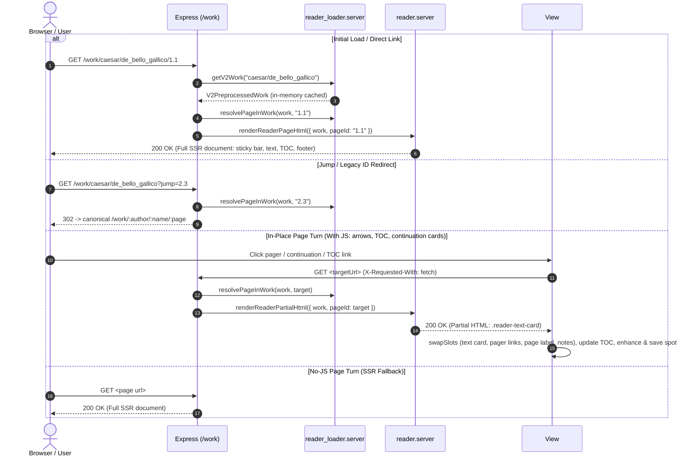

# Reader Topic (`src/web/ui/reader/`)

## Overview

This directory encapsulates all server-side rendering and client-side web components for the library reader: work/page loading, the citation-addressed text view, the sticky navigation bar, the table-of-contents drawer, reading preferences, the parallel translation view, and the embedded dictionary panel.

Companion doc: [`TODOS.md`](TODOS.md) records open work, including remaining V1 → V2 gaps and architectural and performance improvements.

---

## Reader Surface Model & Chrome Architecture

The reader interface is organized along an explicit architectural division:

> **Top bar: things that change what you are seeing (reading chrome).**  
> **Panel: things that help you understand the text (companion surfaces).**

```
CHROME (fixed, single primary row)   PANEL (scalable, tabbed companion)
├─ Navigate   §  TOC drawer          ├─ Dictionary       (default lookup)
└─ Display    Aa typography popover  ├─ Notes            (critical apparatus)
                                     ├─ Translation      (on-demand parallel text)
                                     └─ About this text  (scholarly provenance)
```

### Core Surface Rules

1. **Fixed Top Bar, Scalable Companion Panel**:
   - The top sticky bar is deliberately compact and fixed to preserve vertical reading canvas. It contains only direct passage controls: TOC drawer trigger (`#reader-toc-btn`), pager arrows (`#pager-prev`, `#pager-next`), and the anchored typography popover (`#reader-settings-btn`).
   - The companion panel is the scalable extension point: auxiliary content lives in dedicated tabs (`Dictionary`, `Notes`, `Translation`, `About`) inside the desktop split-pane (`ReaderLayoutController`) or mobile draggable bottom sheet (`DrawerController`).
2. **Single Anchored Typography Popover**:
   - All display preferences (text size, font family, line spacing, section gutter numbers, macra, and dictionary text scale) live together in `#reader-settings-popover` (`<morcus-reader-settings>`).
   - Preferences are never split across multiple surfaces; the reading canvas remains undimmed and unblurred during adjustments with live preview.
3. **Decision Procedure for New Controls**:
   - _Mutates the primary text rendering?_ $\rightarrow$ Top bar chrome.
   - _Content you consult while reading?_ $\rightarrow$ Companion panel tab.
   - _Static metadata about the work?_ $\rightarrow$ Companion panel's `About` tab (`#reader-work-about`), which works without JavaScript via `:target`.

---

## Data Flow & Request Lifecycle



> [!NOTE]
> When JavaScript is active, page turns (pager arrows, continuation cards, TOC links) and browser history (popstate) perform fast in-place partial swaps (`X-Requested-With: fetch`), replacing only the regions in `READER_PAGE_SLOTS` (the text card, the sticky bar's pager links and page label, and the notes inside the companion panel) with one `swapSlots` call, then updating the TOC and saving reading progress without full-page reloads. The dictionary iframe sits outside every slot and never reloads. Native `<a>` links ensure a robust zero-JS fallback.

---

## Component Roles

### Server

- `reader_routes.server.ts`: Registers `/work/:author/:name/:page?`, `/work/:author/:name/:page/translation`, and the legacy `/work/:workId` entry point, handles jump/legacy redirects to canonical URLs, and serves full pages or partials depending on `isPartialRequest`.
- `reader_loader.server.ts`: Reads preprocessed works and pages from `build/library_processed/library.db`, caching work headers, slug→id mappings, and library summaries in memory while lazily reading page HTML on demand. Also resolves a citation string to a concrete page.
- `reader.server.ts`: Renders the page shell — primary sticky navigation bar (TOC drawer launcher, pager controls, and anchored `Aa` typography launcher), passage text with citation gutters, the companion panel, and the passage footer with continuation cards.
- `reader_toc.server.ts`: Renders the table of contents, including its `:target`-addressable No-JS fallback.
- `reader_dialogs.server.ts`: Renders the scholarly `About` section (`#reader-work-about`) and the anchored reader settings typography popover.
- `reader_types.server.ts`: Citation hierarchy types and helpers (`CitationId`, `citationToString`, `parseCitationString`, `getDifferentialCitationLabel`) supporting works of arbitrary citation depth.

### Client

- `reader_view.client.ts`: The main controller — partial navigation, section anchors, word lookup into the dictionary panel, dialog wiring, and keyboard shortcuts.
- `reader_toc.client.ts`: `ReaderTocController` — opens/closes the TOC drawer and applies the live filter.
- `reader_settings.client.ts`: `MorcusReaderSettings` — the anchored typography popover, persisting to `morcus_reader_settings` in `localStorage`.
- `reader_layout.client.ts`: `ReaderLayoutController` — the desktop resizable splitter and the mobile bottom drawer hosting the embedded dictionary.
- `reader_panel.client.ts`: `ReaderPanelController` — adds behaviour to the server-rendered companion panel (`Dictionary`, `Notes`, `Translation`, `About`): tab roles and arbitration, hash reveals, the `notes` page-turn slot, and lazy translation loading.
- `reader_page_nav.client.ts`: `ReaderPageNavController` — swipe page turns on touch devices (V1's side-tap is deliberately not ported; see [below](#deliberately-not-ported-from-v1)). Owns gesture policy and the passage slide only; the turn itself goes through the view's `turnPage` (shared with `[` / `]`), so history, TOC, and notes handling stay in one swap path.

### Styles

`reader_text.css` (passage body, citation gutters, and the TEI rendition classes), `reader_notes.css` (critical apparatus markers and footnotes), `reader_nav.css` (sticky bar), `reader_toc.css`, `reader_dialogs.css`, `reader_layout.css`, `reader_splitter.css`, `reader_dict.css`, `reader_panel.css`, `reader_page_nav.css` (swipe slide, Touch Navigation settings visibility, suppressing the browser's history swipe while swipe turns are on, and the delayed spinner for slow page turns).

---

## Upstream Data Pipeline

The reader does **not** parse TEI at request time. Works are preprocessed offline:

1. [`process_work.ts`](../../../common/library/process_work.ts) parses the TEI source and hoists critical apparatus note bodies into a `notes` array, leaving positional markers in the tree.
2. [`work_preprocessor.ts`](../../../common/library/preprocess/work_preprocessor.ts) flattens the work into `V2PreprocessedWork` — pages of sections with pre-rendered HTML strings, plus metadata (author, editor, translation availability, `hasMacra`, license). It also resolves each note marker against that `notes` array, emitting a footnote link in the text and collecting the bodies the page referenced into `notesHtml`.
3. Output lands in `build/library_processed/library.db` (`works` and `pages` SQLite tables) and is read by `reader_loader.server.ts`.

> [!IMPORTANT]
> Rendition semantics (verse lines, indentation, blockquotes, emphasis) are decided in step 2 and expressed as CSS classes on the emitted HTML. Fixing how text _looks_ therefore usually means editing `work_preprocessor.ts`, `reader_text.css`, or both.

---

## Deliberately Not Ported from V1

These V1 features were reviewed and intentionally left out of V2. Revisit only with a new justification.

- **Side-tap page navigation** (V1 `handleSideTap` in `base_reader.tsx`, `RD_MB_NAV_SIDE_TAP`, off by default): tapping the outer 7.5% of the screen turned the page. Tap-to-turn is already covered by the sticky-bar pager arrows (which also serve screen readers and No-JS, and show first/last-page state) and the footer continuation cards, while swipe covers gesture turning. Cutting it saves ~0.5 kB raw / ~0.23 kB gzipped of JS against the bundle budget, plus a setting and the tap-vs-word/anchor/note-marker precedence rules. V1's stored `RD_MB_NAV_SIDE_TAP` value is ignored.
- **Right-edge swipe to summon mobile nav drawer** (V1 `registerDrawerSwipe` in `navigation_bar.tsx`, `commit 3e180c37`): swiping left anywhere on the screen opened the right-hand slide-over app drawer when no gesture-consuming handler intercepted it. In the V2 Reader, horizontal swipes are dedicated to page turns (`Swipe Left` = Next Page, the highest-frequency gesture), and OS system back gestures already claim the outer 20–30px screen edges on iOS and Android. Instead of overloading horizontal swipes or partitioning vertical screen zones, V2 combines the work title and section indicator into a single wide center pill (`#reader-toc-btn`) in `.reader-sticky-bar`, places a `Return to Library Catalog` footer link inside `#reader-toc-drawer`, and relies on `.back-to-top` to unhide the top navbar on scroll.

---

## Testing

Unit tests live alongside the sources (`reader.test.ts`, `reader_view.test.ts`, `reader_toc.test.ts`, `reader_settings.test.ts`, `reader_layout.test.ts`) and run with `./morcus.sh test` (see [`../docs/TESTING.md`](../docs/TESTING.md) §3). Functional and visual browser coverage is described in [`../docs/TESTING.md`](../docs/TESTING.md).
