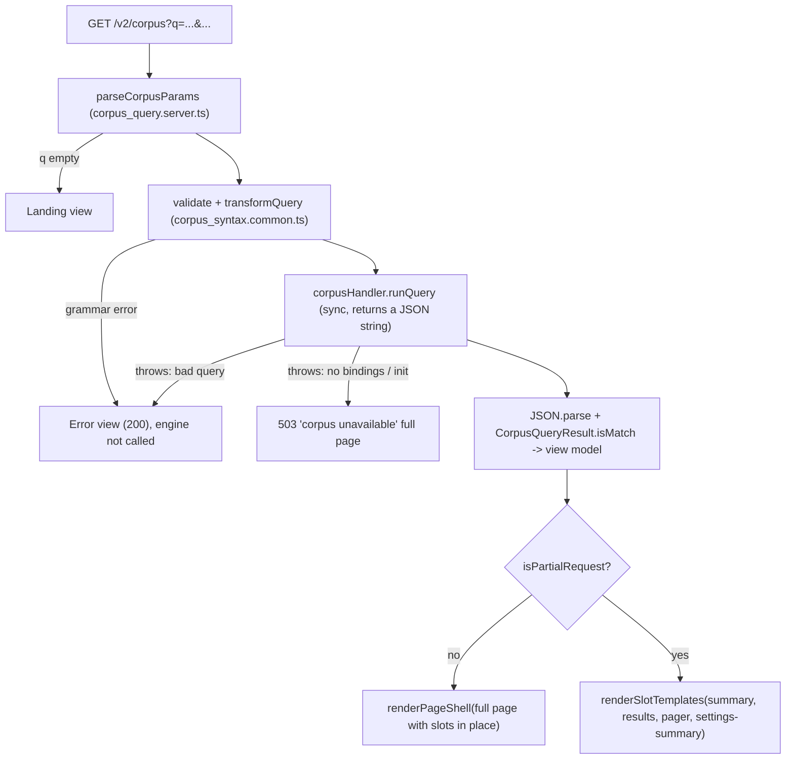

# Corpus V2: Design

**Status:** Signed off (rev 2, 2026-09-28): all decisions settled; implementation in progress. Supersedes rev 1 (the "Proposed / Under Review" draft).
**Surface:** `/v2/corpus`, all code in `src/web/v2/corpus/`
**Inputs merged:** rev 1 of this doc; PE RFC review §7 Phase 3 and Appendix A (`swapSlots`); [`TODO.md`](TODO.md); V1 `src/web/client/pages/corpus/`; the V2 conventions in [`../README.md`](../README.md).

---

## 1. Goals and non-goals

**Goals**

1. **Forms first.** `/v2/corpus` is a plain `GET` form. Query (including any `#Author` filter), settings and page cursor all live in the URL. With JS off, the user can search, change settings, page, and follow result links into the reader.
2. **Enhance with `swapSlots`.** With JS on, submits and pager clicks fetch one slot response and replace only the regions that change (`summary`, `results`, `pager`, `settings-summary`). The form, the input and its focus are never touched.
3. **Instant, client-side autocomplete** as a later, self-contained enhancement (grammar and author list local; lemmata fetched in 1-letter shards).
4. **Direct reader links.** Each result links to `/v2/reader/<author>/<work>?matchText=…`, which highlights the match.
5. **Keep it one slice.** Nothing outside `corpus/` except the router mount, the element manifest, `v2.css`, the app bar link, and (maybe) one small `core/` extension listed in §9.
6. **V1 parity first.** Features V1 doesn't have (Previous page, multiple authors, …) go to [`TODO.md`](TODO.md), not into this design.

**Non-goals (this milestone)**

- No work-level filter. The Rust engine only filters by author (`[A, B] query`). A work filter needs engine work first.
- No lazy chunk infrastructure. That's tracked in [CODE_HEALTH.md](../CODE_HEALTH.md) "Bundle splitting strategy". This design only keeps autocomplete splittable (see D6).
- No changes to V1 or its `/api/corpus/*` RPCs.

---

## 2. What changed from rev 1

| Area            | Rev 1                                              | Rev 2                                                                                          | Why                                                                            |
| :-------------- | :------------------------------------------------- | :--------------------------------------------------------------------------------------------- | :----------------------------------------------------------------------------- |
| URL params      | `cp`, `ps`, `cl`, `sm`, `np`                       | `q`, `pageSize`, `contextLen`, `strictMode`, `cursor`                                          | README convention 1 names these; V2 keeps no backwards compatibility.          |
| Pagination      | `cp` + `np` page tokens                            | One `cursor` param. Next link, browser Back (V1 parity).                                       | A GET link needs only the cursor it goes to. See D2.                           |
| Partial updates | `fetchAndSwapPartial` into one container           | `swapSlots` over 4 named slots, with a slot parity test                                        | RFC Phase 3; `swapSlots` now exists in `core/partial.client.ts`.               |
| Element split   | One `<morcus-corpus-search>`                       | `<morcus-corpus-view>` (form + swaps) and a later `<morcus-corpus-suggestions>` (autocomplete) | Swaps ship without autocomplete; autocomplete stays splittable.                |
| Author filter   | `#Author` in query only; authors in `data-authors` | Unchanged (V1 parity). Server-side validation via the shared grammar.                          | Extensions tracked in `TODO.md`. See D3.                                       |
| Disclaimer      | Inline `<details>`                                 | Same, but rendered inside the `results` slot, only when the query has `@` filters              | RFC said "uses `dialog/`". Recommend inline instead; see D4.                   |
| JS gating       | Not covered                                        | `data-js-only` / `data-nojs-only`, adopt-before-write                                          | Phase 1 gate.                                                                  |
| Engine wiring   | Not covered                                        | `createV2Router(fusedDict, { corpus })` gets the existing handler                              | The Rust engine is a large in-memory singleton; build it once.                 |
| Indexer bugs    | Not covered                                        | Phase 0 decision (fix `extractRowText` first, or ship knowing highlights drift)                | RFC: settle `TODO.md` first.                                                   |
| Bundle          | 129.9 kB, 135 kB ceiling                           | 127.7 kB raw / 37.6 kB gzip today, 142 / 41 ceiling                                            | Re-measured 2026-09-28. Autocomplete probably breaks the gzip ceiling; see D6. |

---

## 3. URL contract

| Param        | Form control                                          | Default    | Range / format                              | Notes                                                                                                                                             |
| :----------- | :---------------------------------------------------- | :--------- | :------------------------------------------ | :------------------------------------------------------------------------------------------------------------------------------------------------ |
| `q`          | `<input name="q">`                                    | `""`       | ≤ 100 chars after transform (engine limit)  | Empty → landing view, engine not called. May start with one `#Author` (V1 syntax); an unknown author is a grammar error, as in V1's autocomplete. |
| `pageSize`   | `<input type="number" name="pageSize">`               | 50         | clamp 10–100                                |                                                                                                                                                   |
| `contextLen` | `<input type="number" name="contextLen">`             | 20         | clamp 1–100                                 | V1's UI default is 20; the engine's is 25. Keep 20.                                                                                               |
| `strictMode` | `<input type="checkbox" name="strictMode" value="1">` | off        | `1` or absent                               | Absent when unchecked, the native checkbox behaviour.                                                                                             |
| `cursor`     | none (links only)                                     | first page | `<resultId>-<resultIndex>-<candidateIndex>` | Only pager links set it. Submitting the form drops it, so a new search or new settings start at page 1.                                           |

- The JS path serializes the form with `new FormData(form)`, the same as a native submit. URLs are identical in both modes, and `form_conformance.test.ts` can cover them.
- Out-of-range numbers are clamped on the server, and the rendered form shows the clamped value.
- A malformed `cursor` is treated as the first page (not an error).

---

## 4. Server

### 4.1 Request flow



- **User errors return 200.** Grammar errors, engine parse errors and over-long queries all return 200 with the message in the `results` slot. Two reasons: No-JS users see the message next to their query, and `swapSlots` falls back to a full navigation on any non-2xx.
- **Engine errors return 503.** Missing bindings or a failed init produce a 503 full page. A partial request gets the same 503, `swapSlots` falls back to navigating, and the user lands on the 503 page.
- **`Vary: X-Requested-With`** is set on every `/v2/corpus` response. The same URL serves either a full page or a slot fragment. Without the header, a cache or the back/forward cache could replay a fragment as a page. (No V2 route sets this today; see §9.)
- **No explicit `Cache-Control` for HTML** in this milestone. `runQuery` is synchronous and blocks the event loop just as V1's does. Caching or offloading is an independent follow-up.

### 4.2 Engine wiring

`start_server.ts` already builds `rustCorpusApiHandler()` and calls `initialize` on a timer. Pass the same instance in: `createV2Router(fusedDict, { corpus: corpusHandler })`, and `createCorpusRoutes(options.corpus)` in `v2_router.server.ts`. Tests inject a fake `CorpusQueryHandler` that returns canned JSON, so unit, conformance and visual tests don't need the Rust bindings or `build/corpus`.

### 4.3 View model and reader links

`runQuery` returns a string. Parse it and validate it with `CorpusQueryResult.isMatch` from `@/common/library/corpus/corpus_common`. Each match becomes:

- **Heading:** `${workName} ${leaders[0][0]} [${author}]`, as a link.
- **Link:** `/v2/reader/${urlAuthor}/${urlName}?matchText=…`
  - `urlAuthor` and `urlName` come from `getV2LibrarySummaries()`, via a `workId → slug` map built once.
  - `matchText` comes from `textHighlightParams(leaders.map(([id, start, len]) => ({ id, start, end: start + len })))`.
  - The reader route redirects a page-less `matchText` link to the right page with a `#sec-` hash, so no page lookup is needed here.
  - An unknown `workId` renders the heading as plain text (no link) and logs a warning.
- **Snippet:** `text` pairs rendered as text runs, with `<mark class="corpus-match">` around matches, inside `white-space: pre-line`.

These two imports cross into `reader/` on the server side only: `reader_loader.server.ts` and `reader_highlight.common.ts`, which defines the `matchText` URL contract. Nothing crosses slices in the client bundle.

**Summary line:** "Found [about] N results matching `q`". Add "Showing X–Y" when the result set is partial, using `cursor.resultIndex`, and the total engine time in ms. The timing text gets `data-volatile` so visual tests can mask it.

### 4.4 Routes

| Route                                | Handler                                          | Notes                                                                                                                                                                                                                                                              |
| :----------------------------------- | :----------------------------------------------- | :----------------------------------------------------------------------------------------------------------------------------------------------------------------------------------------------------------------------------------------------------------------- |
| `GET /v2/corpus`                     | full page or slot templates                      | §4.1                                                                                                                                                                                                                                                               |
| `GET /v2/api/corpus/lemmata/:letter` | JSON array of the lemmata starting with `letter` | Autocomplete phase only. `letter` is one char, lowercased. Shards are built once from `latin_corpus_suggestions_lemmata.json` (gzipped V1 envelope `{w:{data}}`). URLs carry `?v=<commit>`, so responses are `Cache-Control: public, max-age=31536000, immutable`. |

---

## 5. Page structure (SSR)

```html
<morcus-corpus-view class="corpus-page">
  <form class="search-form corpus-form" role="search" action="/v2/corpus" method="GET">
    <div class="input-wrapper">
      <input name="q" id="corpus-q" autocomplete="off" aria-label="Enter corpus query" …>
      <morcus-corpus-suggestions data-js-only><ul role="listbox" …></ul></morcus-corpus-suggestions>  <!-- autocomplete phase -->
      <button type="submit">Search</button>
    </div>
    <div class="search-tray">
      <div data-slot="settings-summary">Context 20 • Page size 50 • Inflections Relaxed</div>
      <div class="search-tray-right">
        <details class="settings-details corpus-settings">
          <summary>…</summary>
          contextLen / pageSize / strictMode inputs
          <button type="submit">Apply</button>          <!-- native in both modes -->
        </details>
      </div>
    </div>
  </form>

  <div aria-live="polite" class="corpus-summary-live">
    <div data-slot="summary">
      <!-- headline + Beta chip; "Showing X to Y • scope • [timing] • inline <details class="corpus-help corpus-syntax-details">" -->
    </div>
  </div>
  <section data-slot="results" tabindex="-1">
    [inflection notice <details class="corpus-inflection-notice">]
    <ol class="corpus-result-list"><li class="corpus-result">heading link + snippet</li>…</ol>
    | landing welcome card + <details class="corpus-help" open>
    | "No results": [inflection notice] + <details class="corpus-help" open>
    | error message
  </section>
  <nav data-slot="pager" aria-label="Result pages">
    <a href="…&cursor=…" class="btn btn-secondary corpus-next" data-focus-key="corpus-next" rel="next" aria-label="Next page"><svg>…</svg></a>   <!-- omitted on the last page -->
  </nav>
</morcus-corpus-view>
```

- **Slots** (`corpus_slots.common.ts`: `CORPUS_SLOTS = ["summary", "results", "pager", "settings-summary"] as const`).
  - Each slot wraps only markup that changes with the URL.
  - The form, settings controls and suggestions host sit outside every slot. The syntax guide lives inside `results` (expanded on landing and zero-results views) or `summary` (collapsed inline disclosure when results are present).
  - `settings-summary` shows the _applied_ settings. It is a slot so that it can't show values the user typed but didn't apply.
- **Live region.** `aria-live` sits on a stable wrapper. `swapSlots` replaces the slot element itself, and a live region that is replaced isn't announced reliably.
- **No-JS.** Everything above is native: links, a submit button, `<details>`. Nothing needs `data-nojs-only`. The only `data-js-only` element is the suggestions host.
- **Title.** `Corpus: <q> | Morcus`, or `Corpus | Morcus` on the landing view.
- **Styling.** `corpus.css` uses tokens and reuses `core/components.css` (buttons, pills, focus ring) and `core/settings.css` (`details[open] > .settings-btn`). No redeclared blocks, because the inventory ratchet counts duplicate CSS.

---

## 6. Client: `<morcus-corpus-view>` (`corpus_view.client.ts`)

It adopts server DOM and creates no nodes.

| Trigger                                               | Behaviour                                                                                                                                                                                                                                                                                                                                                                 |
| :---------------------------------------------------- | :------------------------------------------------------------------------------------------------------------------------------------------------------------------------------------------------------------------------------------------------------------------------------------------------------------------------------------------------------------------------ |
| `onConnect`                                           | Adopt-before-write. Don't reset what the user typed before upgrade. Read the URL once as the "applied" state. Start the history sync (below).                                                                                                                                                                                                                             |
| Form submit (`hijackForm`)                            | Build the URL from the form's fields. `swapSlots(this, url, { slots: CORPUS_SLOTS, signal: this.scope.latest("nav") })`, then `history.pushState` + `sync.updatePath()` and `document.title` (the reader's order: push only after a successful swap). Resubmitting the current URL replaces the entry instead. Close `details.corpus-settings`. Focus stays in the input. |
| Link click (`scope.delegate` on `a[data-corpus-nav]`) | The Next link and the help's example queries. Same swap + push, then resync the form from the URL (examples carry only `q`, so settings go back to defaults, as without JS). Focus returns to the same link through `data-focus-key`. Then scroll `[data-slot="results"]` into view. Modified clicks (ctrl/meta/shift, middle button) aren't intercepted.                 |
| `popstate` (`syncQueryParam("q", { onNavigate })`)    | `swapSlots(…, { fallback: (u) => location.replace(u) })`, then write the URL's values into the form controls (`value`/`checked`). `syncQueryParam` updates `document.title`.                                                                                                                                                                                              |
| Swap failure                                          | `swapSlots` already falls back to a full navigation. Nothing more to do.                                                                                                                                                                                                                                                                                                  |

- **Loading.** `swapSlots` sets `aria-busy` on each live slot, and `corpus.css` dims `[aria-busy]` after a short delay.
- **Stale responses.** `scope.latest("nav")` aborts the previous request.
- **Why not `syncQueryParam.push`.** Its `push` sets a single param. Corpus navigations replace the whole search string, so pushes use `pushState` + `updatePath()`, the pattern the reader uses for page turns. This is logged as evidence (§9).

---

## 7. Autocomplete (later phase)

### 7.1 Shared grammar: `corpus_syntax.common.ts`

Port V1's `token_types.ts`, `input_tokenizer.ts`, `state_transitions.ts`, the inflection tables from `corpus_autocomplete.tsx`, and `transformQuery`. Exports:

- `tokenizeInput`, `categorizeToken`, `findNextOptions`, `termGroups`.
- `validateQuery(q, authors) → string | null`, the first user-facing error (including V1's "invalid author" and "only one #author filter allowed").
- `transformQuery(q) → string`, as in V1:
  - `#A` → `[A]`; `~N` → `N~`; `~N>` → `N~>`.
  - Wraps unparenthesized `and`/`or` groups.
- The category/value tables, which the help section also renders so the help can't drift from the grammar.

The server uses it for validation and the transform, so it is needed from Phase 1 on, not only for autocomplete. V1's tests move to `corpus_syntax.test.ts`.

### 7.2 `<morcus-corpus-suggestions>` (`corpus_autocomplete.client.ts`)

- **Host and listbox.** The server renders both (`data-js-only`). The element creates only the `<li>` options, covered in SSR conformance by `morcus-corpus-suggestions > ul > li, morcus-corpus-suggestions > ul > li *` (exercised by the `corpus-focused-before-upgrade` fixture).
- **Behaviour.** Matches V1:
  - Options are computed at the caret. Choosing one splices the token in and keeps focus.
  - `ArrowUp/Down`, `Enter` (select if an option is active, else submit), `Tab`, `Escape`.
  - Errors from the grammar show as a non-selectable status row (V1's ❌ rows).
- **ARIA.** The input gets `role="combobox"`, `aria-expanded`, `aria-controls`, `aria-activedescendant`.
- **Authors.** `data-authors` on the server-rendered host (36 names, ~400 B), the only copy in the markup. The server validates `#Author` against the same list it loads from `latin_corpus_suggestions_authors.json`.
- **Lemmata.** `LemmaShardCache` fetches `/v2/api/corpus/lemmata/<letter>?v=<commit>` on the first letter after `@lemma:` / `@l:`. It dedupes in-flight requests, keeps shards in memory, and finds completions by binary-searching for the prefix. Shards are ~3–12 kB gzip (rev 1 measurements), and there's no network request after the first letter.
- **Self-contained.** It imports only `core/` and `corpus_syntax.common.ts`, so it can become an async chunk later without changes.
- **Deviations from V1** (found while building Phase 4). Everything else matches V1's `optionsForInput` and its `SearchBox`.
  - _Caret._ V1 was passed the caret position but ignored it. It suggested for the whole input and appended the choice at the end. V2 suggests for the text before the caret and splices the choice in there, reusing a space already after it, and a `replacement` rewrites only the text before the caret. With the caret at the end, the two behave the same.
  - _Rows._
    - `#author` completes in the corpus's case (V1 kept the typed case, e.g. `#cicero`), skips `Seneca Major` and `Seneca Minor` (D3), and says when nothing matches (V1 showed no rows).
    - A complete `@case` gets one `:` row, not two.
    - Short inflection values such as `@tense:impf` count as complete, which is what the grammar already says. V1 called them invalid.
    - Errors are status rows with an "Error:" accessible name, not an ordinary row with `❌` in its text.
  - _Keys and pointer._
    - Tab accepts the highlighted completion and Escape closes the list. V1 had neither.
    - ArrowUp with nothing highlighted goes to the last row. V1 went to the second-to-last.
    - Enter acts on keydown. With nothing highlighted, it lets the form submit natively.
    - Hovering doesn't move the keyboard highlight.
    - Home and End re-suggest, like ArrowLeft/Right.
  - _ARIA._ Adds what V1 lacked: `aria-controls`, `aria-activedescendant`, listbox and option roles with `aria-selected`, and `aria-disabled` on status rows.
  - _Loading._ Lemmata arrive per letter, on demand, instead of as one list, and there's no generic "Loading options" row. Until a shard arrives, the row reads "the lemma `x`", as V1's did while its list loaded.

---

### 7.3 Guardrails that keep a later split cheap (D6)

Autocomplete ships in the main bundle for now. These rules keep a later move to an async chunk small: registration becomes a tiny shell plus `import()`, and nothing else changes.

1. **One way in.** Only `v2_elements.client.ts` imports `corpus_autocomplete.client.ts`. `corpus_view.client.ts` never imports it. The two talk only through the DOM they share (the `q` input and the form's submit event).
2. **Late upgrade is normal.** The input and form work fully without the element, and the host is `data-js-only`. The element adopts whatever is already in the input (adopt-before-write). A lazy chunk just makes that window longer.
3. **No module side effects** other than `registerElement`. `LemmaShardCache` is module-local.
4. **The grammar tables stay out of the view element.** In the client, only the autocomplete (and the server) import `corpus_syntax.common.ts`, so the tables move with the chunk.
5. **Lint for it.** Add a `no-restricted-imports` rule that stops `corpus_view.client.ts` from importing `corpus_autocomplete.client.ts` or `corpus_syntax.common.ts`.

Splitting later needs the same shared infrastructure either way: `assetPrefix`, per-chunk budgets, and conformance tests that know about lazy registration. `external/` remains the better pilot for building it.

## 8. Decisions

| #         | Decision                           | Recommendation                                                                                                                                                                                                                                                                                                                                                                        | Alternatives |
| :-------- | :--------------------------------- | :------------------------------------------------------------------------------------------------------------------------------------------------------------------------------------------------------------------------------------------------------------------------------------------------------------------------------------------------------------------------------------ | :----------- |
| **D1** ✅ | Indexer word-split bug (`TODO.md`) | **Decided: design and build the UI first. Keep the fix as a tracked blocker for the Phase 5 ship** (see the callout in §12). Until it lands, ≈1.1% of rows (mostly Pliny NH) get wrong highlights. Heading-row highlighting stays a known gap. **Update:** the word-split fix has landed (§12).                                                                                       | —            |
| **D2** ✅ | Previous page                      | **Decided: V1 parity. Next link only; Back is the browser's.** V1 rendered a Back button that was always disabled ("Back doesn't work yet") and a Next button. It kept `lp` (last page) in the URL but never used it, and browser Back worked because each page was a history entry. V2 drops the dead button. A real Previous link is tracked in [`TODO.md`](TODO.md#previous-page). | —            |
| **D3** ✅ | Author filter                      | **Decided: V1 parity.** One `#Author` at the start of `q`, validated against the author list. No separate form control or URL param. Multi-author and names with spaces (`Seneca Major`, which V1 can't express either) go to [`TODO.md`](TODO.md#author-filter-beyond-v1).                                                                                                           | —            |
| **D4** ✅ | Disclaimer                         | **Decided: inline `<details>` in the `results` slot**, shown only for `@` queries. Drop V1's auto-opening modal and its "don't show again" storage.                                                                                                                                                                                                                                   | —            |
| **D5** ✅ | App bar "Corpus" link              | **Decided: last step.** Implement the corpus and its tests first, then add the link. It changes the app bar on every V2 page, so the visual baseline diffs need your approval.                                                                                                                                                                                                        | —            |
| **D6** ✅ | Bundle budget                      | **Decided: autocomplete ships in the main bundle now; split later.** This means raising the JS gzip ceiling (41 → ~44 kB) in the autocomplete change, recorded in `v2_bundle_budget.ts` history. Splitting later stays cheap as long as the guardrails in §7.3 hold.                                                                                                                  | —            |
| **D7**    | Bad `cursor`                       | Treat as the first page.                                                                                                                                                                                                                                                                                                                                                              | 400 page.    |

---

## 9. Evidence log (for PE RFC Phase 4)

Things that were missing or awkward in `core/` while designing this. Each is noted, not fixed here, unless a later phase needs it.

1. **Router: multi-param navigation.** `syncQueryParam` models one param. Corpus (and the reader's page turns) push whole URLs with `pushState` + `updatePath()`. A `pushUrl`/`replaceUrl` on the sync object would remove the duplication. _Class: missing primitive._
2. **`Vary: X-Requested-With`.** Every route that branches on `isPartialRequest` should send it; none do. Candidate: set it inside a shared partial-response helper. _Class: correctness gap in a shared seam._
3. **Combobox.** Dict and corpus would each own a suggestions element with the same keyboard and ARIA handling. Two users is the threshold for a `core/` combobox controller. _Class: duplication._
   - _Phase 4 confirmed it._ About 170 of the ~230 lines in `<morcus-corpus-suggestions>` are generic combobox code: the input's ARIA (added on connect, removed on disconnect), `aria-activedescendant` with wrap-around arrows, Enter/Tab/Escape, a `mousedown` handler that keeps focus in the input, and closing on blur and submit. Only the rows and the caret splice are corpus-specific. Dict splits the same job across `dict_search.client.ts` (keys) and `dict_suggestions.client.ts` (list) and has no combobox ARIA at all, so moving it onto a shared controller would also fix that accessibility gap.
4. **Live region around a slot.** `swapSlots` replaces the slot element, so announcements need a stable wrapper. That's worth one sentence in `swapSlots`'s doc, or an option. _Class: sharp edge._
5. **`dialog/dialog.server.ts` still uses `he` and string templates**, not `html`. It's unused here if D4 is accepted. _Class: server `html` migration._
6. **Keyed fetch cache.** `LemmaShardCache` (corpus) and `DictChunkCache` (dict) are both an in-memory map plus in-flight promise dedupe, and both leave the shared request uncancellable on purpose. Only the policy differs: dict evicts LRU, while corpus remembers a failure and doesn't retry. A `core/` cache with those two options would cover both. _Class: duplication._
7. **Build version and cache policy for versioned API URLs.** Three server modules read `process.env.COMMIT_ID` themselves, each differently: `about.server.ts`, `api_routes.server.ts` (falls back to `"undefined"`), and now `corpus_routes.server.ts` (trims it, and treats empty as absent). Immutable `Cache-Control` values are also per-route literals with different lifetimes: V2 assets 311040000 s, lemma shards 31536000 s (§4.4), and V1's commit-hashed APIs 3153600 s (a tenth of a year, on purpose, per `start_server.ts`). One `core/` helper for "the build version" and one for "cache this versioned response" would keep these consistent. _Class: missing primitive._
8. **SSR harness can't see focus-dependent upgrades.** `ssr_conformance.test.ts` never focuses anything. `<morcus-corpus-suggestions>` builds its options during `onConnect()` only if the input already has focus (§7.3 rule 2), so the §7.2 allowlist entry is never exercised and the harness passes without it. Also, the allowlist matches each created element on its own, so `morcus-corpus-suggestions li` still fails on the `<span>`s inside each option. Phase 4 proposes (pending review) a `focusBeforeUpgrade` fixture option that holds the host back until the input has focus, plus an entry that also covers the options' children. _Class: sharp edge (test harness)._

---

## 10. Files

```
src/web/v2/corpus/
├── DESIGN.md, TODO.md
├── corpus_syntax.common.ts        # §7.1 grammar, validate, transform, category tables
├── corpus_slots.common.ts         # CORPUS_SLOTS, corpusPageTitle
├── corpus_params.common.ts        # URL contract: params read/clamp/serialize, cursor codec (server + client)
├── corpus_query.server.ts         # express query adapter, author list, engine call, view model, reader links
├── corpus_view.server.ts          # page + per-slot renderers (single source for full page and partial)
├── corpus_help.server.ts          # static syntax help (large; kept apart for max_file_lines)
├── corpus_lemmata.server.ts       # shard builder (autocomplete phase)
├── corpus_routes.server.ts        # createCorpusRoutes({ engine })
├── corpus_view.client.ts          # <morcus-corpus-view>
├── corpus_autocomplete.client.ts  # <morcus-corpus-suggestions> + LemmaShardCache (autocomplete phase)
├── corpus.css
└── *.test.ts                      # colocated, see §11
```

Outside the slice:

- `v2_router.server.ts` and `start_server.ts`: mount the routes and pass the handler in.
- `v2_elements.client.ts`: register the elements.
- `v2.css`: import `corpus.css`.
- `shell/page_shell.server.ts`: the "corpus" active page and nav link (D5).
- Conformance fixtures: add corpus to `ssr_conformance.test.ts` and `form_conformance.test.ts`.

---

## 11. Testing

| Layer                        | What                                                                                                                                                                                                                                                                                                                                                            |
| :--------------------------- | :-------------------------------------------------------------------------------------------------------------------------------------------------------------------------------------------------------------------------------------------------------------------------------------------------------------------------------------------------------------- |
| Unit (`npm run ts-tests:v2`) | Grammar and transform (V1 tests, plus server-side `#Author` validation). Param parsing, clamping and the cursor codec. View model and link building (unknown work → no link). SSR renderers: landing, results, empty, grammar error, engine error, disclaimer only for `@` queries. Routes via supertest with a fake handler: 200/503, `Vary`, partial vs full. |
| Slot parity                  | `testing/slot_parity.ts`: for sample URLs, each slot in the full page equals its partial template.                                                                                                                                                                                                                                                              |
| Conformance                  | `ssr_conformance` fixture: no reparenting, No-JS controls native, unique ids. `reattach_conformance` covers the new tags automatically. `form_conformance`: edit the query and settings in JSDOM, `FormData` round-trip, and a journey (search → next → change settings → back to page 1).                                                                      |
| Client                       | `corpus_view` tests: submit pushes and swaps; pager focus and scroll; popstate resyncs the controls; modified clicks pass through; aborts when requests overlap.                                                                                                                                                                                                |
| Inventory                    | `./morcus.sh inventory`. The new client files add ratchet entries, so that update needs review.                                                                                                                                                                                                                                                                 |
| E2E / visual (with approval) | `./morcus.sh e2e --v2 --all` with No-JS and JS journeys. New visual scenarios (landing, results, error) × 4 projects, with timing masked, run against a fixture corpus handler. Baselines only after your approval.                                                                                                                                             |

---

## 12. Phases

> [!NOTE] > **Ship blocker resolved: indexer word-split bug ([`TODO.md`](TODO.md#word-tokens-split-at-inline-markup)).** `extractRowText` no longer splits words at inline markup and the corpus has been rebuilt. Rows where corpus word offsets disagree with the V2 reader went from 1,243 to 161 (≈0.11%). The remainder are reader-side word-boundary issues, tracked in [`TODO.md`](TODO.md#reader-word-boundaries-at-inline-markup); they don't block Phase 5.

- [x] **Phase 1: Grammar.** `corpus_syntax.common.ts` and its tests.
- [x] **Phase 2: Zero-JS SSR.** (Manual No-JS check still to do.)
  - Build `corpus_query`, `corpus_view`, `corpus_help` and `corpus_routes`.
  - Wire the handler.
  - Add unit, parity and conformance tests.
  - Check it by hand with JS disabled.
- [x] **Phase 3: `<morcus-corpus-view>`.** (Needs the reviewed ratchet entry: `corpus_view.client.ts` has 3 selector calls, 0 DOM mutations.) Add `swapSlots` for submits, the pager and popstate, plus the client tests.
- [x] **Phase 4: Autocomplete** (main bundle, D6). Ratchet entries approved (1 selector call, 1 DOM mutation for `corpus_autocomplete.client.ts`), SSR allowlist entry applied and tested (§9 item 8). Built lemma shard endpoint, `<morcus-corpus-suggestions>`, §7.3 lint rule, budget raise (JS 142 / 41 → 147 / 44 kB) and unit/conformance tests.
- [x] **Indexer fix.** `extractRowText` rewrite plus `corpus_library_utils.test.ts` (unit tests and a V2 reader alignment test); corpus rebuilt.
- [ ] **Phase 5: Ship.** Add the app bar link (D5), the E2E journeys and the visual scenarios. Review the diffs with you, then update baselines once you approve.
