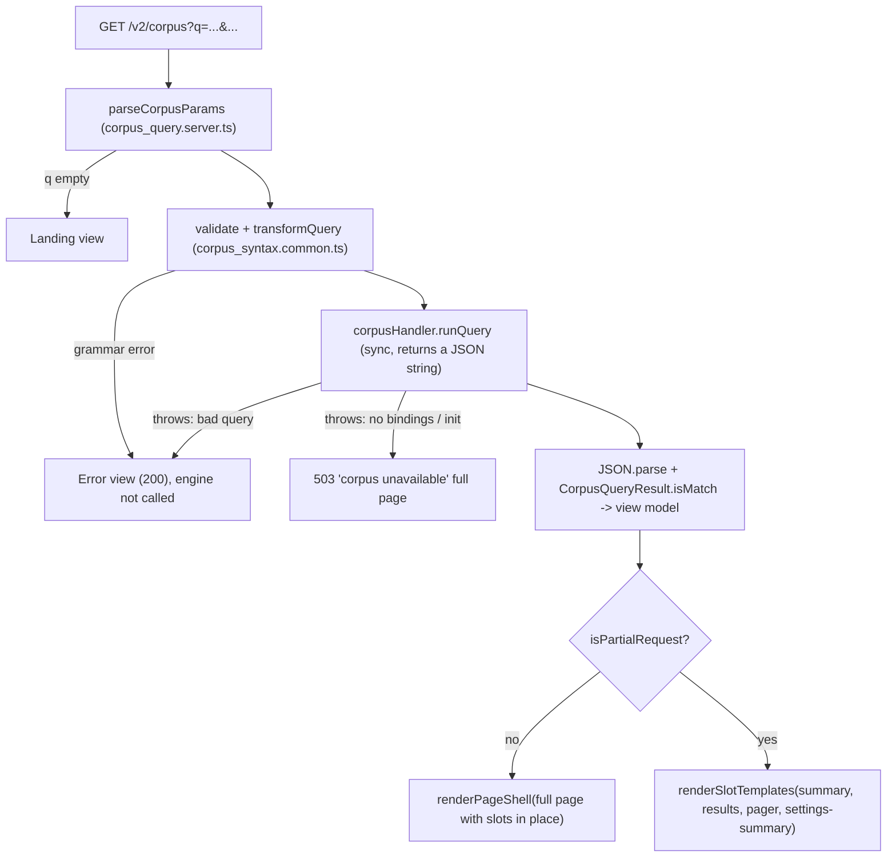

# Corpus (`src/web/v2/corpus/`)

Corpus search at `/v2/corpus`, backed by the Rust corpus engine. Related docs: [`TODOS.md`](TODOS.md) (open work and the word-boundary rule) and the archived design, [`../docs/archive/CORPUS_DESIGN.md`](../docs/archive/CORPUS_DESIGN.md), which has the full rationale and V1 deviations.

The page is a plain `GET` form. The query, including any `#Author` filter, the settings and the page cursor all live in the URL, so with JS off a user can search, change settings, page, and follow result links into the reader. With JS on, `<morcus-corpus-view>` swaps only the regions that change, and `<morcus-corpus-suggestions>` adds client-side autocomplete.

---

## URL contract

| Param        | Form control                                          | Default    | Range / format                              | Notes                                                                                                        |
| :----------- | :---------------------------------------------------- | :--------- | :------------------------------------------ | :----------------------------------------------------------------------------------------------------------- |
| `q`          | `<input name="q">`                                    | `""`       | ≤ 100 chars after transform (engine limit)  | Empty → landing view, engine not called. May start with one `#Author`; an unknown author is a grammar error. |
| `pageSize`   | `<input type="number" name="pageSize">`               | 50         | clamp 10–100                                |                                                                                                              |
| `contextLen` | `<input type="number" name="contextLen">`             | 20         | clamp 1–100                                 | V1's UI default is 20; the engine's is 25.                                                                   |
| `strictMode` | `<input type="checkbox" name="strictMode" value="1">` | off        | `1` or absent                               | Absent when unchecked, the native checkbox behaviour.                                                        |
| `cursor`     | none (links only)                                     | first page | `<resultId>-<resultIndex>-<candidateIndex>` | Only pager links set it. Submitting the form drops it, so a new search or new settings start at page 1.      |

- The JS path serializes the form with `new FormData(form)`, like a native submit, so URLs are identical in both modes (`corpus_form_conformance.test.ts`).
- Out-of-range numbers are clamped on the server, and the form shows the clamped value.
- A malformed `cursor` is treated as the first page, not an error.

`corpus_params.common.ts` implements this for both server and client.

---

## Server



- **User errors return 200.** Grammar errors, engine parse errors and over-long queries render the message in the `results` slot. No-JS users see it next to their query, and `swapSlots` falls back to a full navigation on any non-2xx.
- **Engine errors return 503.** Missing bindings or a failed init give a 503 full page. A partial request gets the same 503, and `swapSlots` falls back to navigating there.
- **`Vary: X-Requested-With`** is set on every `/v2/corpus` response, because the same URL serves a full page or a slot fragment.
- **No `Cache-Control` for HTML.** `runQuery` is synchronous and blocks the event loop, as V1's does.
- **Engine wiring.** `start_server.ts` builds one `rustCorpusApiHandler()` and passes it in with `createV2Router(fusedDict, { corpus })`. Tests inject a fake handler (`testing/fake_corpus_engine.ts`), so nothing needs the Rust bindings or `build/corpus`.

### Results and reader links

Each match becomes:

- **Heading:** `${workName} ${leaders[0][0]} [${author}]`, as a link.
- **Link:** `/v2/reader/${urlAuthor}/${urlName}?matchText=…`. The slugs come from `getV2LibrarySummaries()`; `matchText` comes from `textHighlightParams`. The reader route redirects a page-less `matchText` link to the right page with a `#sec-` hash. An unknown `workId` renders the heading as plain text and logs a warning.
- **Snippet:** text runs with `<mark class="corpus-match">` around matches, in `white-space: pre-line`.

The server imports `reader_loader.server.ts` and `reader_highlight.common.ts` (the `matchText` contract) from `reader/`. Nothing crosses slices in the client bundle.

### Routes

| Route                                | Response                                                                                                                                                                                                                                                                                                          |
| :----------------------------------- | :---------------------------------------------------------------------------------------------------------------------------------------------------------------------------------------------------------------------------------------------------------------------------------------------------------------- |
| `GET /v2/corpus`                     | Full page or slot templates                                                                                                                                                                                                                                                                                       |
| `GET /v2/api/corpus/lemmata/:letter` | JSON array of lemmata starting with `letter` (one lowercased char). URLs carry `?v=<build version>` (`withBuildVersion`, from `<html data-version>`); a request at the server's current version gets `Cache-Control: public, max-age=31536000, immutable`, anything else `no-cache` (`setVersionedCacheControl`). |

---

## Page structure and slots

`CORPUS_SLOTS` (`corpus_slots.common.ts`) is `summary`, `results`, `pager`, `settings-summary`.

- Each slot wraps only markup that changes with the URL. The form, settings controls and suggestions host sit outside every slot.
- `settings-summary` shows the _applied_ settings, so it can't show values the user typed but didn't apply.
- `aria-live` sits on a stable wrapper around `summary`, because `swapSlots` replaces the slot element itself.
- Everything is native without JS: links, a submit button, `<details>`. The only `data-js-only` element is the suggestions host.
- `testing/slot_parity.ts` checks that each slot in the full page equals its partial template.

---

## Client

**`<morcus-corpus-view>`** (`corpus_view.client.ts`) adopts server DOM and creates no nodes.

| Trigger                           | Behaviour                                                                                                                                                                                |
| :-------------------------------- | :--------------------------------------------------------------------------------------------------------------------------------------------------------------------------------------- |
| `onConnect`                       | Adopt-before-write: keep what the user typed before upgrade. Start the history sync.                                                                                                     |
| Form submit                       | `swapSlots` with `scope.latest("nav")`, then `router.pushUrl()` (push only after a successful swap; updates `document.title`). Resubmitting the current URL calls `router.replaceUrl()`. |
| Link click (`a[data-corpus-nav]`) | Next link and help examples: same swap and push, then resync the form from the URL. Focus returns through `data-focus-key`. Modified clicks aren't intercepted.                          |
| `popstate`                        | `swapSlots` with `location.replace` fallback, then write the URL's values into the controls.                                                                                             |

### Autocomplete boundary

**`<morcus-corpus-suggestions>`** (`corpus_autocomplete.client.ts`) is built on `ComboboxController` (`core/widgets/combobox.client.ts`). It creates only the `<li>` options (an allowlisted subtree), reads authors from `data-authors` on the server-rendered host, and fetches lemmata in one-letter shards through `LemmaShardCache`.

`corpus_syntax.common.ts` holds the shared grammar: tokenizing, `validateQuery`, `transformQuery` (`#A` → `[A]`, `~N` → `N~`) and the category tables the help section renders.

Both elements ship in the `corpus.js` route chunk (`corpus_entry.client.ts`). The boundary between them is kept so autocomplete could be lazy-loaded later:

1. Only `corpus_entry.client.ts` (and the test-only `v2_elements.client.ts`) imports `corpus_autocomplete.client.ts`. The two elements talk only through the DOM they share (the `q` input and the form's submit event).
2. The input and form work fully without the suggestions element, which adopts whatever is already typed.
3. No module side effects other than `registerElement`.
4. `corpus_view.client.ts` must not import `corpus_autocomplete.client.ts` or `corpus_syntax.common.ts`; a `no-restricted-imports` rule in `eslint.config.mjs` enforces it.

---

## Decisions

| #   | Decision                                                                                                                                                 |
| :-- | :------------------------------------------------------------------------------------------------------------------------------------------------------- |
| D2  | V1 parity on paging: Next link only, Back is the browser's. A real Previous link is in [`TODOS.md`](TODOS.md#previous-page).                             |
| D3  | V1 parity on authors: one `#Author` at the start of `q`, no separate control or param. Extensions are in [`TODOS.md`](TODOS.md#author-filter-beyond-v1). |
| D4  | The `@`-query disclaimer is an inline `<details>` in the `results` slot; no modal, no "don't show again" storage.                                        |
| D6  | Corpus ships in its own `corpus.js` route chunk; the ceiling is in `v2_bundle_budget.ts`.                                                                |
| D7  | A bad `cursor` is treated as the first page.                                                                                                             |

---

## Files

```
corpus_syntax.common.ts        # grammar, validate, transform, category tables
corpus_slots.common.ts         # CORPUS_SLOTS, corpusPageTitle
corpus_params.common.ts        # URL contract: read/clamp/serialize, cursor codec
corpus_query.server.ts         # query adapter, author list, engine call, view model, reader links
corpus_view.server.ts          # page and per-slot renderers (one source for full page and partial)
corpus_help.server.ts          # static syntax help
corpus_lemmata.server.ts       # lemma shard builder
corpus_routes.server.ts        # createCorpusRoutes
corpus_view.client.ts          # <morcus-corpus-view>
corpus_autocomplete.client.ts  # <morcus-corpus-suggestions> + LemmaShardCache
corpus_entry.client.ts         # corpus.js route chunk entry
corpus.css
```
