# Dictionary Topic (`src/web/v2/dict/`)

## Overview

This directory encapsulates all server-side rendering and client-side web components for dictionary lookups, search bar interactions, morphological entry cards, XML AST transformation, and highlight settings.

Companion docs: [`../docs/PREFERENCES.md`](../docs/PREFERENCES.md) explains how preferences are stored and resolved, and [`TODOS.md`](TODOS.md) records open work, including the remaining V1 → V2 gaps.

---

## Data Flow & Request Lifecycle

```mermaid
sequenceDiagram
    autonumber
    actor User as Browser / User
    participant Router as Express (/v2/dicts)
    participant Fused as FusedDictionary (Server)
    participant Client as Web Components (Client)

    alt Initial Load / No-JS Form Submit
        User->>Router: GET /v2/dicts?q=habeo
        Router->>Fused: getEntry({ query: "habeo", mode: 1 })
        Fused-->>Router: DictsFusedResponse
        Router-->>User: 200 OK (Full SSR HTML document with <details>, app bar)
    else With JS: Live Autocomplete
        User->>Client: Type "hab" into <input name="q">
        Client->>Router: GET /v2/api/completions?q=hab
        Router->>Fused: getCompletions("hab")
        Fused-->>Router: string[]
        Router-->>Client: JSON string[]
        Client-->>User: Declarative <morcus-dict-suggestions> dropdown
    else With JS: Form Hijack (AJAX Swap)
        User->>Client: Submit form / select suggestion
        Client->>Router: GET /v2/dicts?q=habeo&format=partial (X-Requested-With: fetch)
        Router->>Fused: getEntry({ query: "habeo", mode: 1 })
        Router-->>Client: HTML fragment (<details class="dict-card">...)
        Client->>User: replaceChildren(fragment) & history.pushState()
    end
```

---

## Component Roles

- `dict_page.server.ts`: Generates the outer page shell, transparency status pills (including zero-hit pills), and multi-lexicon containers.
- `dict_selection.server.ts`: Parses dictionary parameters from URL (`in=` or `dict=`), parses and formats functional UI cookies (`morcus_d=`), and resolves active dictionaries based on the precedence hierarchy and source language filters (`lang=La`).
- `entry_view.server.ts`: Renders entry headers, definition blocks, and inflection tables.
- `search_bar.server.ts`: Renders the accessible search `<form>`, input field, action buttons, and dictionary settings triggers.
- `xml_to_html.server.ts`: Safe transformer converting TEI XML AST nodes into sanitized HTML.
- `dict_search.client.ts`: Custom element managing form hijacking, history pushes, keyboard navigation, and client-side Latin word progressive enhancement.
- `dict_suggestions.client.ts`: Accessible dropdown list rendering live autocomplete suggestions.
- `dict_settings.client.ts`: Popover controlling highlight strength, individual dictionary selection checkboxes, and the inflection toggle. It adopts the server-rendered state and persists changes to cookies.
- `dict_preferences.client.ts`: Reads the server-rendered dictionary state (`readRenderedDictState`), decides whether a change may be saved (`mayPersistDictChange`), and writes the preference cookies.
- `dict_persistence.server.ts`: Decides which preference cookies a request writes (`save=1` + 303, sliding refresh) and builds the borrowed-view chip's **Use mine** link.

---

## State Management & Precedence Architecture

The active dictionary selection follows a strict source-of-truth priority:

$$\text{URL Query Parameter (dict= / in=)} \succ \text{Functional Cookie (morcus\_d)} \succ \text{Default Preset (All Latin except Pozo)}$$

### 1. URL Parameter (`dict=` or `in=`)

- Highest precedence. Allows bookmarks, reader deep-links, and shared URLs to function deterministically.
- Supports comma- or hyphen-delimited keys (e.g. `?dict=L&S,GAF` or `?in=LnS-GAF`).

### 2. Cookies (`morcus_d`, `morcus_inflected`): the only durable store

- **The server resolves.** On every request the server applies URL → cookie → default (`resolveActiveDicts`, `resolveInflection`) and renders the result. That's the checkboxes' `checked` state plus `data-d` (bitmask) and `data-o` on the search `<form>`.
- **The client adopts.** `<morcus-dict-settings>` reads the checkboxes' `defaultChecked`, and `<morcus-dict-search>` reads `readRenderedDictState(form)`. Neither re-parses the URL or reads `localStorage`, so the controls can't disagree with the rendered results.
- **A URL never saves by itself.** A shared link shows the sender's view without touching the recipient's cookies. The server writes cookies (`SameSite=Lax; Path=/; Max-Age=1 year`) only for `save=1` (the No-JS **Apply** button or the chip's **Save these**) and then 303s the marker away. Other full page loads re-send the cookies' own values (sliding refresh). Scoped views (`embedded=1` or `lang=`) never persist. See [`../docs/PREFERENCES.md`](../docs/PREFERENCES.md#saving-content-preferences).
- **Borrowed views**: when the view differs from a saved cookie, the tray shows _Not your saved settings [Save these] [Use mine]_ and the form gets `data-borrowed`.
- **JS writes**: toggling a control in `<morcus-dict-settings>` writes `document.cookie` (`persistDictKeys` / `persistInflected`), except in borrowed views (deferred until **Save these**, or until the view matches the cookie again) and scoped views (`data-scoped`, never). There is no `localStorage` copy.
- **Privacy & Compliance**: The cookie stores only functional UI preferences (e.g. `morcus_d=3`, the same base36 bitmask as `?d=`). Under GDPR/ePrivacy and CCPA, it qualifies as an exempt **strictly necessary / user preference** cookie and requires no consent banner.

### 3. Query Language Constraints (`lang=La`) vs Layout (`embedded=1`)

- **`lang=La`** is strictly a search constraint: filters dictionaries down to those whose source language is Latin (`languages.from === "La" || "*"`).
  - Used automatically when words are clicked in the Latin Reader.
- **`embedded=1`** is strictly a presentation/layout constraint: hides the site app bar and footer when rendered inside an iframe or reader drawer.
  - Manual typing in an embedded search bar omits `lang` so users can freely search English-to-Latin (e.g. Smith & Hall) or German-to-Latin (Georges).

---

## Transparency & Zero-Hit Status

- The search result navigation bar displays pills for **all** queried dictionaries.
- Dictionaries with matches display active anchor jump links with their count: `<a href="#dict-L-S" class="jump-pill">...</a>`.
- Dictionaries that returned 0 matches are transparently displayed as dashed pills: `...0`.
- If no dictionaries had matches, a summary line shows exactly which lexica were queried (e.g. `Searched: Lewis & Short, Gaffiot`).

## Deliberately Not Ported from V1

- **Mobile layout preference** (V1's "Drawer" vs "Classic" single-column setting): V2 has one responsive layout, a drawer on mobile and a rail on desktop, with no setting.
