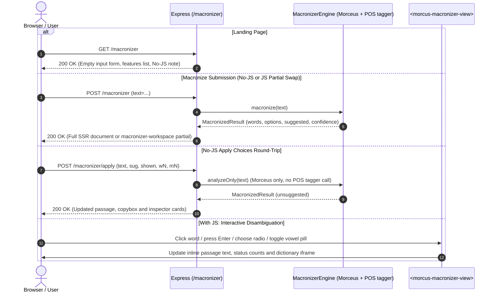

# Macronizer Topic (`src/web/v2/macronizer/`)

## Overview

This directory holds the server-side rendering, the progressive-enhancement custom element and the styles for the UI V2 **Latin Macronizer** (`/macronizer`).

Companion docs:

- [`TODOS.md`](TODOS.md): open follow-ups and optimization candidates.
- [`MACRONIZER_IMPLEMENTATION_PLAN.md`](../docs/archive/MACRONIZER_IMPLEMENTATION_PLAN.md) _(archived)_: initial implementation plan and decision log.
- [`MACRONIZER_RESEARCH.md`](../docs/archive/MACRONIZER_RESEARCH.md) _(archived)_: background research, linguistic analysis and UX trade-offs.

---

## Data Flow & Request Lifecycle

Errors (engine failure, too-long input, too many Apply fields) re-render the workspace with an error banner and the user's text kept in the textarea. Fetch requests get the partial with the error status, so the client swaps it in instead of falling back to a full navigation.

---

## Choosing the engine (`MACRONIZER_ENGINE`)

The server reads `MACRONIZER_ENGINE` once at startup (`macronizerEngineFromEnv`):

| Value                                     | Behavior                                                                                                                                                                        |
| :---------------------------------------- | :------------------------------------------------------------------------------------------------------------------------------------------------------------------------------ |
| `off` (default; also when unset or empty) | Macronize returns 503 ("not configured"); Apply still works, since it only needs Morceus. Logs a loud warning if `LATINCY_SERVER_ADDRESS` is set, as that usually means a typo. |
| `latincy`                                 | Morceus plus the LatinCy server at `LATINCY_SERVER_ADDRESS`. Startup fails if the address is missing.                                                                           |
| `fake-latincy`                            | Morceus plus a deterministic in-process tagger that picks plausible but sometimes wrong tags. The page shows a "Suggestions are simulated" note. For development and E2E only.  |

Any other value fails startup and lists the valid ones. `./morcus.sh web` defaults to `fake-latincy` unless the variable is already set; production (`node build/server.js` in the Dockerfile, with `docker-compose.yaml` setting `latincy`) does not go through that script.

---

## Component Roles

- [`macronizer_tiers.common.ts`](macronizer_tiers.common.ts): Shared pure helpers: macron splitting (`splitMacrons`, and `wordBase`, which also drops format characters such as soft hyphens), `buildFromVowels`, word tier classification (`computeWordTier`, tiers 0–5) and inspector tag metadata (`getCardTagInfo`).
- [`macronizer_slots.common.ts`](macronizer_slots.common.ts): The `macronizer-workspace` slot name, the shared `MACRONIZER_MAX_CHARS` limit (10,000) and the page title helper, used by both the server and the client.
- [`macronizer_engine.server.ts`](macronizer_engine.server.ts): The `MacronizerEngine` interface (`macronize`, `analyzeOnly`, `simulated`), `createMacronizerEngine(tagger?)` and `macronizerEngineFromEnv`.
- [`macronizer_params.server.ts`](macronizer_params.server.ts): Request body parsing (`parseMacronizeBody`, `parseApplyBody`), CRLF normalization and the length check, and the compact round-trip encodings for tagger suggestions (`sug`) and prior shown forms (`shown`). Malformed entries are ignored.
- [`macronizer_apply.server.ts`](macronizer_apply.server.ts): Pure `resolveInitialResult` and `applyChoices`. The initial render is Apply with only the tagger's suggestions, so both paths share one code path.
- [`macronizer_view.server.ts`](macronizer_view.server.ts): SSR HTML for the landing state, the passage workspace, the status bar, inline word tokens, the No-JS copybox and the inspector cards (`#w-plain` + `#w0..#wN`).
- [`macronizer_routes.server.ts`](macronizer_routes.server.ts): Express routes for `GET /macronizer`, `POST /macronizer` and `POST /macronizer/apply`. The URL-encoded parser has a `1mb` body limit and a `parameterLimit` derived from the worst-case Apply form for 10,000 characters (see `MACRONIZER_PARAMETER_LIMIT`).
- [`macronizer_view.client.ts`](macronizer_view.client.ts): `<morcus-macronizer-view>`: word selection, plain-word card population, live radio and vowel-pill updates, keyboard navigation (`Enter`, `↓`, `Escape`), clipboard copy, and the mobile bottom-sheet drawer.
- [`macronizer_entry.client.ts`](macronizer_entry.client.ts): Route-specific client bundle entry registering `<morcus-macronizer-view>`.
- [`macronizer.css`](macronizer.css): Scoped styles using UI V2 design tokens for the workspace layout, word underline tiers, inspector cards, vowel pills and the mobile drawer.

---

## Word Tiers & Visual Encoding

Every word returned by Morceus and the POS tagger falls into one of six tiers:

| Tier  | Condition                                                                       | Underline style                          |
| :---- | :------------------------------------------------------------------------------ | :--------------------------------------- |
| **0** | Unambiguous (`options.length === 1`)                                            | None; plain clickable word (`mac-plain`) |
| **1** | Ambiguous (`options.length > 1`), no tagger suggestion                          | Shaded background with a solid underline |
| **2** | Ambiguous, tagger `confidence === "weak"` (morph-only match)                    | Dashed primary underline                 |
| **3** | Ambiguous, tagger `confidence === "tied"` (several forms match lemma and morph) | Dashed primary underline                 |
| **4** | Ambiguous, tagger `confidence === "confident"` (unique match, or a numeral tag) | Dashed primary underline                 |
| **5** | Unknown to Morceus (`options.length === 0`)                                     | Dotted danger underline (`mac-unknown`)  |

Tiers 2–4 look the same for now; the tier is still in `data-tier` so they can be told apart later. There are no filters: every non-plain word has an inspector card.

### Word indices and spelling

- Word `N` is 0-indexed and counts words only (separators are skipped). The same `N` is used for `#tN`/`#wN` ids, `data-w`, and the `wN`/`mN` form fields, so the Macronize and Apply passes must tokenize the text identically.
- Line breaks are normalized to `\n` before tokenizing; browsers submit textareas with CRLF.
- A known word's forms come from Morceus, which looks up the word with its diacritics removed. So a known word loses any macron or diaeresis the user typed (`poëtae` → `poētae`, `Ōthō` → `Othō`). Unknown words keep their typed spelling, macrons included.
- Format characters such as soft hyphens stay in the displayed word but are ignored for vowel positions and dictionary lookups (`wordBase`).

---

## Apply Precedence & Round-Trip Contract

`POST /macronizer/apply` re-runs Morceus via `engine.analyzeOnly(text)` (never calling the external POS tagger), overlays the first run's suggestions from `sug`, and resolves each word `N`:

1. **Edited vowels (`mN`)**: if the submitted vowel checkboxes differ from what was shown before this submission, the word is shown as built from those vowels (decision `edited`). A word edited in an earlier round stays edited unless a radio choice is made.
2. **Radio option (`wN`)**: a valid option index selects `options[k].form` (decision `chosen`).
3. **Default**: the tagger's suggestion if any; otherwise the first option for ambiguous words, or the typed word for unknown words.

"What was shown before" comes from the `shown` field: the decisions (`chosen` option or `edited` vowels) from the previous round, falling back to the default.
